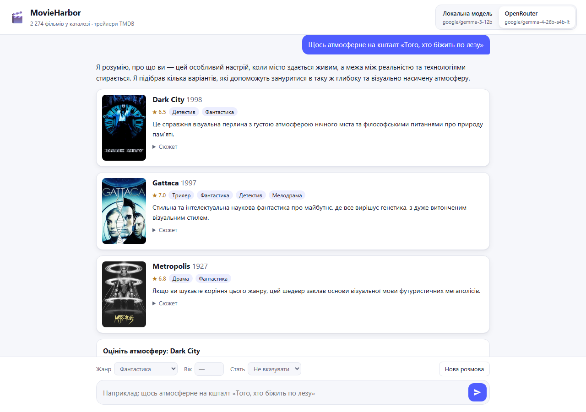
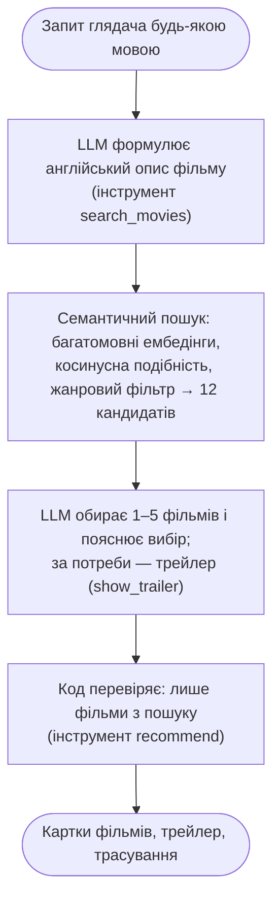

# MovieHarbor

[](https://github.com/woldemarg/movie_rs/actions/workflows/ci.yml)
[](LICENSE)

**Діалоговий сервіс рекомендацій фільмів на основі великої мовної моделі.** Proof of concept магістерської роботи.

Глядач описує бажане своїми словами, українською чи англійською: «щось атмосферне на кшталт "Того, хто біжить по лезу"». Агент на основі LLM (Gemma 4 через OpenRouter або локальна модель) формулює пошуковий запит. Семантичний пошук знаходить кандидатів у каталозі з 2 274 фільмів. Агент обирає найкращі, пояснює кожен вибір і, коли словами не передати атмосферу, показує трейлер. Порадити фільм поза каталогом модель не може: кожна рекомендація перевіряється ([ризики галюцинацій](docs/08-hallucinations.md)).



## Можливості

- **Агент з викликом інструментів**: `search_movies` → (`show_trailer`) → `recommend`. Трасування кожного кроку видно в інтерфейсі («Як це працює»).
- **Багатомовний семантичний пошук**: український запит знаходить англійські описи без перекладу.
- **Заземлення**: лише фільми з результатів пошуку, з постером, роком, рейтингом і поясненням.
- **Розмова**: уточнення на кшталт «а щось легше?» враховують попередні відповіді; агент не повторює вже порадженого.
- **Перемикач моделі**: локальний сервер (LM Studio, Ollama) або Gemma 4 через OpenRouter, в одному протоколі.
- **Легкий вебінтерфейс**: три статичні файли, світла й темна теми, мобільна верстка.

## Як це працює



Детально: [огляд архітектури за моделлю C4](docs/01-overview.md) і [повна схема проходження запиту](docs/05-e2e-workflow.md#51-повна-схема).

## Демо-запити

Сім запитів, що показують можливості агента. Кожен перевірено наживо на `google/gemma-4-26b-a4b-it` через OpenRouter (31.10.2026). Чотири з них є прикладами на стартовому екрані. LLM недетермінована, тож конкретні фільми можуть відрізнятися від запуску до запуску.

| # | Запит (налаштування) | Що демонструє | Що зробив агент |
|---|---|---|---|
| 1 | «Щось атмосферне на кшталт «Того, хто біжить по лезу»», потім «А тепер щось легше й смішніше, але теж про майбутнє» | назву фільму модель перетворює на опис рис; уточнення в розмові | шукав *«neo-noir cyberpunk, atmospheric sci-fi, rainy urban landscapes…»* → Dark City, Metropolis, Cloud Atlas + трейлер Dark City; після уточнення → Galaxy Quest, Treasure Planet, Evolution |
| 2 | *A mind-bending thriller where nothing is what it seems* | відповідь мовою запиту (англійською); трейлер для «відчуття» фільму | Memento (+ трейлер), Trance, Before I Go to Sleep, The Cell |
| 3 | «Мультфільм про дружбу, щоб подивитися з дитиною» (жанр «Анімація», вік 8) | профіль глядача й жорсткий жанровий фільтр | Toy Story, Brother Bear, Happy Feet, Toy Story 2 |
| 4 | *Show me a film with breathtaking visuals of outer space — I want to see what it looks like* | рішення моделі показати трейлер, коли важливий візуальний ряд | Interstellar (+ трейлер), 2001: A Space Odyssey, Treasure Planet |
| 5 | «Порадь страшний фільм без крові, щоб лякав атмосферою» (жанр «Жахи») | тонке обмеження стає частиною запиту (*«minimal gore»*) | 1408, Insidious, Crimson Peak, As Above, So Below |
| 6 | *Something like Amélie, but set in New York* | «схоже на X, але…»: модель переносить настрій фільму в іншу обстановку | Punch-Drunk Love, Manhattan, Confessions of a Shopaholic |
| 7 | «Який завтра буде курс долара?» | поведінка поза темою: ввічлива відмова й повернення до кіно | жодного пошуку; `recommend` без фільмів |

Типова відповідь: 2–3 звернення до LLM за 3–10 с.

## Результати

Якість семантичного пошуку на відтворюваному бенчмарку ([розділ 6](docs/06-evaluation.md)): чи потрапляє потрібний фільм у 12 кандидатів, які отримує LLM.

| Форма запиту | Recall@12 | MRR |
|---|---|---|
| назва фільму українською | 0,343 | 0,218 |
| опис українською | 0,686 | 0,473 |
| **опис англійською, як його формулює LLM** | **0,829** | **0,648** |
| випадковий порядок | 0,005 | 0,004 |

Тематичні запити українською: середня Precision@12 за жанром — 0,729. Кодування запиту разом із пошуком займає 22 мс на CPU. Різниця між першим і третім рядком обґрунтовує ключове рішення: пошуковий запит формулює LLM.

## Швидкий старт

Потрібні [uv](https://docs.astral.sh/uv/) і Python 3.12.

```bash
git clone https://github.com/woldemarg/movie_rs.git && cd movie_rs
uv sync
cp .env.sample .env        # впишіть LLM_API_KEY (OpenRouter) і, за бажання, TMDB_API_KEY
uv run python -m backend   # http://127.0.0.1:8000 — вебінтерфейс, /docs — API
```

Під час першого запуску завантажується модель ембедінгів (≈ 220 МБ, у `models/`).

- **Gemma 4 через OpenRouter:** ключ на https://openrouter.ai/keys → `LLM_API_KEY`.
- **Локальна модель:** запустіть OpenAI-сумісний сервер з моделлю, що підтримує виклик інструментів. У LM Studio це, наприклад, `google/gemma-3-12b` (порт 1234). В Ollama — наприклад, `qwen3:8b` (`LOCAL_LLM_BASE_URL=http://127.0.0.1:11434/v1`). Назву моделі вкажіть у `LOCAL_LLM_MODEL`.
- **Трейлери:** ключ TMDB на https://www.themoviedb.org/settings/api → `TMDB_API_KEY`. Без нього агент працює без інструмента `show_trailer`.

Джерело моделі обирається перемикачем у шапці вебінтерфейсу. Усі змінні описано в [`.env.sample`](.env.sample).

## Структура репозиторію

```
backend/            бекенд (Python, FastAPI)
  api.py            HTTP API: валідація, відповіді, роздача вебінтерфейсу
  settings.py       налаштування, профілі джерел моделі
  core/             логіка рекомендацій, без HTTP
    agent.py        цикл агента
    tools.py        виклик інструментів: схеми, обробники, заземлення
    prompts.py      системний промпт
    catalog.py      каталог і семантичний пошук
  adapters/         зовнішні сервіси: llm.py, tmdb.py, embedder.py
frontend/           вебінтерфейс: index.html, app.js, styles.css
data/               raw/ — сирий набір; movies.json + movie_vectors.npy — каталог; eval/ — бенчмарк
docs/               специфікація (8 розділів) і знімки екрана
scripts/            check.py — контроль якості; build_catalog, refresh_posters, evaluate_retrieval
tests/              модульні, API-, архітектурні та E2E-тести (Playwright)
notebooks/          ноутбук, з якого почався проєкт (довідково)
```

## Документація

Специфікація в [`docs/`](docs/) описує поточний стан коду й оновлюється разом із ним:

1. [Огляд системи (C4)](docs/01-overview.md)
2. [Дані та ембедінги](docs/02-data-and-embeddings.md)
3. [LLM і виклик інструментів](docs/03-llm-and-tool-calling.md)
4. [Інтерфейс: вебсторінка й HTTP API](docs/04-interface.md)
5. [Наскрізний сценарій: модулі, зовнішні сервіси, тести](docs/05-e2e-workflow.md)
6. [Оцінювання якості пошуку](docs/06-evaluation.md)
7. [Вибір моделі ембедінгів](docs/07-embedding-model.md)
8. [Ризики галюцинацій LLM і як їх враховано](docs/08-hallucinations.md)

Правила роботи з кодом (для людей і AI-агентів) — у [AGENTS.md](AGENTS.md).

## Якість і тести

```bash
uv run playwright install chromium   # один раз, для E2E-тестів
uv run python scripts/check.py       # ruff (зокрема складність ≤ 10) + усі тести
```

- **Модульні тести:** каталог, побудова даних, метрики, інструменти, агент, клієнт LLM, TMDB, налаштування.
- **Тести API:** справжній HTTP-стек.
- **Архітектурний тест:** ядро не залежить від HTTP.
- **E2E-сценарії в Chromium.**

Тести не звертаються до мережі: LLM і TMDB замінено локальною заглушкою. CI запускає те саме для кожного PR.

Перебудувати дані й повторити вимірювання:

```bash
uv run python -m scripts.build_catalog        # ≈ 3 хв на CPU
uv run python -m scripts.refresh_posters      # потрібен TMDB_API_KEY
uv run python -m scripts.evaluate_retrieval   # таблиці розділу 6
```

## Дані й ліцензії

- Код і документація — [MIT](LICENSE).
- Метадані фільмів — [The Movies Dataset](https://www.kaggle.com/datasets/rounakbanik/the-movies-dataset) (Kaggle, CC0 1.0).
- Модель ембедінгів `paraphrase-multilingual-MiniLM-L12-v2` — Apache-2.0.
- Метадані, постери й трейлери надає [TMDB](https://www.themoviedb.org/). Цей продукт використовує TMDB API, але не схвалений і не сертифікований TMDB.
- Відео трейлерів відтворюються з YouTube.

## Обмеження

Це proof of concept:

- немає облікових записів і збереження історії на сервері;
- немає колаборативної фільтрації;
- зріз каталогу — 2017 рік;
- якість пояснень LLM не оцінюється автоматично.

Подробиці: [огляд, §1.7](docs/01-overview.md#17-межі-проєкту) і [загрози валідності оцінювання](docs/06-evaluation.md#66-обмеження-та-загрози-валідності).
