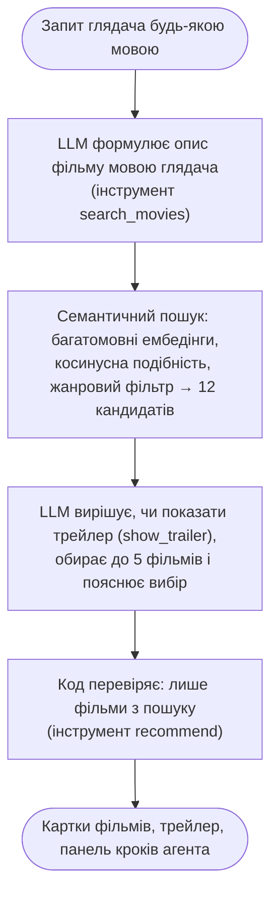

# MovieHarbor

[](LICENSE)

**Діалоговий сервіс рекомендацій фільмів на основі великої мовної моделі.** Proof of concept магістерської роботи.

Глядач описує бажане своїми словами: «пригодницький фільм про пустелю з епічними краєвидами». Агент на основі LLM — за замовчуванням мала локальна Gemma 4, що працює на комп'ютері користувача, або Gemma 4 через OpenRouter — формулює пошуковий запит мовою глядача. Семантичний пошук знаходить кандидатів у каталозі з 2 274 фільмів. Агент сам вирішує, чи показати трейлер, обирає найкращі фільми й пояснює вибір. Порадити фільм поза каталогом модель не може: кожна рекомендація перевіряється ([ризики галюцинацій](docs/08-hallucinations.md)).


## Можливості

- **Агент з викликом інструментів**: `search_movies` → (`show_trailer`, за рішенням моделі) → `recommend`.
- **Панель кроків агента**: запит до пошуку, 12 кандидатів із подібністю, трейлер і вибір моделі — наживо, поки агент працює.
- **Багатомовний семантичний пошук**: запит мовою глядача знаходить англійські описи без перекладу.
- **Заземлення**: лише фільми з результатів пошуку, з постером, роком, рейтингом і поясненням.
- **Розмова**: уточнення на кшталт «а щось легше?» враховують попередні відповіді; агент не повторює вже пораджене.
- **Локальний запуск за замовчуванням**: увесь стек — у Docker на ноутбуці (Gemma 4 в Ollama, на GPU або CPU); Gemma 4 через OpenRouter — альтернатива в перемикачі.
- **Легкий вебінтерфейс**: статичні файли за nginx, світла й темна теми, мобільна верстка.

## Як це працює



Детально: [огляд архітектури за моделлю C4](docs/01-overview.md) і [повна схема проходження запиту](docs/05-e2e-workflow.md#51-повна-схема).

## Демо-запити

Сім запитів зі стартового екрана. Кожен перевірено наживо двічі на локальній `gemma4:e4b` у стеку Docker (31.10.2026, GPU RTX 4060). Результат: 20 з 20 реплік завершилися картками фільмів, без жодної помилки інструментів. Агент робить 2–3 звернення до LLM, медіана відповіді — 35 с (21–46 с). Запити підібрано так, щоб задіяти всі три інструменти: трейлер модель вирішила показати в кожній репліці. LLM недетермінована, тож фільми можуть відрізнятися від запуску до запуску. У таблиці — вибір обох прогонів; через «/» — розбіжності між ними.

| # | Запит | Що демонструє | Що обрав агент |
|---|---|---|---|
| 1 | «Комедійна наукова фантастика з яскравими візуальними ефектами» | два жанри й візуальний стиль в одному описі | Galaxy Quest (+ трейлер), Fantastic Four, The 6th Day — однаково в обох прогонах |
| 2 | «Пригодницький фільм про пустелю з епічними краєвидами» | модель обирає не лише найближчих за подібністю: на знімку вгорі — кандидатів 1, 11 і 12 | Dune (+ трейлер), Once Upon a Time in the West, The Road / Babel |
| 3 | «Щось атмосферне на кшталт «Blade Runner»», потім «А тепер щось легше й смішніше, але теж про майбутнє» | «як X» → риси X і його назва в пошуковому запиті; уточнення в розмові | Blade Runner (+ трейлер), The Terminator, Watchmen / Sunset Boulevard; після уточнення — Back to the Future Part III / Part II, Short Circuit, Tomorrowland, Evolution |
| 4 | «Порадь страшний фільм без крові, щоб лякав атмосферою» | тонке обмеження в описі; і межа малої моделі: вона судить про фільм з короткого опису, тож 28 Days Later і Don't Breathe потрапили до вибору попри «без крові» | The Happening (+ трейлер), Super 8, Don't Breathe / 28 Days Later |
| 5 | «Космічна пригода з краєвидами, від яких перехоплює подих» | трейлер там, де важить візуальний ряд | 2001: A Space Odyssey (+ трейлер), The Space Between Us, Planet of the Apes / Another Earth |
| 6 | «Мрійлива романтична історія в Нью-Йорку, як «Амелі»» | «схоже на X, але…»: настрій фільму в іншому місті | Annie Hall (+ трейлер), Manhattan, Confessions of a Shopaholic, Before We Go |
| 7 | «Історія про подорожі в часі, що змушує замислитися» | тема й настрій без жанру | The Time Machine / About Time (+ трейлер), In Time, The Time Traveler's Wife |

Агент відповідає мовою глядача. Англійські контрольні запити отримали англійську відповідь у 4 з 4 реплік:
- *A whimsical romance like Amélie, with that dreamy look, but set in New York* → Brooklyn, Manhattan, Sex and the City;
- *A mind-bending thriller where nothing is what it seems* → The Sixth Sense, Before I Go to Sleep, Limitless.

Через OpenRouter (`google/gemma-4-26b-a4b-it`) відповідь займає 3–10 с. Як промпт адаптовано до малої моделі, описано в [розділі 3.10](docs/03-llm-and-tool-calling.md#310-мала-локальна-модель).

## Результати

Якість семантичного пошуку на відтворюваному бенчмарку ([розділ 6](docs/06-evaluation.md)): чи потрапляє потрібний фільм у 12 кандидатів, які отримує LLM.

| Форма запиту | Recall@12 | MRR |
|---|---|---|
| назва фільму українською | 0,343 | 0,218 |
| **опис українською — форма запиту агента** | **0,686** | **0,473** |
| опис англійською (з перекладом) | 0,829 | 0,648 |
| випадковий порядок | 0,005 | 0,004 |

Тематичні запити українською: середня Precision@12 за жанром — 0,729. Кодування запиту разом із пошуком займає 22 мс на CPU. Опис замість назви подвоює Recall@12 — тому пошуковий запит формулює LLM. Переклад англійською дав би ще більше, але агент свідомо пише запит мовою глядача: мовні відповідності — справа багатомовної моделі ембедінгів ([розділ 3.7](docs/03-llm-and-tool-calling.md#37-обґрунтування-рішень)). Як жанр і вік змінюють вибір — [розділ 9](docs/09-selection-parameters.md).

## Швидкий старт

Потрібен лише Docker (Desktop). Усі сервіси, зокрема локальна LLM, працюють у контейнерах.

```bash
git clone <адреса-репозиторію> movie_rs && cd movie_rs
cp .env.sample .env      # необов'язково: TMDB_API_KEY (трейлери, постери), LLM_API_KEY (OpenRouter)
docker compose up -d --build                                       # CPU (рекомендовано 16 ГБ RAM)
docker compose -f compose.yaml -f compose.gpu.yaml up -d --build   # GPU NVIDIA (потрібен NVIDIA Container Toolkit)
```

Для слабшої машини — менша модель: `OLLAMA_MODEL=gemma4:e2b` у `.env`.

Відкрийте http://127.0.0.1:8000. Перший запуск будує каталог із сирих даних (≈ 3 хв) і один раз завантажує локальну модель (≈ 5,5 ГБ) у кеш проєкту `models/`. Наступні запуски тривають секунди.

| Сервіс | Що робить |
|---|---|
| `frontend` | nginx: вебінтерфейс на `127.0.0.1:8000`, проксі `/api/` до бекенду; автономний — поки бекенд стартує, сторінка чекає й підключається сама |
| `backend` | API й агент на `127.0.0.1:8001` (`/docs`); перший старт будує каталог у `data/` з `data/raw/`; модель ембедінгів уже в образі |
| `ollama` | локальна модель `gemma4:e4b` — джерело за замовчуванням (`OLLAMA_MODEL` змінює модель) |
| `ollama-init` | одноразово бере ваги з кешу `models/ollama/` або завантажує їх і прогріває модель |

**OpenRouter як альтернатива.** Ключ на https://openrouter.ai/keys → `LLM_API_KEY` у `.env`, після чого в шапці інтерфейсу стане активним «OpenRouter» (`google/gemma-4-26b-a4b-it`).

**Без Docker** (для розробки): [uv](https://docs.astral.sh/uv/), Python 3.12 і [Ollama](https://ollama.com).

```bash
uv sync
ollama pull gemma4:e4b                     # або інший сервер: LOCAL_LLM_BASE_URL, LOCAL_LLM_MODEL
uv run python -m scripts.prepare_data      # каталог, один раз (≈ 3 хв)
uv run python -m backend                   # http://127.0.0.1:8000 — вебінтерфейс, /docs — API
```

Подробиці розгортання: [огляд, §1.8](docs/01-overview.md#18-розгортання-docker-compose). Усі змінні описано в [`.env.sample`](.env.sample).

## Структура репозиторію

```
backend/            бекенд (Python, FastAPI)
  api.py            HTTP API: валідація, відповіді, роздача вебінтерфейсу
  settings.py       налаштування, профілі джерел моделі
  core/             логіка рекомендацій, без HTTP
    agent.py        цикл агента
    tools.py        виклик інструментів: схеми, обробники, заземлення
    prompts.py      системний промпт
    catalog.py      каталог і семантичний пошук
  adapters/         зовнішні сервіси: llm.py, tmdb.py, embedder.py
frontend/           вебінтерфейс: index.html, app.js, styles.css
data/               raw/ — сирий набір (у git); movies.json + movie_vectors.npy — каталог (генерується); eval/ — бенчмарки пошуку й вибору
docs/               специфікація (10 розділів) і знімки екрана
scripts/            check.py — контроль якості; prepare_data, build_catalog, refresh_posters, evaluate_retrieval, evaluate_selection
models/             кеш моделей (у .gitignore): embeddings/, ollama/
compose.yaml, compose.gpu.yaml   контейнери: frontend (frontend/Dockerfile, nginx.conf), backend (backend/Dockerfile), ollama, ollama-init
tests/              модульні, API-, архітектурні та E2E-тести (Playwright)
notebooks/          ноутбук, з якого почався проєкт (довідково)
```

## Документація

Специфікація в [`docs/`](docs/) описує поточний стан коду й оновлюється разом із ним:

1. [Огляд системи (C4)](docs/01-overview.md)
2. [Дані та ембедінги](docs/02-data-and-embeddings.md)
3. [LLM і виклик інструментів](docs/03-llm-and-tool-calling.md)
4. [Інтерфейс: вебсторінка й HTTP API](docs/04-interface.md)
5. [Наскрізний сценарій: модулі й зовнішні сервіси](docs/05-e2e-workflow.md)
6. [Оцінювання якості пошуку](docs/06-evaluation.md)
7. [Вибір моделі ембедінгів](docs/07-embedding-model.md)
8. [Ризики галюцинацій LLM і як їх враховано](docs/08-hallucinations.md)
9. [Вплив параметрів глядача на вибір](docs/09-selection-parameters.md)
10. [Стратегія тестування](docs/10-testing.md)

Правила роботи з кодом (для людей і AI-агентів) — у [AGENTS.md](AGENTS.md).

## Якість і тести

```bash
uv run playwright install chromium   # один раз, для E2E-тестів
uv run python scripts/check.py       # ruff (зокрема складність ≤ 10), каталог (якщо немає, ≈ 3 хв), усі тести
```

- **Модульні тести:** каталог, побудова даних, метрики, інструменти, агент, клієнт LLM, TMDB, налаштування.
- **Тести API:** справжній HTTP-стек.
- **Архітектурний тест:** ядро не залежить від HTTP.
- **E2E-сценарії в Chromium.**

Тести не звертаються до мережі: LLM і TMDB замінено локальною заглушкою. CI запускає те саме для кожного PR. Стратегію тестування описано в [розділі 10](docs/10-testing.md).

Перебудувати дані й повторити вимірювання:

```bash
uv run python -m scripts.build_catalog        # ≈ 3 хв на CPU
uv run python -m scripts.refresh_posters      # потрібен TMDB_API_KEY
uv run python -m scripts.evaluate_retrieval   # таблиці розділу 6
uv run python -m scripts.evaluate_selection --provider local   # розділ 9; потрібен запущений стек
```

## Дані й ліцензії

- Код і документація — [MIT](LICENSE).
- Метадані фільмів — [The Movies Dataset](https://www.kaggle.com/datasets/rounakbanik/the-movies-dataset) (Kaggle, CC0 1.0).
- Модель ембедінгів `paraphrase-multilingual-MiniLM-L12-v2` — Apache-2.0.
- Метадані, постери й трейлери надає [TMDB](https://www.themoviedb.org/). Цей продукт використовує TMDB API, але не схвалений і не сертифікований TMDB.
- Відео трейлерів відтворюються з YouTube.

## Обмеження

Це proof of concept:

- немає облікових записів і збереження історії на сервері;
- немає колаборативної фільтрації;
- зріз каталогу — 2017 рік;
- якість пояснень LLM не оцінюється автоматично.

Подробиці: [огляд, §1.7](docs/01-overview.md#17-межі-проєкту) і [загрози валідності оцінювання](docs/06-evaluation.md#66-обмеження-та-загрози-валідності).
