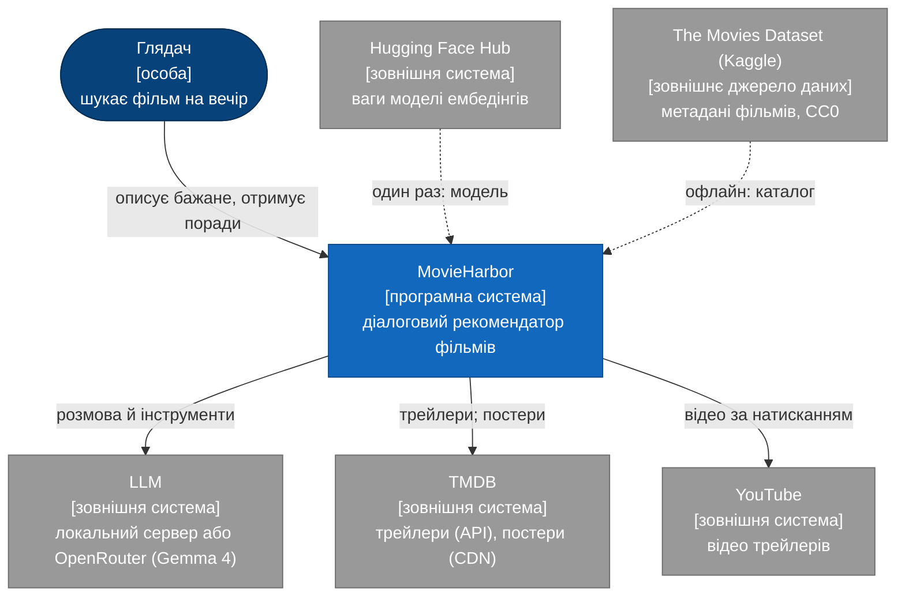
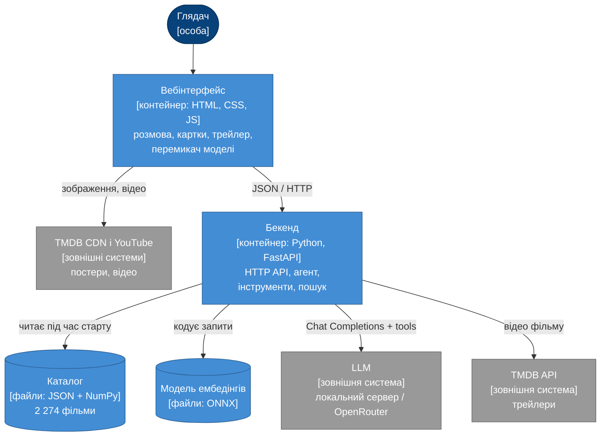
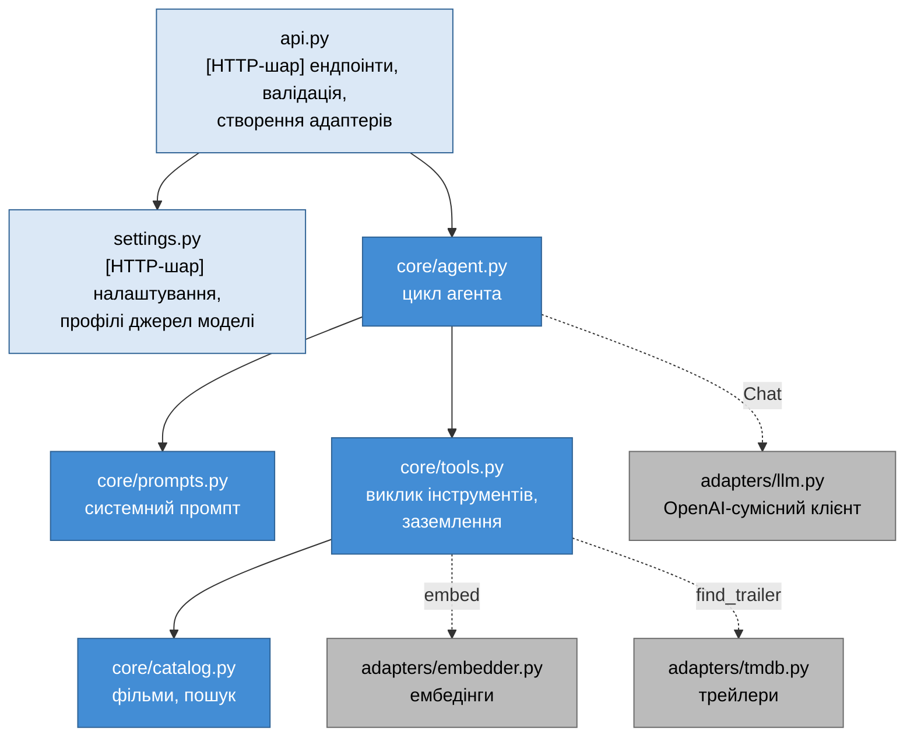

# 1. Огляд системи

MovieHarbor — діалоговий сервіс рекомендацій фільмів на основі великої мовної моделі (LLM), proof of concept магістерської роботи. Глядач описує бажане своїми словами, будь-якою мовою. Агент на основі LLM формулює пошуковий запит, знаходить кандидатів у каталозі з 2 274 фільмів семантичним пошуком, обирає найкращі й пояснює вибір. Коли словами не передати атмосферу, агент показує трейлер.

Архітектуру описано за моделлю [C4](https://c4model.com/): від контексту системи до контейнерів і компонентів. Подробиці кожної частини — в окремих розділах (§1.5).

## 1.1. Ключові властивості

- **Агент з інструментами, а не генерація «з пам'яті».** LLM викликає `search_movies`, `show_trailer` і `recommend`; код виконує пошук і перевіряє вибір ([розділ 3](03-llm-and-tool-calling.md)).
- **Заземлення.** Порадити можна лише фільм, який повернув пошук у цій репліці; вигадані id відхиляються.
- **Багатомовність.** Багатомовна модель ембедінгів зіставляє український запит з англійськими описами ([розділ 7](07-embedding-model.md)), а LLM відповідає мовою глядача.
- **Два джерела моделі.** Локальний сервер (LM Studio, Ollama) або Gemma 4 через OpenRouter; перемикач в інтерфейсі, один протокол у коді.
- **Вимірюваність.** Якість пошуку виміряно на відтворюваному бенчмарку ([розділ 6](06-evaluation.md)); кожна відповідь має трасування кроків агента.
- **Простота.** Без векторної бази даних, фреймворків інтерфейсу й збірки фронтенду: зосередження на алгоритмі рекомендацій, а не на інфраструктурі ([розділ 2.6](02-data-and-embeddings.md#26-чому-без-векторної-бази-даних)).

## 1.2. Рівень 1: контекст системи

## 1.3. Рівень 2: контейнери

Офлайн-скрипти (`scripts/`) не беруть участі у відповіді на запит. Вони будують каталог, оновлюють постери й рахують метрики ([розділ 5.3](05-e2e-workflow.md#53-підготовка-даних-офлайн)).

| Контейнер | Технологія | Відповідальність | Специфікація |
|---|---|---|---|
| Вебінтерфейс | статичні HTML, CSS, JS (`frontend/`) | розмова, картки, трейлер, трасування, перемикач джерела моделі | [4](04-interface.md) |
| Бекенд | Python 3.12, FastAPI, uvicorn (`backend/`) | HTTP API, цикл агента, інструменти, семантичний пошук | [3](03-llm-and-tool-calling.md), [4](04-interface.md) |
| Каталог | `data/movies.json`, `data/movie_vectors.npy` | фільми з метаданими й нормованими векторами | [2](02-data-and-embeddings.md) |
| Модель ембедінгів | ONNX через fastembed (`models/`) | текст → вектор 384 | [2](02-data-and-embeddings.md), [7](07-embedding-model.md) |
| Офлайн-скрипти | Python (`scripts/`) | побудова каталогу, оновлення постерів, метрики пошуку | [2](02-data-and-embeddings.md), [6](06-evaluation.md) |

## 1.4. Рівень 3: компоненти бекенду

Синім позначено ядро (`core`), сірим — адаптери зовнішніх сервісів, світлим — HTTP-шар. Суцільна стрілка — прямий виклик. Пунктир — залежність через інтерфейс: адаптер створює `api.py` і передає ядру як функцію чи об'єкт (`Chat`, `embed`, `find_trailer`).

Імпорти спрямовані до ядра. `core` не імпортує ні FastAPI, ні HTTP-клієнтів, ні адаптерів; це перевіряє `tests/test_architecture.py`. Адаптери, навпаки, імпортують типи ядра: `llm.py` перетворює відповідь сервера на `ToolCall` і `AssistantTurn` з `core/tools.py`. Тому ядро тестується без мережі на детермінованих подвійниках, а заміна провайдера моделі чи джерела трейлерів не зачіпає логіку рекомендацій.

| Компонент | Відповідальність |
|---|---|
| `api.py` | контракт HTTP: моделі запиту й відповіді, коди помилок, створення адаптерів, роздача `frontend/` |
| `settings.py` | змінні оточення й `.env`; профіль джерела моделі (`local` / `openrouter`) |
| `core/agent.py` | до 6 звернень до LLM на репліку, нагадування, вікно історії |
| `core/tools.py` | **виклик інструментів**: схеми з pydantic, обробники `search_movies`, `show_trailer`, `recommend`, заземлення, трасування |
| `core/prompts.py` | системний промпт, правило мови, профіль глядача |
| `core/catalog.py` | `Movie`, `Catalog`: завантаження, косинусний пошук із жанровим фільтром |
| `adapters/llm.py` | `POST /chat/completions`, розбір викликів інструментів, українські повідомлення про помилки |
| `adapters/tmdb.py` | YouTube-трейлер фільму за TMDB id |
| `adapters/embedder.py` | модель ембедінгів через fastembed |

## 1.5. Карта документації

| Розділ | Про що |
|---|---|
| [1. Огляд](01-overview.md) | цей документ: C4, ключові рішення |
| [2. Дані та ембедінги](02-data-and-embeddings.md) | джерело даних, відбір, рейтинг, вектори, пошук, чому без векторної БД |
| [3. LLM і виклик інструментів](03-llm-and-tool-calling.md) | джерела моделі, цикл агента, інструменти, заземлення, промпт, помилки |
| [4. Інтерфейс](04-interface.md) | вебсторінка й HTTP API |
| [5. Наскрізний сценарій](05-e2e-workflow.md) | повний шлях запиту через модулі й зовнішні сервіси, підготовка даних, тести |
| [6. Оцінювання якості пошуку](06-evaluation.md) | бенчмарк, Recall@k, MRR, точність, затримки |
| [7. Вибір моделі ембедінгів](07-embedding-model.md) | вимоги, порівняння за відкритими бенчмарками, обґрунтування |

## 1.6. Ключові рішення

| Рішення | Обґрунтування | Розділ |
|---|---|---|
| Каталог: фільми з кількістю голосів ≥ 95-го перцентиля | надійний рейтинг, відомі фільми; без зсуву до франшиз, який давав `dropna` | [2.2](02-data-and-embeddings.md#22-конвеєр-побудови) |
| Багатомовна модель ембедінгів MiniLM | зіставлення українська↔англійська на рівні значно більших моделей, ≈ 220 МБ, CPU | [7](07-embedding-model.md) |
| Точний пошук у пам'яті без векторної БД | 3,5 МБ векторів, 0,4 мс на пошук, метрики без похибки ANN | [2.6](02-data-and-embeddings.md#26-чому-без-векторної-бази-даних) |
| LLM формулює пошуковий запит | Recall@12 0,83 проти 0,34 за назвою українською | [6.4](06-evaluation.md#64-результати) |
| Остаточна відповідь — виклик інструмента `recommend` | структура гарантована схемою, кожен фільм перевіряється | [3.7](03-llm-and-tool-calling.md#37-обґрунтування-рішень) |
| Один OpenAI-сумісний протокол для локальної моделі й API | перемикач — лише профіль підключення | [3.2](03-llm-and-tool-calling.md#32-джерела-моделі-локально-або-через-api) |
| Статичний фронтенд без збірки | легкість, прозорість, безпека виводу (`textContent`) | [4.1](04-interface.md#41-вебінтерфейс) |
| Сервер без стану розмови | історію тримає клієнт; відтворюваність і простота | [4.2](04-interface.md#42-http-api) |

## 1.7. Межі проєкту

PoC свідомо не включає: облік користувачів і збереження історії на сервері, колаборативну фільтрацію (немає даних про перегляди), векторну БД, контейнеризацію, автоматичну оцінку якості пояснень LLM. Кожне з цього можна додати, не змінюючи ядра: пошук ізольовано в `Catalog.search`, джерела моделі — у профілях, зовнішні сервіси — в адаптерах.
