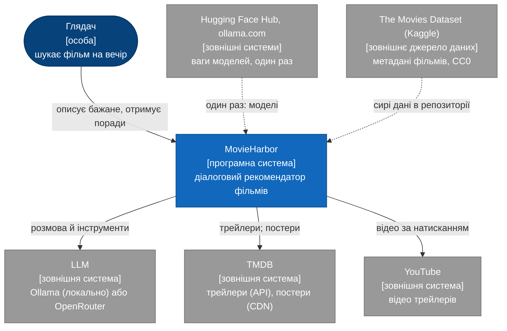
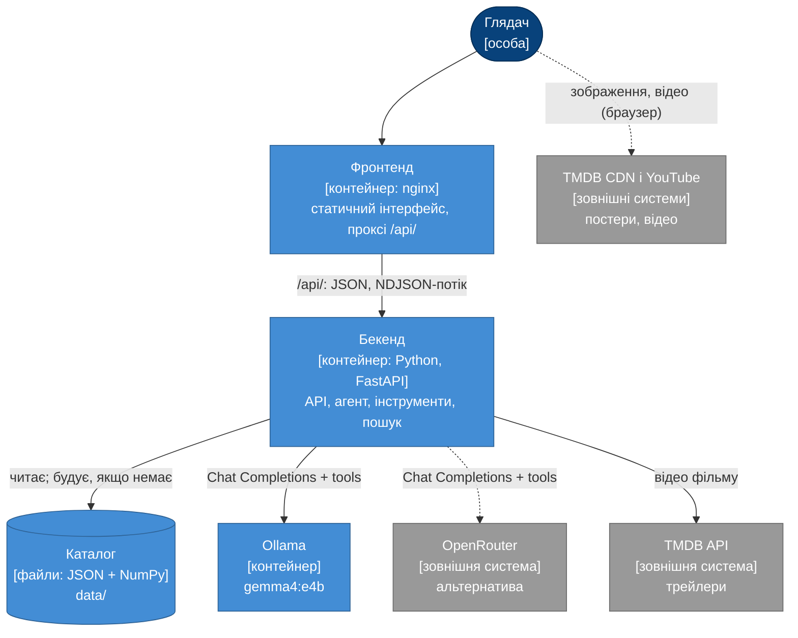
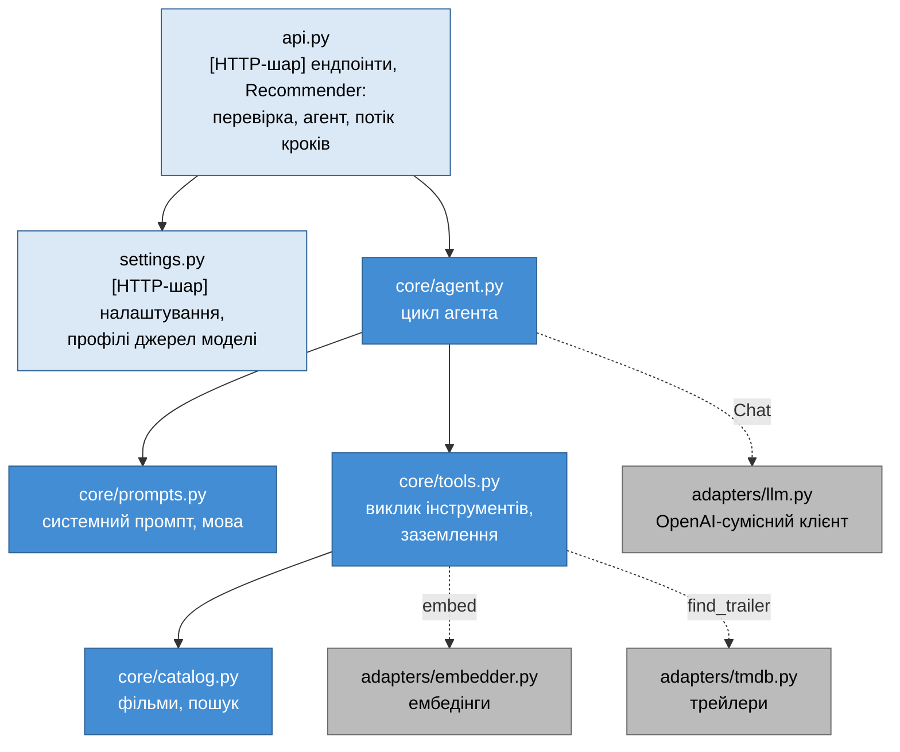
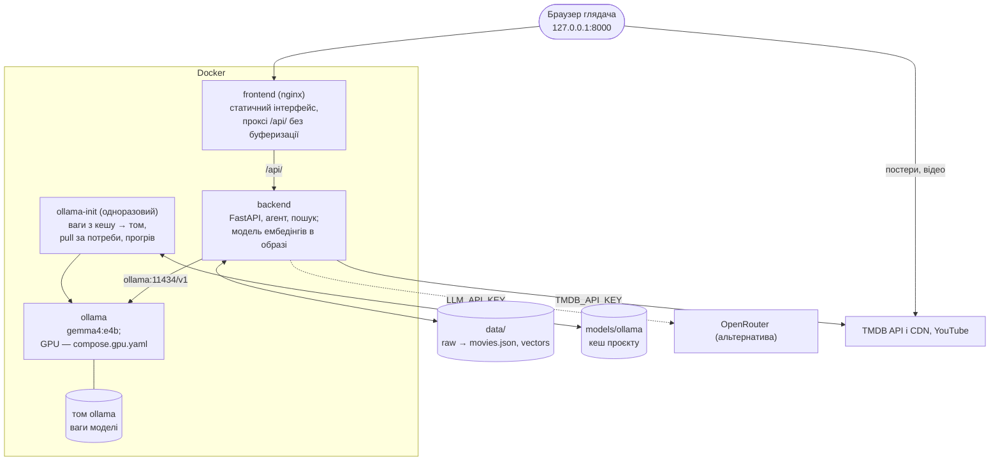

# 1. Огляд системи

MovieHarbor — діалоговий сервіс рекомендацій фільмів на основі великої мовної моделі (LLM), proof of concept магістерської роботи. Глядач описує бажане своїми словами. Агент на основі LLM формулює пошуковий запит, знаходить кандидатів у каталозі з 2 274 фільмів семантичним пошуком, вирішує, чи показати трейлер, і обирає та пояснює фільми. За замовчуванням усе працює локально: Gemma 4 в Ollama і модель ембедінгів на комп'ютері користувача, у контейнерах Docker.

Архітектуру описано за моделлю [C4](https://c4model.com/): від контексту системи до контейнерів, компонентів і розгортання. Подробиці кожної частини — в окремих розділах (§1.5).

## 1.1. Ключові властивості

- **Агент з інструментами, а не генерація «з пам'яті».** LLM викликає `search_movies`, `show_trailer` (за власним рішенням) і `recommend`; код виконує пошук і перевіряє вибір ([розділ 3](03-llm-and-tool-calling.md)).
- **Заземлення.** Порадити можна лише фільм, який повернув останній пошук у цій репліці; вигадані id відхиляються ([розділ 8](08-hallucinations.md)).
- **Багатомовність.** Пошуковий запит пишеться мовою глядача, без перекладу; багатомовна модель ембедінгів зіставляє його з англійськими описами ([розділ 7](07-embedding-model.md)). Відповідь — мовою глядача.
- **Локальний запуск за замовчуванням.** Мала модель `gemma4:e4b` в Ollama; промпт і схеми інструментів розраховано на неї ([розділ 3.10](03-llm-and-tool-calling.md#310-мала-локальна-модель)). Gemma 4 26B через OpenRouter — альтернатива в перемикачі.
- **Спостережність.** Кожен крок агента передається в інтерфейс під час роботи. Бічна панель показує запит до пошуку, кандидатів із подібністю, трейлер і вибір.
- **Вимірюваність.** Якість пошуку виміряно на відтворюваному бенчмарку ([розділ 6](06-evaluation.md)).
- **Простота.** Без векторної бази даних і без збірки фронтенду: зосередження на алгоритмі рекомендацій, а не на інфраструктурі ([розділ 2.6](02-data-and-embeddings.md#26-чому-без-векторної-бази-даних)).

## 1.2. Рівень 1: контекст системи

## 1.3. Рівень 2: контейнери

| Контейнер | Технологія | Відповідальність | Специфікація |
|---|---|---|---|
| Фронтенд | nginx, статичні HTML, CSS, JS (`frontend/`) | розмова, картки, трейлер, панель кроків агента, перемикач джерела моделі; проксі `/api/` до бекенду | [4](04-interface.md) |
| Бекенд | Python 3.12, FastAPI, uvicorn (`backend/`) | HTTP API (зокрема потоковий), цикл агента, інструменти, семантичний пошук; модель ембедінгів в образі | [3](03-llm-and-tool-calling.md), [4](04-interface.md) |
| Каталог | `data/movies.json`, `data/movie_vectors.npy` | фільми з метаданими й нормованими векторами; генерується з `data/raw/` | [2](02-data-and-embeddings.md) |
| Ollama | `ollama/ollama`, модель `gemma4:e4b` | локальна LLM — джерело за замовчуванням | [3](03-llm-and-tool-calling.md), §1.8 |
| Офлайн-скрипти | Python (`scripts/`) | підготовка каталогу, постери, метрики | [2](02-data-and-embeddings.md), [6](06-evaluation.md) |

## 1.4. Рівень 3: компоненти бекенду

Синім позначено ядро (`core`), сірим — адаптери зовнішніх сервісів, світлим — HTTP-шар. Суцільна стрілка — прямий виклик. Пунктир — залежність через інтерфейс: адаптер створює `api.py` і передає ядру як функцію чи об'єкт (`Chat`, `embed`, `find_trailer`).

Імпорти спрямовані до ядра. `core` не імпортує ні FastAPI, ні HTTP-клієнтів, ні адаптерів; це перевіряє `tests/test_architecture.py`. Адаптери, навпаки, імпортують типи ядра: `llm.py` перетворює відповідь сервера на `ToolCall` і `AssistantTurn` з `core/tools.py`. Тому ядро тестується без мережі на детермінованих подвійниках, а заміна провайдера моделі чи джерела трейлерів не зачіпає логіку рекомендацій.

| Компонент | Відповідальність |
|---|---|
| `api.py` | контракт HTTP: моделі запиту й відповіді, коди помилок, `Recommender` (перевірка запиту, запуск агента, потік кроків), роздача `frontend/` у локальній розробці |
| `settings.py` | змінні оточення й `.env`; профіль джерела моделі (`local` / `openrouter`) |
| `core/agent.py` | до 6 звернень до LLM на репліку; завершення лише через прийнятий `recommend`; повідомлення про кожен крок |
| `core/tools.py` | **виклик інструментів**: схеми з pydantic, обробники `search_movies`, `show_trailer`, `recommend`, заземлення, дані трасування |
| `core/prompts.py` | системний промпт, мова відповіді (`reply_language`), розмова як контекст, профіль глядача |
| `core/catalog.py` | `Movie`, `Catalog`: завантаження, атомарний запис, косинусний пошук із жанровим фільтром |
| `adapters/llm.py` | `POST /chat/completions`, розбір викликів інструментів, українські повідомлення про помилки |
| `adapters/tmdb.py` | YouTube-трейлер фільму за TMDB id |
| `adapters/embedder.py` | модель ембедінгів через fastembed; кеш `models/embeddings/` |

## 1.5. Карта документації

| Розділ | Про що |
|---|---|
| [1. Огляд](01-overview.md) | цей документ: C4, ключові рішення, розгортання |
| [2. Дані та ембедінги](02-data-and-embeddings.md) | джерело даних, відбір, рейтинг, вектори, пошук, чому без векторної БД |
| [3. LLM і виклик інструментів](03-llm-and-tool-calling.md) | джерела моделі, цикл агента, інструменти, заземлення, промпт, мала локальна модель |
| [4. Інтерфейс](04-interface.md) | вебсторінка, панель кроків агента, HTTP API |
| [5. Наскрізний сценарій](05-e2e-workflow.md) | повний шлях запиту через модулі й зовнішні сервіси, підготовка даних, тести |
| [6. Оцінювання якості пошуку](06-evaluation.md) | бенчмарк, Recall@k, MRR, точність, затримки |
| [7. Вибір моделі ембедінгів](07-embedding-model.md) | вимоги, порівняння за відкритими бенчмарками, обґрунтування |
| [8. Ризики галюцинацій LLM](08-hallucinations.md) | реєстр ризиків, шари захисту, живі спостереження |

## 1.6. Ключові рішення

| Рішення | Обґрунтування | Розділ |
|---|---|---|
| Каталог: фільми з кількістю голосів ≥ 95-го перцентиля | надійний рейтинг, відомі фільми, без зсуву до франшиз | [2.2](02-data-and-embeddings.md#22-конвеєр-побудови) |
| Багатомовна модель ембедінгів MiniLM на CPU | зіставляє українську з англійською, ≈ 220 МБ, не конкурує з LLM за GPU | [7](07-embedding-model.md) |
| Точний пошук у пам'яті без векторної БД | 3,5 МБ векторів, 0,4 мс на пошук, метрики без похибки ANN | [2.6](02-data-and-embeddings.md#26-чому-без-векторної-бази-даних) |
| LLM формулює пошуковий запит мовою глядача | враховує розмову й «як X»; мовні відповідності — справа багатомовної моделі ембедінгів | [3.7](03-llm-and-tool-calling.md#37-обґрунтування-рішень) |
| Мала локальна модель за замовчуванням | приватність і нульова вартість; промпт і схеми під неї підлаштовано й перевірено наживо | [3.10](03-llm-and-tool-calling.md#310-мала-локальна-модель) |
| Остаточна відповідь — прийнятий виклик `recommend` | структура гарантована схемою, кожен фільм перевіряється | [3.3](03-llm-and-tool-calling.md#33-цикл-агента) |
| Один OpenAI-сумісний протокол для локальної моделі й API | перемикач — лише профіль підключення | [3.2](03-llm-and-tool-calling.md#32-джерела-моделі-локально-за-замовчуванням-або-через-api) |
| Потік кроків агента в інтерфейс | повільна локальна модель не виглядає зависанням; панель робить роботу агента відстежуваною | [4](04-interface.md) |
| Сервер без стану розмови | історію тримає клієнт; простота й відтворюваність | [4.2](04-interface.md#42-http-api) |

## 1.7. Межі проєкту

PoC свідомо не включає облік користувачів, збереження історії на сервері, колаборативну фільтрацію (немає даних про перегляди), векторну БД і автоматичну оцінку якості пояснень LLM. Кожне з цього можна додати, не змінюючи ядра: пошук ізольовано в `Catalog.search`, джерела моделі — у профілях, зовнішні сервіси — в адаптерах.

## 1.8. Розгортання (Docker Compose)

Рівень розгортання C4: які процеси й де виконуються, коли систему запущено командою `docker compose` на комп'ютері користувача. За замовчуванням і модель ембедінгів, і LLM працюють локально, без платного API.

| Сервіс | Образ / файл | Що робить | Порт |
|---|---|---|---|
| `frontend` | `frontend/Dockerfile`, `frontend/nginx.conf` | роздає інтерфейс; проксує `/api/` до бекенду без буферизації (потік кроків), таймаут 600 с | `127.0.0.1:8000` |
| `backend` | `backend/Dockerfile` | API й агент; під час старту `scripts.prepare_data` будує каталог у змонтованій `data/`, якщо його немає | `127.0.0.1:8001` (API і `/docs` окремо) |
| `ollama` | `ollama/ollama:0.40.13` | локальна LLM; ваги в іменованому томі | — |
| `ollama-init` | `ollama/ollama:0.40.13` | одноразово: ваги з `models/ollama/` → том, `ollama pull`, лише якщо моделі ще немає, копія назад у кеш, прогрів моделі, якщо її ще не завантажено | — |

Рішення:

- **Фронтенд і бекенд — окремі автономні сервіси.** nginx знаходить бекенд за іменем під час кожного запиту, тож фронтенд стартує й без нього. Поки бекенд запускається, сторінка показує «Сервер ще запускається» і підключається сама. Бекенд у локальній розробці (`python -m backend`) роздає ті самі файли сам.
- **Бекенд стартує, щойно Ollama працює**, а не після завантаження ваг: OpenRouter доступний одразу, а локальна модель — після `ollama-init`.
- **Каталог — у змонтованій папці проєкту `data/`.** Перший старт будує його з `data/raw/` (≈ 3 хв на CPU; з `TMDB_API_KEY` оновлює й постери). Наступні старти знаходять готові файли.
- **Моделі завантажуються один раз у кеш проєкту `models/`** (вміст у `.gitignore`, папки збережено через `.gitkeep`). Модель ембедінгів копіюється в образ бекенду (`HF_HUB_OFFLINE=1`: контейнер не звертається до Hugging Face). Ваги LLM `ollama-init` копіює з `models/ollama/` у том Docker і назад.
- **Ваги LLM працюють з тому Docker, а не з папки проєкту.** Ollama відображає ваги в пам'ять (mmap). Через файловий обмін Windows таке читання надто повільне: 5,5 ГБ не встигали завантажитися за 5-хвилинний ліміт Ollama (виміряно; послідовне читання — 86 МБ/с).
- **`OLLAMA_CONTEXT_LENGTH` = 8192, `OLLAMA_KEEP_ALIVE` = −1, `LLM_TIMEOUT_S` = 300.** Промпт агента з 12 кандидатами перевищує типове вікно Ollama, а обрізає вона мовчки. Модель лишається в пам'яті між запитами. Локальна модель на CPU може відповідати хвилинами.
- **GPU — окремий файл `compose.gpu.yaml`.** Потрібен NVIDIA Container Toolkit (Docker Desktop з WSL2 на Windows). Без нього `docker compose up` працює на CPU; рекомендовано 16 ГБ оперативної пам'яті. Для слабшої машини — `OLLAMA_MODEL=gemma4:e2b`.
