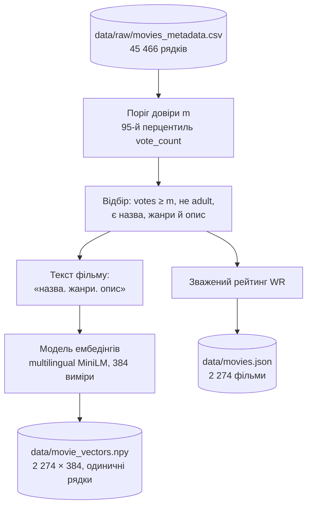
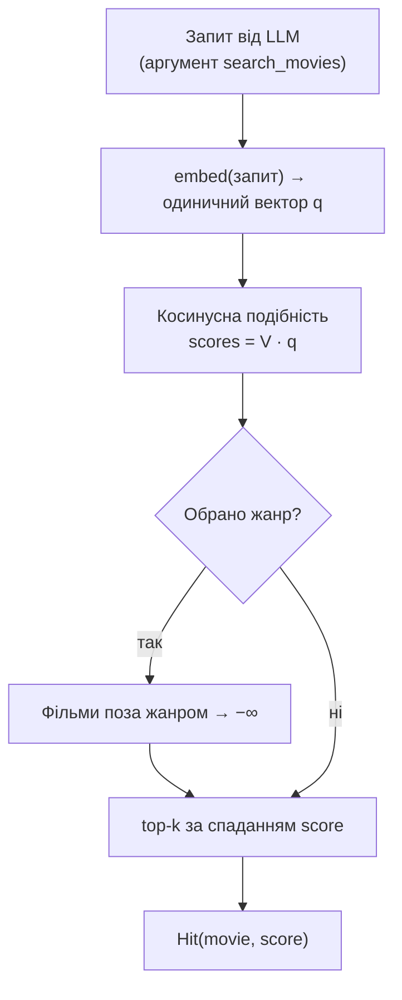

# 2. Дані та ембедінги

Цей документ описує, з чого складається каталог фільмів, як він будується і як у ньому працює семантичний пошук. Каталог — це все, що сервіс може порадити: модель обирає фільми лише з нього (див. [3. LLM і виклик інструментів](03-llm-and-tool-calling.md)).

## 2.1. Джерело

| | |
|---|---|
| Набір | [The Movies Dataset](https://www.kaggle.com/datasets/rounakbanik/the-movies-dataset) (Kaggle), метадані з TMDB, зріз 2017 року |
| Ліцензія | CC0 1.0 (суспільне надбання) |
| Файл у репозиторії | `data/raw/movies_metadata.csv` — 45 466 рядків, 24 колонки |
| Використані колонки | `id` (TMDB id), `title`, `overview`, `genres`, `release_date`, `vote_average`, `vote_count`, `adult`, `poster_path` |

Ноутбук, з якого почався проєкт, лежить у `notebooks/` як довідка. Каталог будується скриптом, а не ноутбуком.

## 2.2. Конвеєр побудови

Запуск: `python -m scripts.build_catalog`. Скрипт детермінований: той самий CSV і та сама модель дають той самий каталог. Після нього `python -m scripts.refresh_posters` оновлює шляхи до постерів через TMDB API: шляхи зі зрізу 2017 року більше не відкриваються ([розділ 5.3](05-e2e-workflow.md#53-підготовка-даних-офлайн)).

### Правила відбору

Фільм потрапляє до каталогу, якщо одночасно:

1. `vote_count` ≥ *m*, де *m* — 95-й перцентиль кількості голосів по всьому набору (*m* = 434). Так лишаються фільми, про які глядачі мають усталену думку, а рейтинг стає надійним.
2. `adult` = `False`.
3. Є непорожні назва, опис і хоча б один жанр.
4. TMDB id числовий. Дублікати id відкидаються (лишається перший рядок).

Результат — **2 274 фільми**, у кожного є постер і дата виходу. Відбір за повнотою *всіх* колонок (`dropna`) не застосовується: він вимагає `homepage`, `tagline` і `belongs_to_collection`, тому лишив би 693 фільми, переважно частини франшиз.

### Зважений рейтинг

Середня оцінка фільму з малою кількістю голосів ненадійна, тому каталог зберігає байєсове середнє (формула IMDb):

$$
WR = \frac{v \cdot R + m \cdot C}{v + m}
$$

де *R* — середня оцінка фільму (`vote_average`), *v* — кількість голосів, *m* — поріг довіри з правила 1, *C* = 5,0 — апріорна оцінка, до якої тяжіють фільми з малою кількістю голосів. Код: `weighted_rating` у `scripts/build_catalog.py`.

## 2.3. Артефакти каталогу

| Файл | Вміст |
|---|---|
| `data/movies.json` | `embedding_model` (модель, якою зроблено вектори), `source`, `min_votes`, `posters_refreshed` (дата оновлення постерів) і список `movies`: `id`, `title`, `year`, `genres`, `rating` (WR, 2 знаки), `votes`, `overview`, `poster_path` |
| `data/movie_vectors.npy` | матриця `float32` розміру 2 274 × 384. Рядок *i* — вектор фільму `movies[i]`, нормований до одиничної довжини |

`Catalog.load` перевіряє, що кількість рядків матриці дорівнює кількості фільмів. Тест `test_shipped_catalogue_is_consistent` перевіряє цілісність каталогу в репозиторії: унікальні id, розмірність, одиничні норми, наявність постерів.

Постер будується з `poster_path` без ключа API: `https://image.tmdb.org/t/p/w342{poster_path}`. Його завантажує браузер глядача безпосередньо з CDN TMDB.

## 2.4. Модель ембедінгів

| | |
|---|---|
| Модель | `sentence-transformers/paraphrase-multilingual-MiniLM-L12-v2` |
| Розмірність | 384 |
| Мови | 50+, зокрема українська й англійська, в одному векторному просторі |
| Виконання | [fastembed](https://github.com/qdrant/fastembed): квантизована ONNX-версія на CPU, без PyTorch; ≈ 220 МБ, завантажується в `models/` під час першого запуску |

Чому багатомовна модель: описи фільмів англійською, а глядач пише українською. Багатомовна модель відображає «страшний фільм про будинок з привидами» і англійський опис фільму жахів у близькі вектори, тож пошук працює без перекладу.

Обидва боки — фільми під час побудови каталогу і запити під час роботи — кодує **та сама** модель: її назва записана в `movies.json`, і бекенд завантажує саме її. Зміна моделі означає перебудову каталогу.

Модуль: `backend/adapters/embedder.py` — функція `load_embedder(model_name)` повертає `embed(texts) → матриця одиничних векторів`.

## 2.5. Семантичний пошук

Оскільки всі вектори одиничні, косинусна подібність дорівнює скалярному добутку. Пошук по всьому каталогу — одне множення матриці 2 274 × 384 на вектор запиту: точний (не наближений) пошук за мілісекунди на CPU.

Жанровий фільтр — жорстке обмеження, яке обирає глядач в інтерфейсі. Він застосовується в коді, а не делегується моделі. Код: `Catalog.search` у `backend/core/catalog.py`.

Запит до пошуку формулює LLM через інструмент `search_movies` (див. [розділ 3](03-llm-and-tool-calling.md)). Модель знає фільми, які глядач називає («щось як "Той, хто біжить по лезу"»), і описує їхні риси. Ембедінг самої назви, особливо перекладеної, майже нічого не говорить про зміст фільму. Це підтверджують вимірювання в [розділі 6](06-evaluation.md).

## 2.6. Чому без векторної бази даних

Проєкт навмисно не використовує векторну базу даних (FAISS, Qdrant, pgvector, LanceDB тощо). Це студентський proof of concept. Його предмет — алгоритм рекомендацій (відбір кандидатів, роль LLM, обґрунтування вибору), а не інфраструктура. Для цього масштабу векторна БД не дає переваг, лише додає складності:

| Критерій | Цей проєкт | Коли векторна БД виправдана |
|---|---|---|
| Обсяг | 2 274 вектори × 384 = 3,5 МБ, повністю в пам'яті | від сотень тисяч — мільйонів векторів |
| Швидкість | точний пошук за 0,4 мс (0,7 мс із жанровим фільтром); разом із кодуванням запиту ≈ 22 мс | коли повний перебір стає помітним у затримці відповіді |
| Точність | точний перебір: метрики відображають модель ембедінгів, а не похибку наближеного індексу (ANN) | наближений індекс прийнятний заради швидкості |
| Оновлення | каталог статичний, перебудовується скриптом | часті вставки й видалення в робочому режимі |
| Відтворюваність | два файли в репозиторії, жодного сервера | — |

Перехід на векторну БД не змінює алгоритм: інструмент `search_movies` викликає `Catalog.search`, і достатньо замінити реалізацію цього методу.

## 2.7. Якість пошуку

Метрики якості (Recall@k, MRR, точність тематичних запитів), бенчмарк і затримки винесено в [розділ 6](06-evaluation.md). Коротко: для запитів у формі, яку формулює LLM, потрібний фільм потрапляє до 12 кандидатів у 83 % випадків, для українських описів — у 69 %.

## 2.8. Код

| Файл | Роль |
|---|---|
| `scripts/build_catalog.py` | конвеєр побудови: відбір, зважений рейтинг, ембедінги, запис артефактів |
| `scripts/refresh_posters.py` | актуальні шляхи до постерів із TMDB API |
| `backend/core/catalog.py` | `Movie`, `Catalog`: завантаження, збереження, пошук |
| `backend/adapters/embedder.py` | модель ембедінгів (fastembed) |
| `tests/test_build_catalog.py`, `tests/test_catalog.py` | правила відбору, формула рейтингу, пошук, цілісність каталогу |
