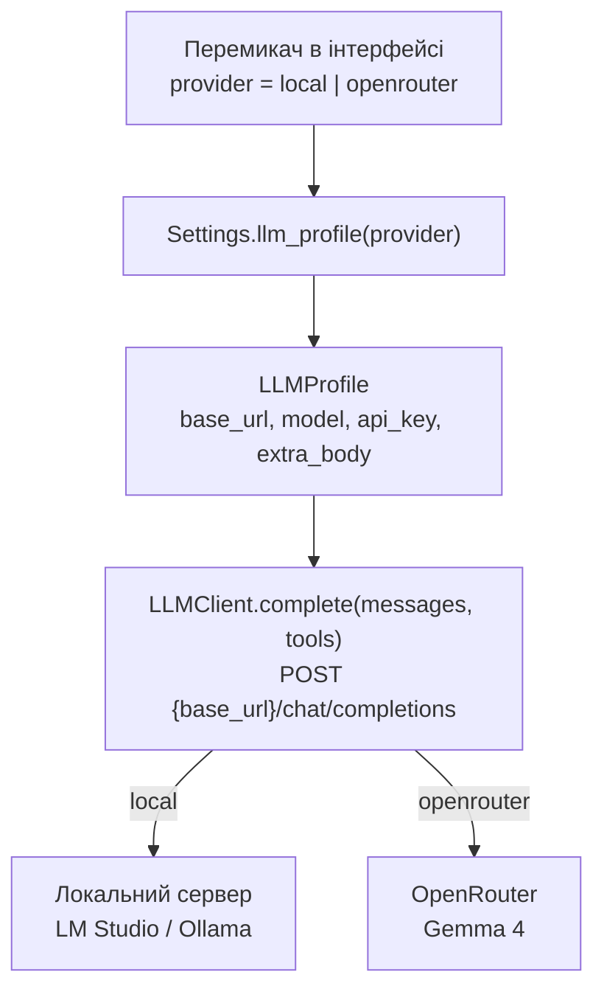
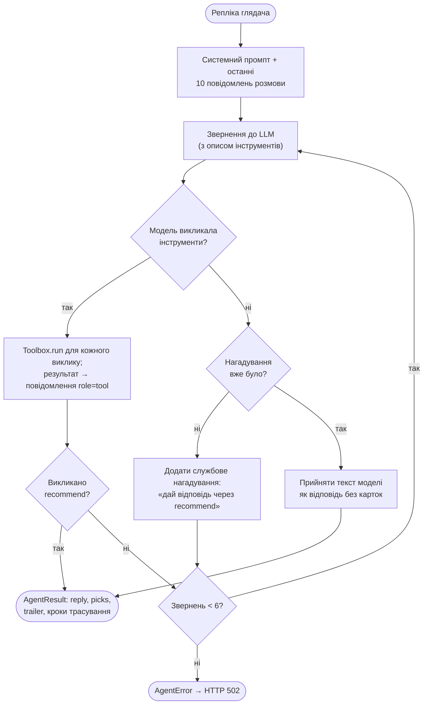
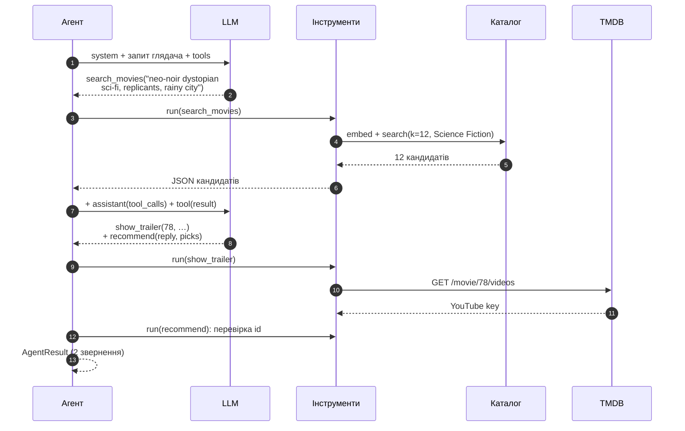

# 3. LLM і виклик інструментів

Цей документ описує, як сервіс спілкується з мовною моделлю: звідки береться модель (локально чи через API), як побудований цикл агента, які інструменти (tools) модель може викликати і чому рекомендації не можуть вийти за межі каталогу.

## 3.1. Роль LLM

LLM у MovieHarbor — не генератор тексту «з пам'яті», а **агент з інструментами**. Вона:

1. розуміє запит глядача будь-якою мовою, з урахуванням усієї розмови;
2. формулює пошуковий запит до каталогу: англійський опис бажаного фільму (`search_movies`);
3. обирає 1–5 фільмів **лише** з результатів пошуку і пояснює кожен вибір;
4. вирішує, чи потрібен трейлер, коли словами не передати атмосферу (`show_trailer`);
5. оформлює остаточну відповідь структуровано (`recommend`), мовою глядача.

Код і модель ділять відповідальність так: модель вирішує *що* шукати і *що* порадити, код виконує пошук, перевіряє вибір і рахує бюджет звернень.

## 3.2. Джерела моделі: локально або через API

Перемикач в інтерфейсі обирає одне з двох джерел. Обидва говорять одним протоколом — OpenAI Chat Completions з `tools`. Тому перемикання — лише інший профіль підключення (URL, модель, ключ), а не інший код.

| | Локальна модель | OpenRouter |
|---|---|---|
| Сервер | LM Studio, Ollama, llama.cpp або будь-який OpenAI-сумісний | `https://openrouter.ai/api/v1` |
| Модель за замовчуванням | `google/gemma-3-12b` | `google/gemma-4-26b-a4b-it` |
| Ключ | не потрібен | `LLM_API_KEY` |
| Налаштування | `LOCAL_LLM_BASE_URL`, `LOCAL_LLM_MODEL` | `LLM_BASE_URL`, `LLM_MODEL`, `LLM_API_KEY`, `LLM_PROVIDER_ORDER` |
| Доступність в інтерфейсі | завжди | лише коли задано ключ |

Спільні параметри генерації: `LLM_TEMPERATURE` (0,7), `LLM_MAX_TOKENS` (1500), `LLM_TIMEOUT_S` (60 с). Шаблон усіх змінних — `.env.sample`. `LLM_PROVIDER_ORDER` передається OpenRouter як `provider.order`: список провайдерів, яких пробувати першими.



Клієнт (`backend/adapters/llm.py`) — тонкий шар над `httpx`, без SDK провайдера. Він надсилає `model`, `messages`, `tools`, `tool_choice: "auto"`, `temperature`, `max_tokens`. Відповідь він розбирає в `AssistantTurn`: текст і список `ToolCall`, аргументи яких лишаються сирим JSON-текстом, бо їх перевіряє інструмент.

## 3.3. Цикл агента

Одна репліка глядача — це до `MAX_LLM_CALLS` = 6 звернень до моделі. Код: `run_agent` у `backend/core/agent.py`.



Типова репліка займає 2 звернення: `search_movies` → `recommend`. З трейлером — 2 або 3: модель може викликати `show_trailer` і `recommend` в одному зверненні. Бюджет 6 лишає місце для повторного пошуку й одного нагадування.

**Нагадування.** Деякі моделі після пошуку відповідають звичайним текстом замість виклику `recommend`. Тоді агент один раз додає службове повідомлення з проханням оформити відповідь інструментом. Якщо модель знову відповідає текстом, цей текст стає відповіддю без карток фільмів. Порожня відповідь — помилка.

**Історія.** Сервер не зберігає стан розмови: клієнт надсилає повідомлення сам. Агент бере останні `HISTORY_MESSAGES` = 10 і відкидає початкові репліки асистента, бо шаблони чату Gemma вимагають, щоб діалог починався з користувача. Попередня відповідь асистента зберігається в історії разом зі списком порад: `[recommended: Blade Runner (1982, id 78); …]`. Так модель знає, що вже радила, і не повторюється.

## 3.4. Інструменти

Модуль `backend/core/tools.py` — уся логіка виклику інструментів в одному місці: типи виклику (`ToolCall`, `AssistantTurn`), схеми аргументів, обробники, стан репліки і реєстр `TOOLS`. Кожен запис `Tool` у реєстрі — це назва, опис, модель аргументів і обробник. `Toolbox.available` в одному місці вирішує, які інструменти доступні, і цей набір використовують і опис для моделі, і виконання викликів. Він не залежить ні від HTTP, ні від конкретного провайдера: адаптер `llm.py` лише перетворює відповідь сервера на ці типи (правило перевіряє `tests/test_architecture.py`).

| Інструмент | Навіщо модель його викликає | Що робить код | Результат для моделі |
|---|---|---|---|
| `search_movies(query)` | знайти кандидатів за описом | `embed(query)` → `Catalog.search(k = 12, жанр глядача)`; кандидати додаються в `ToolState.candidates` | до 12 фільмів: `id`, `title`, `year`, `genres`, `rating`, `overview` (≤ 300 символів) |
| `show_trailer(movie_id, reason)` | показати трейлер, коли словами не передати атмосферу | перевіряє, що фільм серед кандидатів; шукає YouTube-трейлер на TMDB | `{"status": "shown"}`, `"not_found"` або помилка |
| `recommend(reply, picks[])` | дати остаточну відповідь | приймає лише фільми з кандидатів, без повторів, не більше 5 | `{"status": "ok", "accepted": [...], "rejected": [...]}` |

`show_trailer` пропонується моделі лише тоді, коли задано `TMDB_API_KEY`. Без ключа інструмента немає ні в списку `tools`, ні в промпті.

### Схеми: одне джерело для опису і перевірки

Аргументи кожного інструмента описано pydantic-моделлю (`SearchMoviesArgs`, `ShowTrailerArgs`, `RecommendArgs`). З неї:

- генерується JSON Schema, яку бачить модель (`tool_spec`: вкладені `$ref` розгортаються, службові `title` прибираються, тож схему приймає будь-який сервер);
- перевіряються аргументи, які модель повернула (`model_validate_json`).

Тому опис інструмента і його перевірка не можуть розійтися. Згенерований опис `recommend`:

```json
{
  "type": "function",
  "function": {
    "name": "recommend",
    "description": "Give the final answer: a short introduction and the chosen films with reasons. Call it exactly once, at the end.",
    "parameters": {
      "type": "object",
      "required": ["reply", "picks"],
      "properties": {
        "reply": {"type": "string", "minLength": 1, "maxLength": 1500,
                  "description": "A short, lively introduction (1-3 sentences) in the viewer's language, without listing the films."},
        "picks": {"type": "array", "maxItems": 5,
                  "description": "1-5 films, best first; empty if the request is not about films.",
                  "items": {"type": "object", "required": ["movie_id", "why"],
                            "properties": {
                              "movie_id": {"type": "integer", "description": "id of a film from the search_movies results"},
                              "why": {"type": "string", "minLength": 3, "maxLength": 600,
                                      "description": "1-2 sentences, in the viewer's language: why the film suits the request."}}}}
      }
    }
  }
}
```

### Заземлення (grounding)

`ToolState.candidates` — множина фільмів, які `search_movies` повернув у цій репліці. `show_trailer` і `recommend` приймають лише `movie_id` з цієї множини. Вигаданий або чужий id відхиляється і повертається моделі в `rejected`. Тому кожна картка в інтерфейсі — реальний фільм каталогу з постером, роком і рейтингом. Модель може помилитися з поясненням, але не може «порадити» фільм, якого немає.

### Помилки в аргументах

Невалідний JSON, порушення схеми чи невідомий інструмент не обривають репліку. Модель отримує `{"error": "invalid arguments: picks.0.why: ..."}` і може виправитися на наступному кроці. Кожен виклик, успішний чи ні, потрапляє в трасування (`Step`: інструмент, аргументи, підсумок українською), яке інтерфейс показує в блоці «Як це працює».

## 3.5. Приклад обміну

Репліка «Хочу щось атмосферне на кшталт «Того, хто біжить по лезу»» з жанровим фільтром «Science Fiction»:



## 3.6. Промпт

Системний промпт (`backend/core/prompts.py`) написаний англійською: її найнадійніше виконують instruction-tuned моделі. Він складається з:

1. **ролі**: дружній кіноконсультант, порадник, а не довідник;
2. **правила мови**: відповідати мовою останньої репліки глядача — англійською на англійську, українською на українську тощо. Це стосується `reply`, кожного `why` і пояснення до трейлера. Лише `query` пошуку завжди англійська, бо каталог англійський. Правило повторено наприкінці промпту і в нагадуванні: з одним згадуванням на початку Gemma 4 відповідала українською навіть на англійські запити (перевірено наживо, [README](../README.md#демо-запити));
3. **даних глядача**: вік, стать і жанровий фільтр — те, що глядач сам вказав в інтерфейсі. Вік і стать — лише м'яка підказка без стереотипів; для глядачів до 16 років — без фільмів із відвертим насильством;
4. **алгоритму**: спершу пошук з описом рис фільму, а не його назвою; модель бачить лише результати пошуку, тож не може стверджувати, що фільму немає в каталозі, але може шукати повторно (не більше двох разів, [розділ 8](08-hallucinations.md), R5); вибір лише з результатів; без повторів у межах розмови; трейлер за правилом «коли словами не передати атмосферу»; фінал через `recommend` з відповіддю, що починається по суті, без шаблонних вступів;
5. **поведінки поза темою**: коротко відповісти й повернути розмову до вибору фільму.

Правило трейлера має два варіанти: з інструментом і без нього (коли TMDB не налаштовано). Так модель не обіцяє відео, якого не буде.

## 3.7. Обґрунтування рішень

| Рішення | Альтернатива | Чому так |
|---|---|---|
| Пошуковий запит формулює LLM (інструмент) | шукати за сирим текстом глядача | Recall@12 = 0,83 для опису, як його пише модель, проти 0,34 для назви українською ([розділ 6](06-evaluation.md)); модель також враховує контекст розмови («щось легше») |
| Остаточна відповідь — виклик `recommend` | вільний текст або JSON у тексті, який треба розбирати | структура гарантована схемою; кожен фільм перевіряється; інтерфейс показує картки, а не розбирає прозу |
| Заземлення на результатах пошуку | довіряти моделі | модель не може порадити неіснуючий фільм; відхилені id видно в трасуванні |
| Трейлер як окремий інструмент | завжди показувати трейлер першого фільму | рішення про візуальний доказ ухвалює модель за правилом із промпту, і воно видно в трасуванні |
| Один OpenAI-сумісний протокол | окремий SDK для кожного провайдера | локальна модель і API відрізняються лише профілем; немає дублювання коду |
| Промпт англійською + правило мови | промпт українською | надійніше виконання інструкцій; відповідь мовою глядача, зокрема англійською |
| Бюджет 6 звернень, одне нагадування | необмежений цикл | передбачувана затримка й вартість; зациклена модель завершується зрозумілою помилкою |

## 3.8. Обробка помилок

Усі помилки моделі доходять до глядача українським текстом без секретів. Клієнт не повторює запит автоматично: глядач бачить причину й кнопку «Спробувати ще раз».

| Ситуація | Що бачить глядач | HTTP |
|---|---|---|
| OpenRouter обрано, ключа немає | «OpenRouter не налаштовано: додайте LLM_API_KEY у файл .env.» | 400 |
| Локальний сервер не запущено (з'єднання відхилено або немає відповіді за 5 с) | «Сервер моделі недоступний (URL)…» | 502 |
| Модель не відповіла за `LLM_TIMEOUT_S` | «Модель не відповіла за 60 с…» | 502 |
| 401/403, 402, 404, 429 від сервера моделі | ключ відхилено / недостатньо коштів / модель не знайдено / ліміт запитів | 502 |
| Інша помилка сервера | код і повідомлення сервера (до 200 символів) | 502 |
| Модель не завершила відповідь за 6 звернень або відповіла порожньо | «Модель не завершила відповідь…» | 502 |
| TMDB недоступний | трейлера немає, рекомендації працюють | 200 |

Ключ TMDB передається в URL (API v3), тому помилки TMDB журналюються лише за типом, без URL.

## 3.9. Код

| Файл | Роль |
|---|---|
| `backend/core/agent.py` | цикл агента `run_agent`, історія, нагадування, бюджет звернень |
| `backend/core/tools.py` | **виклик інструментів**: типи `ToolCall` і `AssistantTurn`, схеми, обробники, заземлення, `ToolState` |
| `backend/core/prompts.py` | системний промпт, правило мови, `Viewer` |
| `backend/adapters/llm.py` | OpenAI-сумісний клієнт, `LLMProfile`, розбір відповіді, помилки |
| `backend/adapters/tmdb.py` | пошук трейлера на TMDB |
| `backend/settings.py` | налаштування й профілі джерел моделі |
| `tests/test_agent.py`, `tests/test_tools.py`, `tests/test_llm_client.py` | поведінка циклу, інструментів і клієнта на сценарних подвійниках, без мережі |
