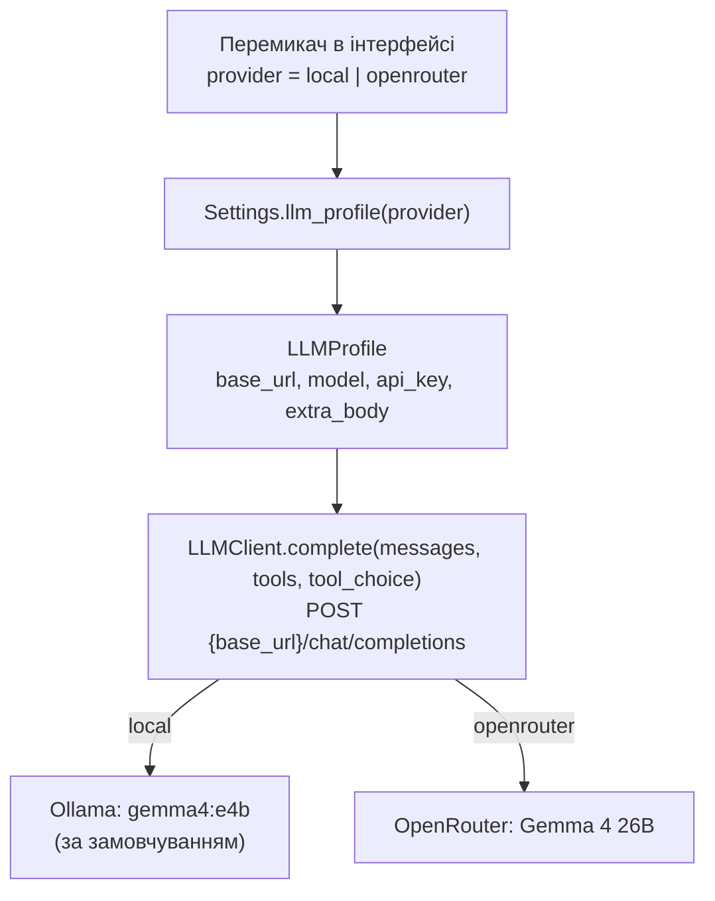
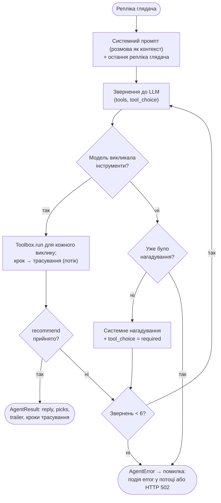
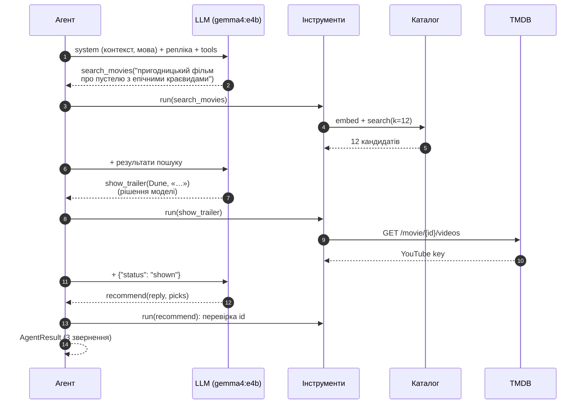

# 3. LLM і виклик інструментів

Цей документ описує, як сервіс спілкується з мовною моделлю. Звідки береться модель: за замовчуванням локальна Gemma 4 в Ollama, альтернатива — OpenRouter. Як побудований цикл агента, які інструменти модель викликає і чому рекомендації не можуть вийти за межі каталогу. Промпт і схеми розраховано на малу локальну модель; що саме в них підлаштовано і як це виміряно — у §3.10.

## 3.1. Роль LLM

LLM у MovieHarbor — не генератор тексту «з пам'яті», а **агент з інструментами**. Вона:

1. розуміє запит глядача з урахуванням усієї розмови;
2. формулює пошуковий запит до каталогу — опис бажаного фільму **мовою глядача** (`search_movies`);
3. вирішує, чи варто показати трейлер найкращого кандидата (`show_trailer`, необов'язково);
4. обирає фільми **лише** з результатів пошуку і пояснює кожен вибір (`recommend`).

Код і модель ділять відповідальність так. Модель вирішує, *що* шукати, *чи* показати трейлер і *що* порадити. Код виконує пошук, перевіряє вибір, рахує бюджет звернень і звітує про кожен крок.

## 3.2. Джерела моделі: локально (за замовчуванням) або через API

Перемикач в інтерфейсі обирає одне з двох джерел; за замовчуванням — локальна модель. Обидва говорять одним протоколом — OpenAI Chat Completions з `tools`. Перемикання — це лише інший профіль підключення (URL, модель, ключ), а не інший код.

| | Локальна модель (за замовчуванням) | OpenRouter (альтернатива) |
|---|---|---|
| Сервер | Ollama (у Docker — сервіс `ollama`) або інший OpenAI-сумісний: LM Studio, llama.cpp | `https://openrouter.ai/api/v1` |
| Модель за замовчуванням | `gemma4:e4b` | `google/gemma-4-26b-a4b-it` |
| Ключ | не потрібен | `LLM_API_KEY` |
| Налаштування | `LOCAL_LLM_BASE_URL` (`http://127.0.0.1:11434/v1`), `LOCAL_LLM_MODEL`; у Docker — `OLLAMA_MODEL` | `LLM_BASE_URL`, `LLM_MODEL`, `LLM_API_KEY`, `LLM_PROVIDER_ORDER` |
| Доступність в інтерфейсі | завжди | лише коли задано ключ |

Спільні параметри генерації:

- **`LLM_TEMPERATURE`** — 0,7.
- **`LLM_MAX_TOKENS`** — 1500. На цей ліміт розраховано схему `recommend` (§3.4).
- **`LLM_TIMEOUT_S`** — 60 с; у Docker 300 с, бо локальна модель на CPU може відповідати хвилинами.

`LLM_PROVIDER_ORDER` передається OpenRouter як `provider.order`. Шаблон усіх змінних — `.env.sample`.

Модель у локальному сервері має підтримувати виклик інструментів. Gemma 4 в Ollama підтримує його, Gemma 3 — ні.



Клієнт (`backend/adapters/llm.py`) — тонкий шар над `httpx`, без SDK провайдера. Він надсилає `model`, `messages`, `tools`, `tool_choice`, `temperature`, `max_tokens`. Відповідь розбирає в `AssistantTurn`: текст і список `ToolCall`. Аргументи викликів лишаються сирим JSON-текстом; аргументи, надіслані сервером як JSON-об'єкт, перетворюються на текст.

## 3.3. Цикл агента

Одна репліка глядача — до `MAX_LLM_CALLS` = 6 звернень до моделі. Код: `run_agent` у `backend/core/agent.py`.

Модель бачить лише два повідомлення. Перше — системний промпт; у ньому параметри глядача, мова відповіді й **попередня розмова** як контекст. Друге — остання репліка глядача.



Типова репліка займає 2–3 звернення: `search_movies` → (`show_trailer`) → `recommend`. Модель може викликати кілька інструментів одним зверненням. Бюджет 6 лишає місце для повторного пошуку й однієї корекції.

**Одне завершення.** Репліка завершується лише одним способом: прийнятим викликом `recommend`. Він приймається, якщо хоча б один фільм заземлений або якщо список фільмів порожній (запит поза темою).

Якщо модель відповіла текстом без інструментів, агент додає **системне** нагадування («відповідай викликом інструмента») і ставить `tool_choice: "required"`. Повторна відповідь текстом — помилка 502. Обидва засоби потрібні:

- `tool_choice` виконують OpenAI-сумісні сервери (OpenRouter, vLLM, LM Studio), а Ollama його ігнорує (перевірено, §3.10);
- системне нагадування читає будь-яка модель.

Від імені глядача агент нічого не пише: розмова містить лише те, що написав глядач.

**Історія.** Сервер не зберігає стану розмови: клієнт надсилає її сам (не більше 20 повідомлень). У системний промпт потрапляють останні `HISTORY_MESSAGES` = 8 попередніх повідомлень як рядки «Viewer: …» і «You: …», кожне до 400 символів. Попередня відповідь асистента зберігається разом зі списком порад (`[recommended: Blade Runner (1982, id 78); …]`), тож модель знає, що вже радила.

Чому контекст, а не повідомлення асистента: мала модель наслідує форму власних попередніх реплік. Коли попередня відповідь лежала в історії як текст асистента, наступна відповідь теж приходила текстом, без виклику інструментів (§3.10).

**Потік кроків.** `run_agent` повідомляє про кожен виконаний виклик (`on_step`). `POST /api/recommend/stream` передає ці кроки інтерфейсу, поки агент працює ([розділ 4.2](04-interface.md#42-http-api)).

## 3.4. Інструменти

Модуль `backend/core/tools.py` — уся логіка виклику інструментів в одному місці: типи виклику (`ToolCall`, `AssistantTurn`), схеми аргументів, обробники, стан репліки (`ToolState`) і реєстр `TOOLS`. Кожен запис `Tool` у реєстрі — назва, опис, модель аргументів і обробник. `Toolbox.available` в одному місці вирішує, які інструменти доступні. Цей набір використовують і опис для моделі, і виконання викликів.

| Інструмент | Що робить код | Результат для моделі | Дані для трасування |
|---|---|---|---|
| `search_movies(query)` | `embed(query)` → `Catalog.search(k = 12, жанр глядача)`; результат **замінює** `ToolState.candidates` | до 12 фільмів: `id`, `title`, `year`, `genres`, `rating`, `overview` (≤ 200 символів) | кандидати з подібністю |
| `show_trailer(movie_id, reason)` | перевіряє, що фільм серед кандидатів; шукає YouTube-трейлер на TMDB | `{"status": "shown"}`, `"not_found"` або помилка | фільм і статус |
| `recommend(reply, picks[])` | приймає лише фільми з кандидатів, без повторів, не більше 5; якщо не прийнято жодного, репліка триває | `{"status": "ok", "accepted", "rejected"}` або `{"error", "rejected"}` | прийняті й відхилені id |

`show_trailer` пропонується моделі лише тоді, коли задано `TMDB_API_KEY`. Без ключа інструмента немає ні в списку `tools`, ні в промпті.

### Схеми: одне джерело для опису і перевірки

Аргументи кожного інструмента описано pydantic-моделлю (`SearchMoviesArgs`, `ShowTrailerArgs`, `RecommendArgs`). З неї:

- генерується JSON Schema, яку бачить модель (`tool_spec`): вкладені `$ref` розгортаються, у необов'язкових полів прибирається альтернатива `null`, службові `title` зникають. Виходить проста схема, яку читає будь-який сервер і мала модель;
- перевіряються аргументи, які модель повернула (`model_validate_json`).

Тому опис інструмента і його перевірка не можуть розійтися. Згенеровані параметри інструментів:

```json
{"search_movies": {"type": "object", "required": ["query"], "properties": {
   "query": {"type": "string", "minLength": 2, "maxLength": 400,
             "description": "Description of the wanted film in the viewer's language (do not translate): plot, themes, mood, style; for 'like film X', its traits plus its title."}}},
 "show_trailer": {"type": "object", "required": ["movie_id", "reason"], "properties": {
   "movie_id": {"type": "integer", "description": "id of your best film from the search_movies results"},
   "reason": {"type": "string", "minLength": 3, "maxLength": 300,
              "description": "One sentence, in the viewer's language: what exactly to watch for."}}},
 "recommend": {"type": "object", "required": ["reply", "picks"], "properties": {
   "reply": {"type": "string", "minLength": 1, "maxLength": 600,
             "description": "One or two lively sentences in the viewer's language that introduce the picks without listing them."},
   "picks": {"type": "array", "maxItems": 5,
             "description": "Usually 3 films (up to 5 if asked), best first, ids from the latest search results; empty if the request is not about films.",
             "items": {"type": "object", "required": ["movie_id", "why"], "properties": {
               "movie_id": {"type": "integer", "description": "id of a film from the search_movies results"},
               "why": {"type": "string", "minLength": 3, "maxLength": 300,
                       "description": "One sentence, in the viewer's language: why the film fits this request."}}}}}}}
```

Ліміти довжини підібрано під `LLM_MAX_TOKENS` = 1500: найбільша допустима відповідь `recommend` (5 фільмів із поясненнями) вміщається в ліміт навіть за консервативних 2 символів на токен (`test_the_largest_valid_recommend_fits_the_default_token_budget`).

### Заземлення (grounding)

`ToolState.candidates` — фільми з **останнього** пошуку в цій репліці. Повторний пошук замінює набір, бо модель шукає знову саме тоді, коли попередні кандидати не підходять.

- `show_trailer` і `recommend` приймають лише `movie_id` з цього набору.
- Вигаданий або чужий id відхиляється і повертається моделі в `rejected`.
- Якщо відхилено всі запропоновані фільми, `recommend` повертає помилку й не завершує репліку: модель обирає знову.

Кожна картка в інтерфейсі — реальний фільм каталогу. Детально — у [розділі 8](08-hallucinations.md).

### Помилки в аргументах

Невалідний JSON, порушення схеми чи невідомий інструмент не обривають репліку. Модель отримує `{"error": "invalid arguments: …"}` (для невідомого інструмента — `{"error": "unknown tool '…'"}`) і може виправитися наступним кроком. Кожен виклик, успішний чи ні, потрапляє в трасування.

## 3.5. Приклад обміну

Репліка «Пригодницький фільм про пустелю з епічними краєвидами», локальна модель:



## 3.6. Промпт

Системний промпт (`backend/core/prompts.py`) — англійською, бо цю мову instruction-tuned моделі виконують найнадійніше. Він складається з:

1. **ролі**: дружній кінорадник, що радить лише з каталогу, доступного через `search_movies`;
2. **процедури з нумерованих кроків**, по кроку на інструмент:
   - пошук: опис мовою глядача, без перекладу; для «як X» — риси X і його назва; уточнення поєднуються з попереднім проханням;
   - за потреби — повторний пошук;
   - рішення про трейлер: показати трейлер найкращого кандидата, коли глядач хоче побачити фільм або коли важать атмосфера, візуальний стиль, краєвиди, видовище чи екшн; інакше пропустити;
   - `recommend`: зазвичай 3 фільми (до 5 на прохання), лише id з останнього пошуку, без повторів, по одному реченню «чому» і 1–2 речення вступу;
   - запит поза темою: порожній список і повернення до кіно;
3. **мови відповіді, названої кодом**. `reply_language` визначає мову за письмом останньої репліки (кирилиця — Ukrainian, латиниця — English); `language_rule` підставляє її назву: «Write reply, why and the show_trailer reason in Ukrainian, and the search_movies query too». Промпт закінчується рядком «Answer in Ukrainian.» (або іншою названою мовою);
4. **правил мови й стилю**: назви фільмів — як у результатах пошуку, без перекладу. Лише для української відповіді — природна сучасна мова, звертання на «ви», без кальок: в англійському промпті ці правила тягнули малу модель в українську;
5. **запобіжників**: не вигадувати фільмів; не стверджувати, що фільму немає в каталозі; вік і стать — лише м'яка підказка без стереотипів; до 16 років — без відвертого насильства;
6. **профілю глядача** і **попередньої розмови** як контексту.

Правило трейлера має два варіанти: з інструментом і без нього (коли TMDB не налаштовано). Так модель не обіцяє відео, якого не буде. Наявність кожного запобіжника фіксує `tests/test_prompts.py`.

## 3.7. Обґрунтування рішень

| Рішення | Альтернатива | Чому так |
|---|---|---|
| Пошуковий запит формулює LLM | шукати за сирим текстом глядача | модель враховує розмову («щось легше» уточнює попереднє), перетворює «як X» на риси X і розгортає короткі прохання |
| Запит — мовою глядача, без перекладу | перекладати запит англійською | переклад — неявний шар перекладу, який робить зайвою багатомовну модель ембедінгів. Мовні відповідності — її робота ([розділ 7](07-embedding-model.md)). Ціна: на бенчмарку англійський опис дає вищий Recall@12, ніж український (0,83 проти 0,69, [розділ 6](06-evaluation.md)) |
| Трейлер — окремий необов'язковий інструмент; рішення ухвалює модель за конкретною умовою | поле у `recommend`; або трейлер завжди | демонструє, що мала модель сама вирішує, коли інструмент доречний. З довгим абстрактним правилом вона трейлер не викликала; з конкретною умовою в процедурі — викликає там, де це доречно (§3.10) |
| Остаточна відповідь — виклик `recommend` | вільний текст | структура гарантована схемою, кожен фільм перевіряється |
| Заземлення на останньому пошуку | довіряти моделі | модель не може порадити неіснуючий фільм; відхилені id видно в трасуванні |
| Розмова — контекст у системному промпті | повідомлення асистента в історії | мала модель наслідувала б текстові відповіді й не викликала інструментів |
| Мова відповіді названа кодом | «мовою останньої репліки» | мала модель відповідала українською на англійські запити; названу мову виконує надійно |
| Репліка завершується лише прийнятим `recommend` | прийняти текст як відповідь | немає незаземлених відповідей |
| Один OpenAI-сумісний протокол | окремий SDK для кожного провайдера | локальна модель і API відрізняються лише профілем |

## 3.8. Обробка помилок

Помилки доходять до глядача українським текстом без секретів. Клієнт не повторює запит автоматично: глядач бачить причину й кнопку «Спробувати ще раз».

| Ситуація | Що бачить глядач | HTTP |
|---|---|---|
| OpenRouter обрано, ключа немає | «OpenRouter не налаштовано: додайте LLM_API_KEY у файл .env.» | 400 |
| Сервер моделі не запущено (з'єднання відхилено або немає відповіді за 5 с) | «Сервер моделі недоступний (URL)…» | 502 |
| Модель не відповіла за `LLM_TIMEOUT_S` | «Модель не відповіла за … с…» | 502 |
| 401/403, 402, 404 (модель ще не завантажено), 429 | ключ відхилено / недостатньо коштів / модель не знайдено / ліміт запитів | 502 |
| Інша помилка сервера | код і повідомлення сервера (до 200 символів) | 502 |
| Модель двічі відповіла текстом без інструментів | «Модель відповіла текстом замість виклику інструментів…» | 502 |
| Модель не завершила відповідь за 6 звернень | «Модель не завершила відповідь…» | 502 |
| TMDB недоступний | трейлера немає, рекомендації працюють | 200 |

У потоковому ендпоінті ті самі помилки моделі приходять подією `{"type": "error", "detail": …}`.

## 3.9. Код

| Файл | Роль |
|---|---|
| `backend/core/agent.py` | цикл агента `run_agent`, завершення лише через `recommend`, нагадування, `on_step` |
| `backend/core/tools.py` | **виклик інструментів**: типи, схеми, обробники, заземлення, дані трасування |
| `backend/core/prompts.py` | системний промпт, `reply_language`, `language_rule`, контекст розмови, `Viewer` |
| `backend/adapters/llm.py` | OpenAI-сумісний клієнт, `LLMProfile`, розбір відповіді, помилки |
| `backend/adapters/tmdb.py` | пошук трейлера на TMDB |
| `backend/settings.py` | налаштування й профілі джерел моделі |
| `tests/test_agent.py`, `tests/test_tools.py`, `tests/test_prompts.py`, `tests/test_llm_client.py` | цикл, інструменти, запобіжники промпту, клієнт — на сценарних подвійниках, без мережі |

## 3.10. Мала локальна модель

За замовчуванням працює `gemma4:e4b`: ≈ 4 млрд активних параметрів, ≈ 5,5 ГБ ваг, GPU ноутбука (RTX 4060, 8 ГБ). Промпт і схеми спершу тестувалися на більшій Gemma 4 26B через OpenRouter. На малій моделі той самий дизайн мав системні збої. Нижче — що виміряно наживо через стек Docker і що змінено.

### Спостереження

| Спостереження на `gemma4:e4b` | Причина | Зміна |
|---|---|---|
| Уточнення «а щось легше» → відповідь текстом → 502 (1 з 9 реплік) | попередня відповідь лежала в історії як текст асистента, і мала модель її наслідувала | розмова — контекст у системному промпті (§3.3) |
| Ollama ігнорує `tool_choice: "required"` | обмеження OpenAI-сумісного API Ollama (перевірено: модель і далі відповідає текстом) | системне нагадування (§3.3) |
| Трейлер — 0 з 8 реплік | рішення про трейлер було сформульоване довгим абстрактним правилом | рішення лишилося за моделлю, але стало окремим кроком процедури з конкретними умовами (бачити фільм; атмосфера, візуальний стиль, краєвиди, видовище, екшн) |
| Англійський запит → українська відповідь | спершу абстрактне «мовою останньої репліки»; потім — правила стилю української, що стояли і в промпті англійської відповіді | мову називає код (`reply_language`); правила стилю української — лише для української відповіді; промпт закінчується «Answer in …» |
| «Без крові» → 28 Days Later, Don't Breathe | модель судить про фільм лише з 200 символів опису кандидата | не змінено: межа малої моделі, видна в демо-запиті 4 (README) |
| «Той, хто біжить по лезу» → «The Running Man» | мала модель не знає українських прокатних назв і перекладає назву дослівно | у демо-запитах — оригінальні назви; обмеження зафіксовано в [розділі 8](08-hallucinations.md) |
| Відповідь 20–60 с | до 5 розлогих українських пояснень при ≈ 35 токенах/с | зазвичай 3 фільми, по одному реченню; опис кандидатів скорочено до 200 символів; кроки показуються наживо |

### Перевірка демо-запитів

Після кожної зміни промпту демо-запити того етапу проганялися наживо через стек Docker (`POST /api/recommend`, `gemma4:e4b`, RTX 4060):

| Етап промпту | Прогонів | Реплік із картками | Трейлер | Мова відповіді | Медіана, с |
|---|---|---|---|---|---|
| Початковий (налаштований на Gemma 4 26B) | 1 | 8 з 9 | 0 з 8 | 8 з 8 | 29 |
| Розмова — у системному промпті; нагадування | 1 | 9 з 9 | 2 з 9 | 9 з 9 | 28 |
| Трейлер — окремий крок процедури з умовами | 2 | 16 з 16 | 13 з 16 | 14 з 16 | 35–41 |
| Мову називає код | 2 | 17 з 18 | 17 з 17 | 15 з 17 | 40–42 |
| Правила стилю української — лише для української відповіді (поточний) | 2 | 20 з 20 | 20 з 20 | 20 з 20 | 35 |

- **Помилки мови.** Усі помилки мови — англійський контрольний запит, на який модель відповіла українською.
- **Невдалий запит.** Єдину репліку без карток (502: модель не завершила відповідь за 6 звернень) дав запит «Анімаційний детектив про розслідування для всієї родини». У каталозі лише 8 сімейних чи анімаційних фільмів із жанром Mystery або Crime, тож пошук не знаходив доречних кандидатів, а модель шукала знову. Цей запит замінено на «Історія про подорожі в часі, що змушує замислитися».
- **Трейлер.** У поточному прогоні модель показала трейлер у всіх 20 репліках: демо-запити обрано так, щоб задіяти всі три інструменти. Пропускає трейлер вона там, де мова не про вигляд чи атмосферу: в оцінюванні параметрів — у 2 з 8 реплік комедійного запиту ([розділ 9](09-selection-parameters.md)).
