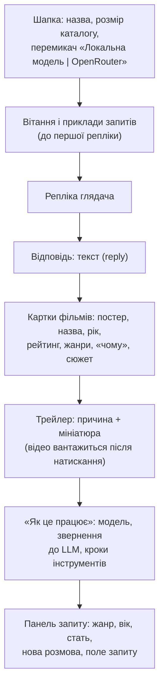
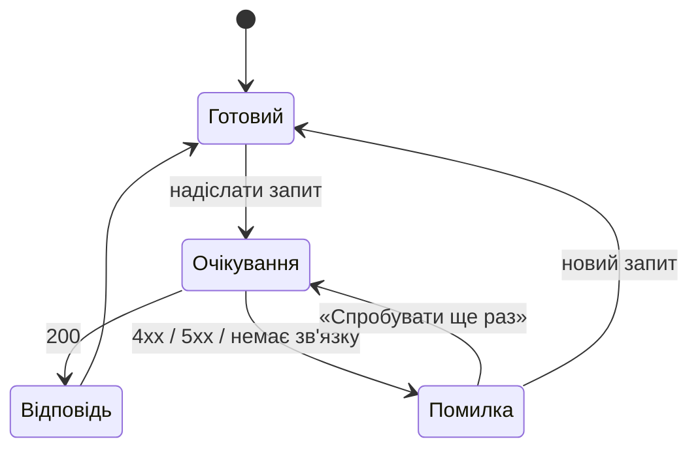

# 4. Інтерфейс

Інтерфейс складається з двох частин: вебсторінки, з якою працює глядач, і HTTP API, через яке сторінка (або будь-який інший клієнт) звертається до рекомендатора. Обидві обслуговує один процес: `python -m backend` → http://127.0.0.1:8000.

## 4.1. Вебінтерфейс

Сторінка зверху вниз:



| Елемент | Поведінка |
|---|---|
| Перемикач джерела моделі | Два варіанти з назвою моделі. OpenRouter неактивний, якщо не задано `LLM_API_KEY` (підказка пояснює чому). Вибір запам'ятовується; за замовчуванням OpenRouter, якщо налаштований |
| Приклади запитів | Чотири готові запити українською й англійською; натискання одразу надсилає запит |
| Жанр | Жорсткий фільтр пошуку; назви жанрів українською |
| Вік, стать | Необов'язкові; модель враховує їх лише як м'яку підказку ([розділ 3.6](03-llm-and-tool-calling.md#36-промпт)) |
| Поле запиту | `Enter` — надіслати, `Shift+Enter` — новий рядок; поле росте до 160 px |
| Картка фільму | Постер (посилання на сторінку TMDB), назва, рік, зважений рейтинг ★, жанри, пояснення моделі «чому», згорнутий сюжет. Якщо постер не завантажився, показується значок 🎬 |
| Трейлер | Заголовок «Оцініть атмосферу», пояснення моделі, мініатюра YouTube; відео (`youtube-nocookie.com`) вантажиться лише після натискання |
| «Як це працює» | Джерело й модель, кількість звернень до LLM, затримка, кожен виклик інструмента з аргументом і підсумком. Це прозорість агента, корисна для демонстрації |
| Нова розмова | Очищає історію; налаштування лишаються |
| Помилка | Червона картка з українським поясненням від бекенду і кнопкою «Спробувати ще раз» |

### Стани репліки



Під час очікування поле запиту лише для читання, а кнопки «Надіслати» і «Нова розмова» вимкнені, тож дві репліки не накладаються. Після помилки невдала репліка вилучається з історії, щоб репліки глядача й асистента чергувалися, як того вимагають шаблони чату. Повтор надсилає її знову.

### Принципи

- **Легкість.** Три статичні файли (`index.html`, `app.js`, `styles.css`), без збірки, фреймворків і зовнішніх шрифтів. Їх роздає той самий FastAPI.
- **Безпека.** Усі рядки з API потрапляють у сторінку як текст (`textContent` через допоміжну функцію `h`), ніколи як HTML. Відповідь моделі не може вставити розмітку чи скрипт.
- **Приватність.** До YouTube сторінка звертається лише після натискання на трейлер. `localStorage` зберігає тільки налаштування (джерело, жанр, вік, стать), а не розмову.
- **Доступність.** Семантичні елементи, підписи полів, `aria-live` для розмови, `role="radiogroup"` для перемикача, керування з клавіатури, `prefers-reduced-motion`.
- **Теми й адаптивність.** Світла й темна тема за налаштуванням ОС; верстка від 360 px.
- **Атрибуція TMDB.** Метадані, постери й трейлери належать TMDB. Сторінка містить обов'язкову примітку про використання TMDB API.

## 4.2. HTTP API

Інтерактивна документація OpenAPI генерується автоматично: http://127.0.0.1:8000/docs.

| Метод і шлях | Призначення |
|---|---|
| `GET /api/config` | що вміє сервер: джерела моделі, жанри, розмір каталогу, трейлери |
| `POST /api/recommend` | одна репліка розмови → відповідь агента |
| `GET /` | вебінтерфейс (статичні файли з `frontend/`) |

### `GET /api/config`

```json
{
  "providers": [
    {"id": "local", "label": "Локальна модель", "model": "google/gemma-3-12b", "configured": true},
    {"id": "openrouter", "label": "OpenRouter", "model": "google/gemma-4-26b-a4b-it", "configured": true}
  ],
  "genres": ["Action", "Adventure", "…"],
  "movies": 2274,
  "trailers": true
}
```

Ключі API не повертаються ніколи: лише ознака `configured`.

### `POST /api/recommend`

Запит:

```json
{
  "provider": "openrouter",
  "messages": [
    {"role": "user", "content": "Щось атмосферне на кшталт «Того, хто біжить по лезу»"}
  ],
  "viewer": {"age": 30, "gender": null, "genre": "Science Fiction"}
}
```

| Поле | Правило |
|---|---|
| `provider` | `local` або `openrouter` |
| `messages` | 1–50 повідомлень `user`/`assistant`, кожне 1–4000 символів; останнє — від `user` |
| `viewer.age` | 1–120 або `null` |
| `viewer.gender` | `female`, `male`, `other` або `null` |
| `viewer.genre` | жанр із `/api/config` або `null` |

Відповідь:

```json
{
  "reply": "Ось кілька фільмів із тією ж похмурою неоновою естетикою…",
  "picks": [
    {"id": 78, "title": "Blade Runner", "year": 1982, "genres": ["Science Fiction", "Drama", "Thriller"],
     "rating": 7.8, "overview": "In the smog-choked dystopian Los Angeles of 2019…",
     "poster_url": "https://image.tmdb.org/t/p/w342/…jpg",
     "why": "Першоджерело всієї кіберпанк-естетики…"}
  ],
  "trailer": {"movie_id": 78, "title": "Blade Runner", "youtube_key": "…",
              "reason": "Зверніть увагу на неонові відблиски в дощі."},
  "message": {"role": "assistant", "content": "Ось кілька фільмів…\n\n[recommended: Blade Runner (1982, id 78)]"},
  "trace": {
    "provider": "openrouter", "model": "google/gemma-4-26b-a4b-it", "llm_calls": 2, "latency_ms": 4210,
    "steps": [
      {"tool": "search_movies", "arguments": {"query": "neo-noir dystopian sci-fi…"}, "outcome": "знайдено 12 фільмів"},
      {"tool": "show_trailer", "arguments": {"movie_id": 78, "reason": "…"}, "outcome": "трейлер «Blade Runner» показано"},
      {"tool": "recommend", "arguments": {"reply": "…", "picks": ["…"]}, "outcome": "прийнято 3, відхилено 0"}
    ]
  }
}
```

`message` — репліка асистента у формі, яку клієнт додає в `messages` наступного запиту. Сервер не зберігає стану розмови: історію тримає клієнт.

### Коди відповіді

| Код | Коли | `detail` |
|---|---|---|
| 200 | відповідь агента | — |
| 400 | обрано OpenRouter без `LLM_API_KEY` | українське пояснення |
| 422 | запит не відповідає схемі або невідомий жанр; до моделі запит не доходить | опис помилки валідації |
| 502 | модель недоступна, відповіла помилкою або не завершила відповідь | українське пояснення ([розділ 3.8](03-llm-and-tool-calling.md#38-обробка-помилок)) |

## 4.3. Код

| Файл | Роль |
|---|---|
| `frontend/index.html` | розмітка сторінки |
| `frontend/app.js` | стан, запити до API, відображення відповіді, перемикач, налаштування |
| `frontend/styles.css` | стилі, світла й темна теми, адаптивність |
| `backend/api.py` | ендпоінти, моделі запиту й відповіді, роздача `frontend/` |
| `tests/test_api.py` | контракт API через справжній HTTP-стек |
| `tests/test_e2e.py` | сценарії в браузері ([розділ 5](05-e2e-workflow.md)) |
