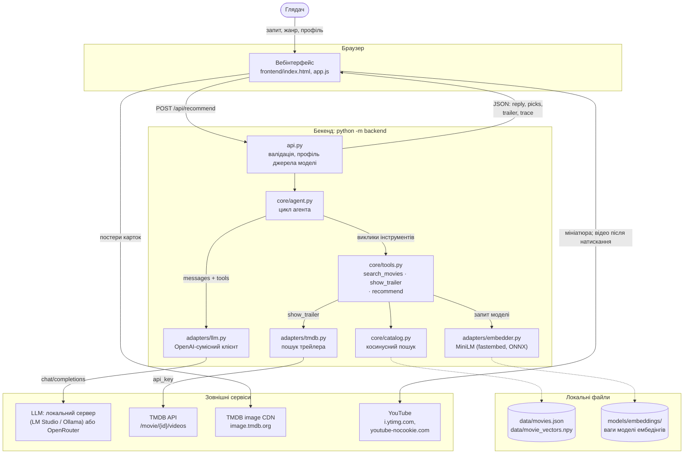
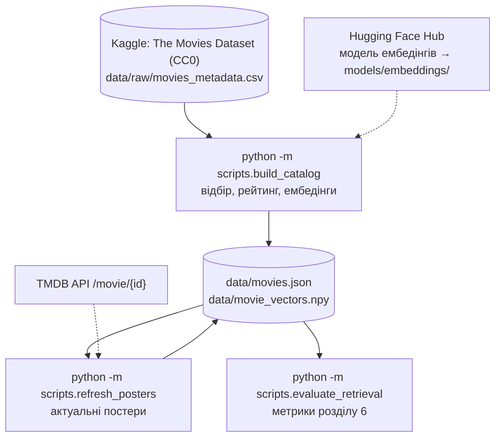
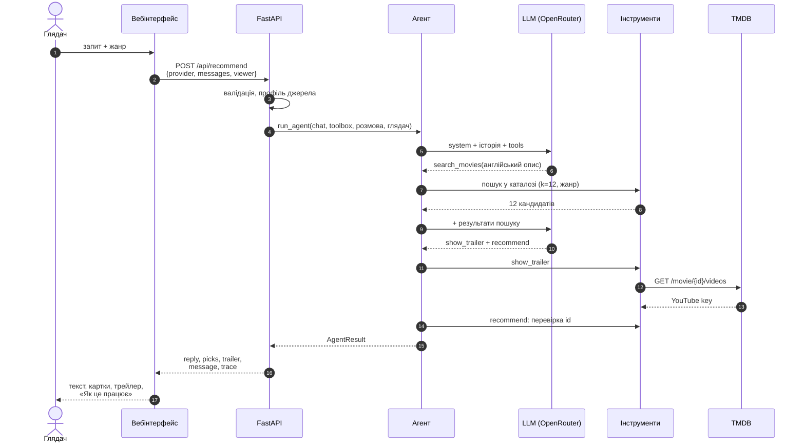
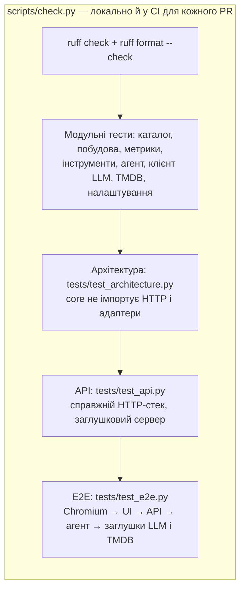

# 5. Наскрізний сценарій

Цей документ простежує одну репліку глядача через усі модулі, локальні дані й зовнішні сервіси, описує зовнішні джерела та підготовку даних і пояснює, як цей шлях перевіряють тести.

## 5.1. Повна схема



Суцільні стрілки — запити під час відповіді на репліку. Пунктирні — дані, завантажені один раз під час старту бекенду. Бекенд звертається до двох зовнішніх сервісів: LLM і TMDB API. Браузер — до двох CDN зображень і відео, без ключів. Ключі API лишаються на сервері.

## 5.2. Зовнішні джерела

| Джерело | Хто звертається | Коли | Ключ | Якщо недоступне |
|---|---|---|---|---|
| LLM: локальний сервер (LM Studio, Ollama) | `adapters/llm.py` | кожна репліка, зазвичай 2–3 звернення | — | 502: «Сервер моделі недоступний…» |
| LLM: OpenRouter (Gemma 4) | `adapters/llm.py` | те саме, коли обрано OpenRouter | `LLM_API_KEY` | 502 з причиною (ключ, кошти, ліміт…) |
| TMDB API `/movie/{id}/videos` | `adapters/tmdb.py` | коли модель викликає `show_trailer` | `TMDB_API_KEY` | відповідь без трейлера; без ключа інструмента немає |
| TMDB image CDN `image.tmdb.org` | браузер | показ картки фільму | — | значок 🎬 замість постера |
| YouTube `i.ytimg.com` | браузер | мініатюра трейлера у відповіді | — | порожня мініатюра |
| YouTube `youtube-nocookie.com` | браузер | лише після натискання на трейлер | — | програвач не відкривається |
| Hugging Face Hub (`Qdrant/paraphrase-multilingual-MiniLM-L12-v2-onnx-Q`) | fastembed | один раз; далі з кешу `models/embeddings/` (і в Docker-образі) | — | без збереженої моделі бекенд не стартує |
| TMDB API `/movie/{id}` | `scripts/refresh_posters.py` | офлайн, після побудови каталогу | `TMDB_API_KEY` | лишається попередній шлях до постера |

Дані глядача, які йдуть назовні: до LLM — текст розмови й необов'язкові вік, стать, жанр; до TMDB API — лише TMDB id фільму. Браузер звертається до CDN без даних глядача.

## 5.3. Підготовка даних (офлайн)



Каталог і вектори зберігаються в репозиторії, тож для запуску сервісу ці кроки не потрібні. Їх повторюють після зміни правил відбору, моделі ембедінгів або для оновлення постерів. Шляхи до постерів у зрізі 2017 року застаріли, бо TMDB змінює адреси зображень, тому `refresh_posters` бере актуальні з API (2 273 з 2 274 оновлено, одна відповідь із помилкою зберегла попередній шлях).

## 5.4. Від запиту до відповіді

Репліка «Щось атмосферне на кшталт «Того, хто біжить по лезу»», жанр «Фантастика», джерело OpenRouter:



| Крок | Хто | Що відбувається | Де описано |
|---|---|---|---|
| 1–2 | вебінтерфейс | збирає історію, джерело й профіль, надсилає JSON | [4.1](04-interface.md#41-вебінтерфейс) |
| 3 | API | перевіряє запит за схемою (422 без звернення до моделі), обирає профіль (400 без ключа) | [4.2](04-interface.md#42-http-api) |
| 4–5 | агент | будує системний промпт і вікно історії, звертається до моделі з описом інструментів | [3.3](03-llm-and-tool-calling.md#33-цикл-агента) |
| 6–8 | інструменти | модель формулює запит; код кодує його й шукає в каталозі з жанровим фільтром | [2.5](02-data-and-embeddings.md#25-семантичний-пошук), [3.4](03-llm-and-tool-calling.md#34-інструменти) |
| 9–14 | агент, інструменти | модель обирає фільми й, за потреби, трейлер; код приймає лише кандидатів із пошуку | [3.4](03-llm-and-tool-calling.md#заземлення-grounding) |
| 15–17 | API, вебінтерфейс | відповідь із картками й трасуванням; клієнт додає `message` в історію | [4.2](04-interface.md#post-apirecommend) |

**Затримка.** Кодування запиту й пошук займають ≈ 22 мс ([розділ 6.5](06-evaluation.md#65-затримки)). Майже весь час відповіді — два-три звернення до LLM. Тому інтерфейс показує індикатор очікування, а трасування — фактичну затримку кожної відповіді.

## 5.5. Межі довіри

Кожне зовнішнє значення перевіряється один раз, там, де входить у систему. Далі код йому довіряє.

| Межа | Що входить | Перевірка |
|---|---|---|
| Браузер → API | запит глядача | pydantic-схеми `RecommendRequest`, `ViewerIn`; жанр — з каталогу; помилка валідації — один рядок українською |
| LLM → агент | відповідь моделі | `parse_turn`: формат відповіді; помилки сервера → українські повідомлення |
| LLM → інструменти | аргументи викликів | pydantic-схеми інструментів; id — лише з результатів пошуку |
| TMDB → інструменти | відео фільму | лише YouTube, `Trailer`/`Teaser`; збій TMDB → без трейлера |
| API → браузер | текст моделі | відображається як текст, не як HTML |
| `.env` → налаштування | ключі | `SecretStr`; ключі не потрапляють у відповіді, журнали й повідомлення про помилки |

## 5.6. Як перевірено



Рівні впорядковано від найшвидших і найізольованіших до повного сценарію.

Тести не звертаються до мережі. Зовнішні сервіси замінено:

- **Модель ембедінгів** → детермінований хеш-ембедер `fake_embed` (`tests/doubles.py`).
- **LLM** → у модульних тестах `ScriptedChat`, що відтворює заготовлені кроки. В API- й E2E-тестах це локальний HTTP-сервер (`tests/servers.py`), який поводиться як модель з інструментами: шукає за словами глядача, показує трейлер, якщо про нього просять, і радить перші три результати.
- **TMDB** → той самий заглушковий сервер; сторінка в E2E-тестах не може звернутися ні до чого, крім `127.0.0.1`.

Сценарії E2E (`tests/test_e2e.py`):

| Сценарій | Що перевіряє |
|---|---|
| Повна розмова | перемикання на локальну модель, жанровий фільтр, три картки з жанром «Жахи» і поясненням, запасний значок замість недоступного постера, трасування `search_movies` → `recommend`, наступна репліка передає попередню відповідь в історії, трейлер вмикає програвач `youtube-nocookie` |
| OpenRouter | вибір OpenRouter надсилає ключ, використовує віддалену модель; джерело й жанр зберігаються після перезавантаження |
| Помилка й повтор | помилка 500 від моделі показується українською; «Спробувати ще раз» дає відповідь без повторної репліки глядача |
| Приклади й нова розмова | приклад запиту запускає розмову; «Нова розмова» повертає вітання |
| Недоступна конфігурація | помилка `/api/config` → повідомлення й вимкнене поле запиту |
| Неочікувана відповідь | тіло відповіді не того формату → «неочікуваному форматі», а не «немає зв'язку» |

## 5.7. Запуск

```bash
uv sync
uv run playwright install chromium   # один раз, для E2E
uv run python scripts/check.py       # ruff + усі тести, разом з E2E
uv run python -m pytest tests/test_e2e.py   # лише E2E
```

Якщо Chromium для Playwright не встановлено, E2E-тести позначаються як пропущені з поясненням і не рахуються пройденими. CI встановлює Chromium і запускає їх для кожного PR.
