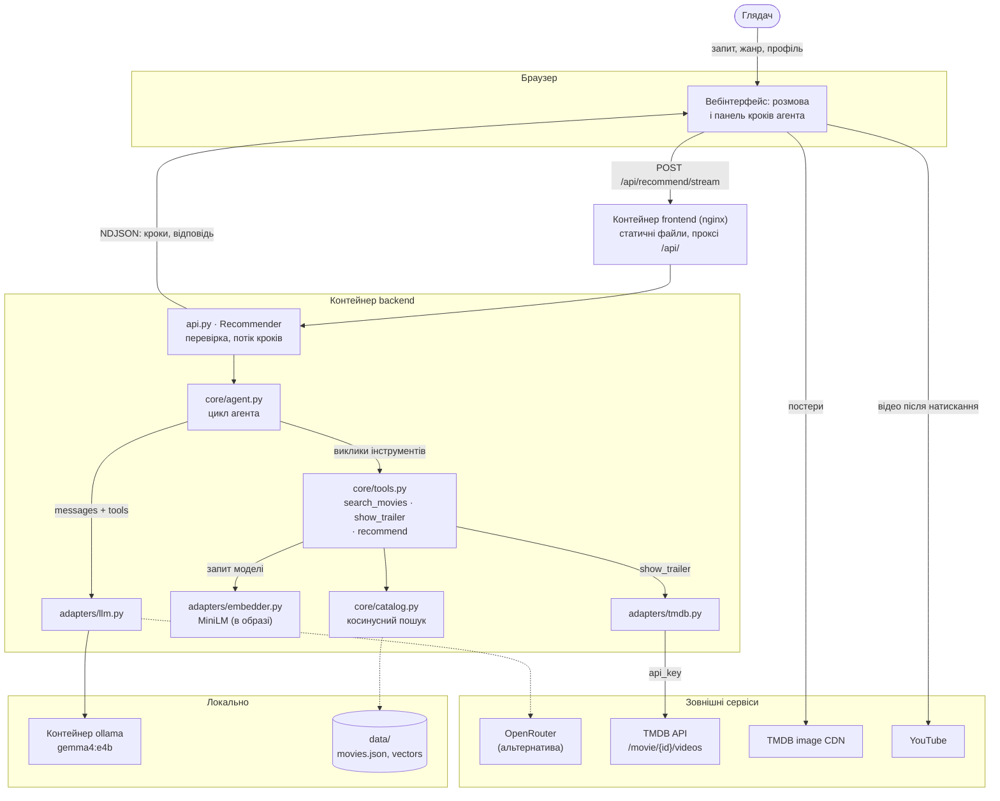
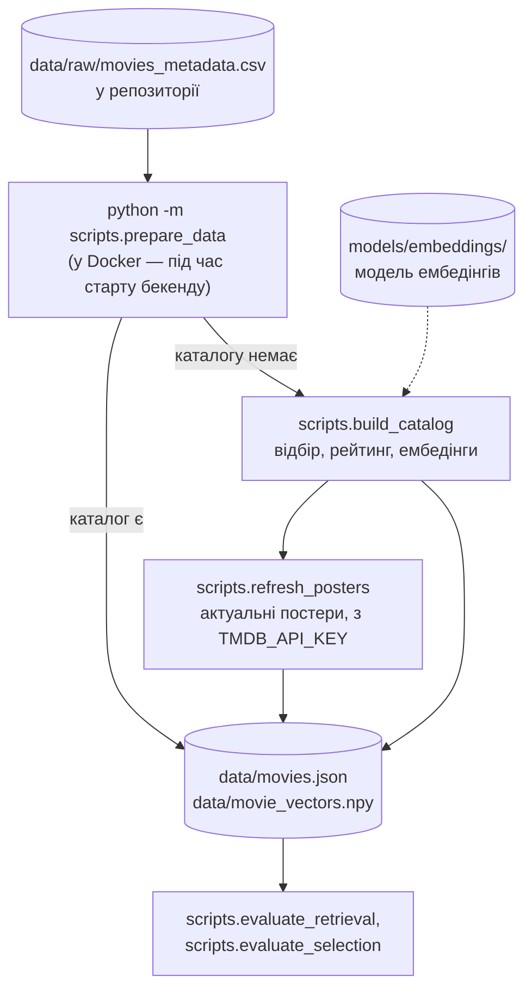
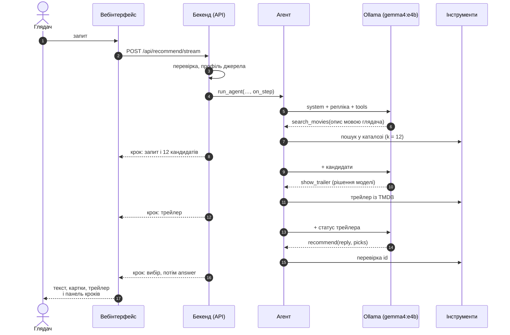

# 5. Наскрізний сценарій

Цей документ простежує одну репліку глядача через усі модулі, контейнери, локальні дані й зовнішні сервіси. Також описано зовнішні джерела й підготовку даних.

## 5.1. Повна схема

Суцільні стрілки — запити під час відповіді на репліку. Пунктирні — альтернатива (OpenRouter) і дані, завантажені під час старту бекенду. Ключі API лишаються на бекенді. Браузер звертається до CDN зображень і відео без ключів і без даних глядача.

## 5.2. Зовнішні джерела

| Джерело | Хто звертається | Коли | Ключ | Якщо недоступне |
|---|---|---|---|---|
| Ollama (контейнер `ollama`) — за замовчуванням | `adapters/llm.py` | кожна репліка, 2–3 звернення | — | 502 «Сервер моделі недоступний…»; поки ваги не завантажено, сторінка не пропонує локальну модель (`ready: false`) |
| OpenRouter (Gemma 4 26B) — альтернатива | `adapters/llm.py` | те саме, коли обрано OpenRouter | `LLM_API_KEY` | 502 з причиною (ключ, кошти, ліміт…) |
| Реєстр Ollama (ollama.com) | `ollama-init` | один раз, якщо ваг немає ні в томі, ні в кеші `models/ollama/` | — | локальна модель недоступна; OpenRouter працює |
| TMDB API `/movie/{id}/videos` | `adapters/tmdb.py` | коли модель викликає `show_trailer` | `TMDB_API_KEY` | відповідь без трейлера; без ключа інструмента немає |
| TMDB image CDN `image.tmdb.org` | браузер | показ картки фільму | — | значок 🎬 замість постера |
| YouTube `i.ytimg.com`, `youtube-nocookie.com` | браузер | мініатюра у відповіді; відео лише після натискання | — | порожня мініатюра / відео не відкривається |
| Hugging Face Hub (`Qdrant/paraphrase-multilingual-MiniLM-L12-v2-onnx-Q`) | fastembed | один раз, якщо кеш `models/embeddings/` порожній (локально або під час збирання образу) | — | без моделі не збираються ні каталог, ні образ |
| TMDB API `/movie/{id}` | `scripts/refresh_posters.py` | під час підготовки каталогу, якщо задано ключ | `TMDB_API_KEY` | лишаються шляхи до постерів із набору даних |

Дані глядача, які йдуть назовні: до LLM — текст розмови й необов'язкові вік, стать, жанр (у Docker за замовчуванням нікуди за межі комп'ютера); до TMDB API — лише TMDB id фільму.

## 5.3. Підготовка даних

Каталог не зберігається в git. `prepare_data` будує його, лише коли бракує файлів, тож повторні старти беруть готові файли з `data/` (≈ 3 хв лише під час першого запуску). Побудова детермінована: перебудований каталог збігається з попереднім до байта.

## 5.4. Від запиту до відповіді

Репліка «Пригодницький фільм про пустелю з епічними краєвидами», локальна модель:

| Кроки | Хто | Що відбувається | Де описано |
|---|---|---|---|
| 1–3 | вебінтерфейс, API | запит через nginx; перевірка схеми (422) і джерела (400) до початку потоку | [4.2](04-interface.md#42-http-api) |
| 4–6 | агент | системний промпт із контекстом і мовою; модель формулює пошук | [3.3](03-llm-and-tool-calling.md#33-цикл-агента) |
| 7–8 | інструменти, API | косинусний пошук; крок із кандидатами одразу йде в панель | [2.5](02-data-and-embeddings.md#25-семантичний-пошук) |
| 9–12 | агент, інструменти | модель вирішує показати трейлер; код шукає його на TMDB | [3.4](03-llm-and-tool-calling.md#34-інструменти) |
| 13–16 | агент, API | модель обирає; код приймає лише кандидатів; подія `answer` | [3.4](03-llm-and-tool-calling.md#заземлення-grounding) |

**Затримка.** Кодування запиту й пошук займають ≈ 22 мс ([розділ 6.5](06-evaluation.md#65-затримки)). Майже весь час відповіді — звернення до LLM: на `gemma4:e4b` із GPU ноутбука 20–50 с. Тому кроки йдуть потоком: глядач бачить роботу агента, а не порожнє очікування.

## 5.5. Межі довіри

Кожне зовнішнє значення перевіряється один раз, там, де входить у систему; далі код йому довіряє.

| Межа | Що входить | Перевірка |
|---|---|---|
| Браузер → API | запит глядача | pydantic-схеми `RecommendRequest`, `ViewerIn`; жанр — з каталогу; помилка валідації — один рядок українською |
| LLM → агент | відповідь моделі | `parse_turn`: формат відповіді; аргументи-об'єкти перетворюються на текст; помилки сервера → українські повідомлення |
| LLM → інструменти | аргументи викликів | pydantic-схеми інструментів; id — лише з останнього пошуку |
| TMDB → інструменти | відео фільму | лише YouTube, `Trailer`/`Teaser`; збій TMDB → без трейлера |
| API → браузер | текст моделі | відображається як текст, не як HTML |
| `.env` → налаштування | ключі | `SecretStr`; ключі не потрапляють у відповіді, журнали й повідомлення про помилки; `.env` не потрапляє в образи |

## 5.6. Перевірка

Цей шлях перевіряють на трьох рівнях:
- модульні тести — окремі кроки;
- API-тести — справжній HTTP-стек;
- E2E-тести — у браузері, від сторінки до агента.

LLM і TMDB у тестах замінено локальною заглушкою, тож мережі тести не потребують. Поведінку справжньої моделі вимірюють живі перевірки на стеку Docker: демо-запити (README) і оцінювання параметрів ([розділ 9](09-selection-parameters.md)). Стратегію тестування, підміни, сценарії E2E, CI й запуск описано в [розділі 10](10-testing.md).
