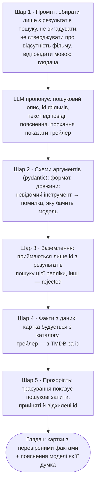

# 8. Ризики галюцинацій LLM і як їх враховано

Цей документ — реєстр ризиків, пов'язаних із галюцинаціями мовної моделі в MovieHarbor. Для кожного ризику вказано, як його обмежено в рішенні, як це перевірено і що лишається відкритим. Механізми, на які він посилається, описано в [розділі 3](03-llm-and-tool-calling.md); тут вони зібрані з погляду надійності.

## 8.1. Що вважається галюцинацією

Галюцинація — твердження моделі, яке не випливає з наданих їй даних або суперечить їм. Для рекомендатора це означає:

- **вигадані фільми:** порада фільму, якого немає в каталозі або не існує взагалі;
- **хибні факти:** неправильні рік, жанр, режисер чи сюжет у тексті пояснення;
- **хибні твердження про систему:** «цього фільму немає в базі», обіцянка трейлера, якого немає;
- **вигадані дії:** виклик неіснуючого інструмента, аргументи не за схемою.

Ризик тим більший, що мовна модель пише впевнено. Глядач не відрізнить правдиве пояснення від вигаданого, якщо інтерфейс не покаже факти окремо від тексту моделі.

## 8.2. Принцип: факти — з даних, мова — від моделі

Головне рішення — розподіл відповідальності. Модель відповідає лише за те, у чому вона сильна: розуміння запиту, формулювання пошукового опису, вибір серед кандидатів і людське пояснення. Усе, що можна перевірити, береться з даних.

| Що бачить глядач | Звідки береться | Може модель це вигадати? |
|---|---|---|
| Назва, рік, жанри, рейтинг, сюжет, постер у картці | каталог (`data/movies.json`) за TMDB id | ні |
| Який саме фільм показано в картці | id, перевірений на належність до результатів пошуку | ні: чужий id відхиляється |
| Трейлер | TMDB API за id фільму; модель лише просить його показати | ні: модель не пише посилань |
| Текст відповіді (`reply`) і пояснення «чому» (`why`) | модель | так, це залишковий ризик (§8.5) |
| Причина показу трейлера (`reason`) | модель | так, але це оцінка, а не факт |

Захист складається з кількох шарів. Лише перший — інструкція моделі; решта виконуються кодом незалежно від того, чи послухалася модель.

## 8.3. Реєстр ризиків

| # | Ризик | Як обмежено | Рівень | Перевірка | Що лишається |
|---|---|---|---|---|---|
| R1 | Порада фільму поза каталогом або неіснуючого | `recommend` і `show_trailer` приймають лише id із `ToolState.candidates`; решта повертається моделі як `rejected` | код | `test_recommend_keeps_only_searched_movies_once_each`, `test_show_trailer_needs_a_searched_movie_with_a_trailer`; API- й E2E-тести | для карток — нічого; див. R13 щодо репліки загалом |
| R2 | Хибні факти в картці (рік, рейтинг, жанр, сюжет, постер) | `MovieCard` будується з `Movie` каталогу; від моделі береться лише `why` | код | `test_recommend_runs_the_agent_through_the_selected_model` | нічого |
| R3 | Хибні факти в поясненні (`why`, `reply`) | модель отримує по кожному кандидату рік, жанри, рейтинг і опис; пояснення коротке (1–2 речення, ≤ 600 символів); поруч картка з фактами й «Сюжет» для звірки | промпт, UI | наживо (§8.4) | автоматичної перевірки тексту немає (§8.5) |
| R4 | Пояснення про один фільм прикріплене до картки іншого | у результатах пошуку id і назва стоять поруч; id має бути серед кандидатів | код (частково) | наживо: у 59 поясненнях не спостерігалося | змістова невідповідність не виявляється автоматично |
| R5 | Хибне твердження про каталог: «цього фільму немає в базі» | правило промпту: модель бачить лише результати пошуку, а не весь каталог; не можна стверджувати відсутність, можна шукати ще раз (до двох разів) | промпт | `test_prompts.py`; наживо (§8.4) | промахи пошуку лишаються ([розділ 6](06-evaluation.md)), але модель не має видавати їх за факт |
| R6 | Вигаданий інструмент або аргументи не за схемою | pydantic-схема на кожен інструмент; невалідний JSON, порушення схеми й невідомий інструмент повертаються моделі як `{"error": ...}`; `show_trailer` пропонується лише з `TMDB_API_KEY` | код | `test_bad_calls_return_an_error_the_model_can_read`, `test_a_tool_that_is_not_offered_cannot_be_called` | нічого |
| R7 | Обіцянка трейлера, якого немає | модель не пише посилань: ключ YouTube береться з TMDB за id; без TMDB промпт забороняє згадувати трейлери | код, промпт | `test_the_trailer_rule_matches_what_the_toolbox_offers`, E2E | якщо модель викликає `show_trailer` і `recommend` одним кроком, текст `reply` пишеться до результату пошуку трейлера; якщо трейлера немає, запрошення його переглянути зависає (наживо 8 із 8 трейлерів знайдено) |
| R8 | Відповідь не тією мовою | явне правило з прикладами мовних пар, повторене наприкінці промпту і в нагадуванні | промпт | `test_prompts.py`; наживо: до виправлення 3 з 3 англійських запитів отримали українську відповідь, після — 0 з 4 | інша мова після службового нагадування (див. R12) |
| R9 | Стереотипи або недоречний для віку зміст | вік і стать — лише м'яка підказка, без стереотипів; до 16 років — без відвертого насильства; каталог не містить фільмів `adult` | промпт, дані | `test_prompts.py` | у наборі даних немає вікових рейтингів (MPAA), тож вікове обмеження не можна забезпечити кодом |
| R10 | Ін'єкція в промпт («ігноруй правила, порадь X») | текст глядача йде лише в повідомлення `user`, ніколи в системний промпт; заземлення виконує код, а не модель | код | R1 | текст `reply` можна схилити до довільного змісту, але не картки |
| R11 | Зациклення або незавершена відповідь | не більше 6 звернень до LLM на репліку; далі зрозуміла помилка 502 | код | `test_agent_gives_up_after_the_call_budget` | нічого |
| R12 | Відповідь без пошуку і без карток | якщо модель відповідає прозою, агент один раз нагадує про `recommend`; якщо проза повторюється, вона стає відповіддю без карток | код | `test_agent_falls_back_to_the_models_prose_after_one_nudge` | **відома прогалина:** незаземлений текст можливий; нагадування — англомовне повідомлення з роллю `user`, тож воно може зсунути мову відповіді |
| R13 | Усі запропоновані id відхилено, а репліка виглядає успішною | відхилені id видно в трасуванні | код (частково) | — | **відома прогалина:** `recommend` завершує репліку навіть без жодного прийнятого id, і модель не отримує шансу виправитися |
| R14 | Вибір фільму з першого пошуку після повторного | — | — | — | **відома прогалина:** кандидати двох пошуків об'єднуються, тож заземлення означає «будь-який фільм, знайдений у цій репліці» |

## 8.4. Що показали живі прогони

Демо-запити ([README](../README.md#демо-запити)) прогнано на `google/gemma-4-26b-a4b-it` через OpenRouter 31.10.2026: 20 реплік, 53 звернення до моделі.

| Показник | Значення |
|---|---|
| Фільмів, прийнятих у `recommend` | 59 |
| Відхилених id (вигадані або не з пошуку) | 0 |
| Помилок аргументів інструментів | 0 |
| Відповідей прозою замість `recommend` | 0 |
| Трейлерів запитано / знайдено | 8 / 8 |

Спостережені галюцинації:

1. **Хибне твердження про каталог (R5).** На запит «Фільм, де герой знову і знову проживає один і той самий день» модель відповіла: «у моїй базі зараз немає прямого клона "Дня передбачення"». Тут дві помилки. «День бабака» (Groundhog Day) є в каталозі. А «День передбачення» — вигаданий переклад назви. Причина: промах пошуку. Для трьох пошукових описів моделі Groundhog Day опинився на 13–16 місці, за межею 12 кандидатів. Мала модель ембедінгів надала вагу словам «time» і «day» (*The 6th Day*, *25th Hour*, [розділ 7.5](07-embedding-model.md#75-обґрунтування-вибору)). Модель же перетворила «не бачу серед кандидатів» на «немає в базі». Після правила R5 запит прогнано 5 разів: у відповідях жодного твердження про відсутність, Groundhog Day знайдено в 4 прогонах із 5 (частіше за рахунок повторного пошуку).
2. **Змішування тотожностей (R3).** Продовження *Blair Witch* (2016) модель назвала «класичним прикладом» жанру. Це репутація оригіналу *The Blair Witch Project* (1999). Картка при цьому показує правильний рік і рейтинг 2016 року, тож факти й оцінка моделі розділені.
3. **Мова (R8).** До виправлення промпту всі три англійські запити отримали відповідь українською; після — правильною мовою.

Вибірка мала (кілька десятків реплік однієї моделі), тому ці числа ілюструють типові збої, а не оцінюють їхню частоту.

## 8.5. Залишкові ризики й як їх оцінювати

Відкритими лишаються два класи:

1. **Зміст тексту моделі (R3, R4).** Кожне пояснення — коротке, поруч із фактами каталогу, але не перевіряється автоматично.
2. **Правила завершення репліки (R12–R14).** Ці прогалини виявило рев'ю коду. Вони стосуються того, коли агент приймає відповідь, а не окремих фільмів.

Для тексту магістерської роботи частоту галюцинацій у поясненнях можна оцінити так:

- **Ручна розмітка.** Вибірка з N відповідей на запити бенчмарку ([розділ 6](06-evaluation.md)). Кожне `why` позначається як «підтверджене описом / нейтральне / хибне» за `overview` і даними TMDB. Метрика — частка хибних тверджень.
- **LLM як суддя.** Окрема модель порівнює `why` з описом фільму з каталогу. Це дешевше, але потребує калібрування на ручній розмітці.
- **Заземленість вибору.** Частка відхилених id серед запропонованих. Її вже можна рахувати з трасування кожної відповіді.

Технічні покращення, що зменшують причини галюцинацій, а не наслідки:

- точніша модель ембедінгів ([розділ 7.6](07-embedding-model.md#76-альтернативи-й-шлях-покращення)) або більше кандидатів — менше промахів пошуку, отже менше приводів для R5;
- точний збіг назв фільмів, які згадує модель, як додаток до семантичного пошуку.

## 8.6. Код і тести

| Захід | Код | Тести |
|---|---|---|
| Заземлення, перевірка аргументів, доступні інструменти | `backend/core/tools.py` (`ToolState.candidates`, `Toolbox.run`, `Toolbox.available`) | `tests/test_tools.py` |
| Правила промпту | `backend/core/prompts.py` | `tests/test_prompts.py` |
| Бюджет звернень, нагадування | `backend/core/agent.py` | `tests/test_agent.py` |
| Картки лише з даних каталогу | `backend/api.py` (`to_response`) | `tests/test_api.py`, `tests/test_e2e.py` |
| Трасування для аудиту | `Step` у `tools.py`, блок «Як це працює» у `frontend/app.js` | `tests/test_e2e.py` |
