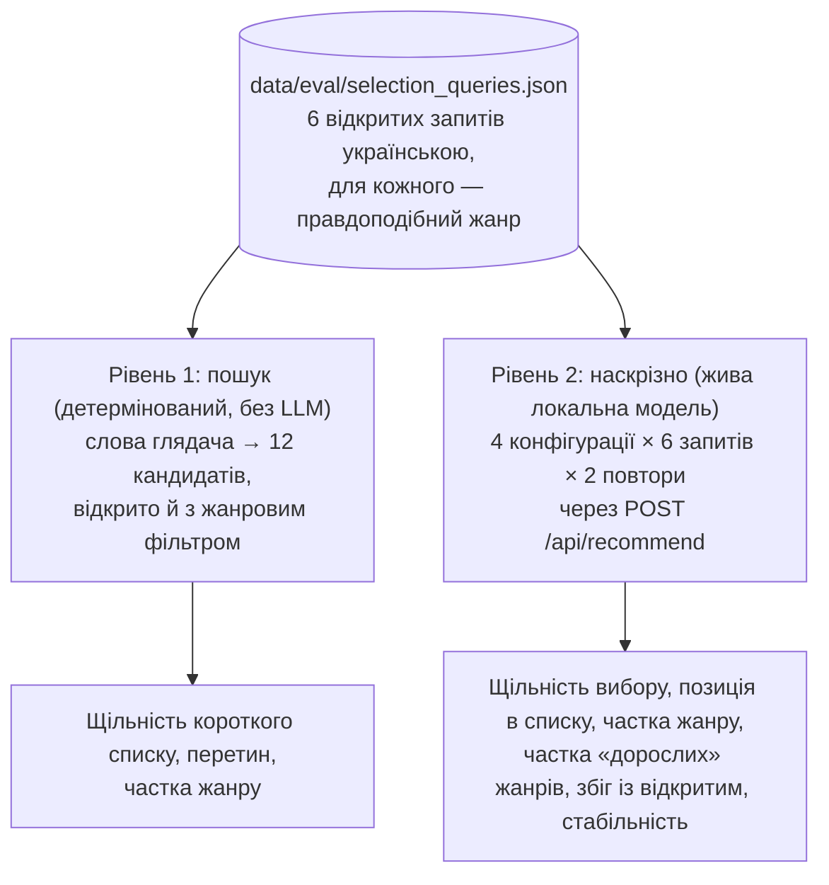

# 9. Вплив параметрів глядача на вибір

Цей документ оцінює, як параметри, які глядач задає в інтерфейсі, змінюють добірку фільмів порівняно з тим самим запитом без параметрів. Таких параметрів два: жанр — жорсткий фільтр пошуку в коді, і вік — м'яка підказка моделі в промпті. Методику описано так, щоб її можна було відтворити й цитувати; числа отримано командою з §9.6.

## 9.1. Питання дослідження

1. **Ціна жанрового фільтра для пошуку.** Наскільки менш схожими на запит стають кандидати, коли пошук обмежено жанром, і наскільки інший короткий список це дає?
2. **Вплив параметрів на остаточний вибір.** Як жанр і вік змінюють фільми, які обирає модель: їхню схожість на запит, частку цільового жанру, частку «дорослих» жанрів, позицію в короткому списку, збіг із вибором без параметрів?
3. **Стабільність.** Наскільки відтворюваний вибір моделі за однакових умов?

## 9.2. Дизайн експерименту



**Запити.** Шість відкритих запитів українською, сформульованих без назв фільмів, щоб вибір визначав зміст, а не відомість назви. Для кожного обрано жанр, який глядач правдоподібно поставив би у фільтрі (`Comedy`, `Animation`, `Adventure`, `Mystery`, `Science Fiction`, `Horror`).

**Конфігурації рівня 2.**

| Конфігурація | Жанр | Вік | Що перевіряє |
|---|---|---|---|
| `open` | — | — | базова лінія: запит без параметрів |
| `genre` | жанр запиту | — | жорсткий фільтр пошуку |
| `age 10` | — | 10 | м'яку підказку в промпті («до 16 — без відвертого насильства») |
| `genre + age 10` | жанр запиту | 10 | взаємодію фільтра й підказки, зокрема конфлікт `Horror` + 10 років |

**Умови.** Стек Docker Compose, локальна модель `gemma4:e4b` в Ollama на GPU, температура 0,7 (як у звичайній роботі), кожна репліка — нова розмова. Модель недетермінована, тому кожну комбінацію повторено двічі.

## 9.3. Метрики

Нехай *u* — одиничний вектор слів глядача (та сама модель ембедінгів, що й у каталозі), *v*<sub>f</sub> — вектор фільму *f*. Усі вектори одиничні, тож косинусна подібність — скалярний добуток.

| Метрика | Визначення | Що показує |
|---|---|---|
| Щільність короткого списку | середнє cos(*u*, *v*<sub>f</sub>) за 12 кандидатами | наскільки кандидати близькі до слів глядача |
| Щільність вибору | середнє cos(*u*, *v*<sub>f</sub>) за обраними фільмами; також сума | наскільки близький до слів глядача остаточний вибір (сума враховує й кількість фільмів) |
| Щільність запиту моделі | середня подібність кандидатів до пошукового запиту, який написала модель (з трасування) | наскільки щільно пошук зібрав кандидатів довкола формулювання моделі |
| Позиція вибору | середня позиція обраних фільмів у короткому списку, ранжованому за подібністю (1 — найближчий) | чи обирає модель найближчих, чи переранжовує |
| Частка жанру | частка обраних фільмів із цільовим жанром | дотримання жанру |
| Частка «дорослих» жанрів | частка обраних фільмів із жанром `Horror`, `Thriller`, `Crime` або `War` | реакцію на вікову підказку |
| Збіг із відкритим | коефіцієнт Жаккара між вибором у конфігурації та вибором `open` для того самого запиту й повтору | наскільки параметр змінює добірку |
| Стабільність | коефіцієнт Жаккара між двома повторами однієї конфігурації | відтворюваність вибору моделі |
| Частка трейлерів | частка реплік, у яких модель викликала `show_trailer` | використання третього інструмента |

Щільність рахується відносно **слів глядача**, а не пошукового запиту моделі: так метрика однакова для всіх конфігурацій і не залежить від того, як модель переформулювала прохання.

## 9.4. Результати

### Рівень 1: пошук

12 кандидатів для слів глядача без фільтра і з жанровим фільтром.

| Запит | Жанр | щільність відкрито | щільність з жанром | Δ | перетин | частка жанру: відкрито → з жанром |
|---|---|---|---|---|---|---|
| Щось на вечір з друзями, щоб посміятися й подумати | Comedy | 0,495 | 0,494 | −0,002 | 0,846 | 0,92 → 1,00 |
| Фільм про дружбу, яка долає всі випробування | Animation | 0,511 | 0,405 | −0,106 | 0,000 | 0,00 → 1,00 |
| Історія про виживання в дикій природі | Adventure | 0,533 | 0,505 | −0,028 | 0,263 | 0,42 → 1,00 |
| Напружена історія про таємницю, яку треба розгадати | Mystery | 0,586 | 0,580 | −0,006 | 0,500 | 0,67 → 1,00 |
| Фільм про космос і людську самотність | Science Fiction | 0,565 | 0,556 | −0,009 | 0,500 | 0,67 → 1,00 |
| Щось темне й атмосферне на ніч | Horror | 0,470 | 0,431 | −0,038 | 0,263 | 0,42 → 1,00 |

**Висновки.**

- Фільтр гарантує жанр (частка 1,00), а ціна за це залежить від того, чи збігається жанр з природою запиту.
- Коли запит і так тяжіє до жанру (комедія, детектив, фантастика), щільність майже не падає (−0,002…−0,009), а короткий список здебільшого той самий (перетин 0,50–0,85).
- Коли жанр задає інший ракурс («дружба» → анімація), фільтр будує зовсім інший список (перетин 0) і помітно менш близький до слів глядача (−0,106). Це жанр фільмів, яких без фільтра пошук не пропонував би.

### Рівень 2: наскрізно

Прогін 31.10.2026: 4 конфігурації × 6 запитів × 2 повтори = 48 реплік, усі завершилися прийнятим `recommend` (2–4 звернення до LLM, 2–4 фільми). Сирі дані — `data/eval/selection_run.json`.

**Щільність і позиція вибору** (середнє за 12 репліками конфігурації):

| Конфігурація | Щільність вибору | Сума | Щільність списку | Щільність запиту моделі | Позиція вибору |
|---|---|---|---|---|---|
| `open` | 0,519 | 1,597 | 0,504 | 0,546 | 4,9 |
| `genre` | 0,509 | 1,558 | 0,480 | 0,528 | 4,7 |
| `age 10` | 0,522 | 1,567 | 0,505 | 0,544 | 4,5 |
| `genre + age 10` | 0,496 | 1,443 | 0,484 | 0,513 | 5,5 |

**Склад вибору:**

| Конфігурація | Частка жанру | Частка «дорослих» | Збіг із відкритим | Стабільність | Частка трейлерів | Час, с |
|---|---|---|---|---|---|---|
| `open` | 0,65 | 0,54 | 1,00 | 0,66 | 1,00 | 33 |
| `genre` | 1,00 | 0,39 | 0,29 | 0,82 | 1,00 | 33 |
| `age 10` | 0,58 | 0,47 | 0,65 | 0,75 | 0,92 | 33 |
| `genre + age 10` | 1,00 | 0,33 | 0,10 | 0,34 | 0,92 | 39 |

**Висновки.**

1. **Модель переранжовує кандидатів.** Щільність вибору в усіх конфігураціях трохи вища за щільність короткого списку (+0,012…+0,029). Водночас середня позиція обраних фільмів — 4,5–5,5 з 12, і лише 43 % обраних належать до трійки найближчих. Модель не бере просто найближчих за подібністю: вона зважує прохання цілком. Те саме видно в панелі «Хід роботи агента» ([розділ 4](04-interface.md)).
2. **Жанр змінює, які саме фільми, майже не віддаляючи їх від прохання.** Частка жанру зростає з 0,65 до 1,00, а середня щільність вибору падає лише на 0,010. Добірка при цьому інша (збіг із відкритою — 0,29). Це повторює висновок рівня 1.
3. **Вікова підказка діє слабо й нерівно.** Для 10 років частка «дорослих» жанрів падає лише з 0,54 до 0,47. Модель майже ніколи не переносить вік у пошуковий запит: у 24 з 48 реплік її запит дослівно повторює слова глядача. Тож підказка може діяти лише на вибір серед тих самих кандидатів. Для «виживання в дикій природі» це спрацювало (The Descent і The Thing зникли з вибору). Для детективу (Shutter Island, The Secret in Their Eyes) і «темного й атмосферного» (The Mist) — ні.
4. **Фільтр і підказка разом дають найменш передбачуваний вибір.** У конфігурації `genre + age 10` частка «дорослих» жанрів найнижча (0,33), але й стабільність (0,34) та збіг із відкритим (0,10) найнижчі. Конфлікт жорсткого фільтра з м'якою підказкою модель щоразу розв'язує інакше:
   - `Mystery` + 10: в одному повторі модель дописала в запит «нестрашний»;
   - `Horror` + 10: в одному повторі вона обрала хорор-комедії (What We Do in the Shadows, Army of Darkness), в іншому — Paranormal Activity і Blair Witch.
5. **Трейлер модель викликала в 46 з 48 реплік.** Усі шість запитів — про настрій чи атмосферу, тобто про саму умову кроку 3 промпту ([розділ 3.6](03-llm-and-tool-calling.md#36-промпт)). Цей бенчмарк не перевіряє, чи пропускає модель трейлер там, де він недоречний.

**Наслідок для системи.** Жанр надійно забезпечує код, а вікову придатність промпт малої моделі не забезпечує. Надійним заходом був би жорсткий фільтр за віковим рейтингом, але такого рейтингу в наборі даних немає (§9.5, ризик R9 у [розділі 8](08-hallucinations.md)).

## 9.5. Обмеження

- **Малий бенчмарк.** 6 запитів × 2 повтори дають оцінку напрямку ефектів, а не точні величини.
- **Жанр як наближення.** Частки жанрів відображають метадані TMDB, а не зміст фільму. Частка «дорослих» жанрів — грубе наближення до вікової придатності; вікових рейтингів (MPAA) у наборі даних немає. Дорослих комедій це наближення не помічає: The Hangover у конфігурації `genre + age 10` має лише жанр `Comedy`.
- **Одна модель.** Результати рівня 2 стосуються `gemma4:e4b`. Інша модель, наприклад Gemma 4 26B через OpenRouter, може реагувати на вікову підказку інакше.
- **Щільність — не якість.** Висока подібність до слів глядача не гарантує доречного вибору: модель свідомо переранжовує кандидатів. Тому щільність читається разом із позицією вибору й частками жанрів.

## 9.6. Відтворення

```bash
docker compose -f compose.yaml -f compose.gpu.yaml up -d --build   # стек із локальною моделлю
python -m scripts.evaluate_selection --retrieval-only               # рівень 1, секунди
python -m scripts.evaluate_selection                                # рівні 1 і 2, ≈ 30 хв на GPU (RTX 4060)
```

Скрипт друкує таблиці цього розділу й зберігає всі репліки (запити моделі, кандидати, вибір, інструменти, час) у `data/eval/selection_run.json`. Рівень 1 детермінований; рівень 2 варіюється від прогону до прогону.
