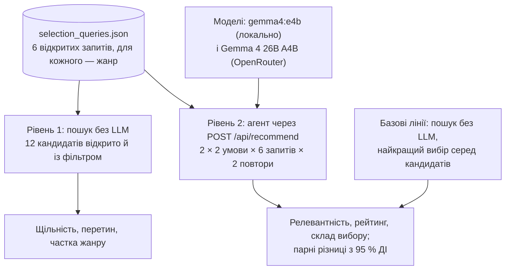

# 9. Вплив параметрів глядача на вибір: експериментальне оцінювання

**Анотація.** Розділ оцінює, як два параметри глядача змінюють добірку агента порівняно з тим самим запитом без параметрів:
- **жанр** — жорсткий фільтр пошуку в коді;
- **вік** — м'яка підказка моделі в промпті.

**Дизайн.** Факторний експеримент 2 × 2 (жанр × вік) на шести відкритих запитах із двома повторами. Його виконано для двох моделей: малої локальної `gemma4:e4b` і Gemma 4 26B A4B через OpenRouter. Якість добірки оцінено за двома осями:
- **релевантність** — косинусна близькість до слів глядача;
- **рейтинг** — сума й середнє зважених рейтингів обраних фільмів.

Порівняння йде з базовими лініями «пошук без LLM» і «найкращий вибір серед кандидатів».

**Результати:**
1. Агент обирає фільми з вищим рейтингом, ніж чистий семантичний пошук. Для 26B — в усіх умовах: +1,57 бала суми рейтингів на репліку, 95 % ДІ [1,22; 1,89]. Для малої моделі — лише з жанровим фільтром.
2. Жанровий фільтр гарантує цільовий жанр і не знижує рейтинг вибору.
3. Вікова підказка на малій моделі майже не діє. На 26B вона зсуває вибір до сімейних фільмів ціною нижчого рейтингу: −0,30 бала на фільм [−0,48; −0,13].
4. Вищий рейтинг супроводжується зсувом до популярніших фільмів.

## 9.1. Мета, дослідницькі питання й гіпотези

Мета — кількісно описати, як параметри глядача і сама LLM змінюють вибір системи, і на цій основі визначити сильні й слабкі сторони архітектури «семантичний пошук + LLM-агент» ([розділ 1](01-overview.md)).

| | Дослідницьке питання | Очікування |
|---|---|---|
| RQ1 | Яка ціна жанрового фільтра для пошуку? | H1: фільтр знижує щільність кандидатів тим більше, чим менше жанр відповідає змісту запиту |
| RQ2 | Як параметри змінюють релевантність і склад вибору? | H2a: фільтр гарантує цільовий жанр; H2b: вікова підказка знижує частку «дорослих» жанрів |
| RQ3 | Як параметри змінюють рейтинг вибору? | H3a: фільтр не знижує рейтинг; H3b: вікова підказка знижує рейтинг, бо зсуває вибір до сімейних фільмів |
| RQ4 | Чи додає LLM цінності порівняно з чистим семантичним пошуком? | H4: агент обирає фільми з вищим рейтингом, ніж перші результати пошуку за тими самими словами |
| RQ5 | Яка ціна цієї переваги? | H5: перевага за рейтингом супроводжується зсувом до популярних фільмів |
| RQ6 | Чи залежать відповіді від розміру моделі? | розвідувальне питання, без гіпотези |

## 9.2. Дизайн експерименту



**Тип експерименту.** Факторний експеримент 2 × 2 із повторними вимірюваннями: кожен запит проходить усі чотири умови.
- Фактори: жанровий фільтр (немає / жанр запиту) і вікова підказка (немає / 10 років).
- Запит — блоковий фактор.
- Модель — фактор на рівні серії: дві окремі серії по 48 реплік.

Вимірювання має два рівні:
- **Рівень 1** детермінований: він ізолює пошук без LLM.
- **Рівень 2** вимірює систему цілком, від запиту до вибору агента.

**Запити.** Шість відкритих запитів українською. Вони сформульовані без назв фільмів, щоб вибір визначав зміст, а не впізнаваність назви. Для кожного обрано жанр, який глядач правдоподібно поставив би у фільтрі.

| Запит | Жанр |
|---|---|
| Щось на вечір з друзями, щоб посміятися й подумати | `Comedy` |
| Фільм про дружбу, яка долає всі випробування | `Animation` |
| Історія про виживання в дикій природі | `Adventure` |
| Напружена історія про таємницю, яку треба розгадати | `Mystery` |
| Фільм про космос і людську самотність | `Science Fiction` |
| Щось темне й атмосферне на ніч | `Horror` |

**Умови.**

| Умова | Жанр | Вік | Що перевіряє |
|---|---|---|---|
| `open` | — | — | контроль: запит без параметрів |
| `genre` | жанр запиту | — | жорсткий фільтр пошуку |
| `age 10` | — | 10 | м'яку підказку в промпті («до 16 — без відвертого насильства») |
| `genre + age 10` | жанр запиту | 10 | взаємодію фільтра й підказки, зокрема конфлікт `Horror` + 10 років |

**Контрольовані умови.** Усі серії мали:
- той самий каталог (2 274 фільми), промпт, схеми інструментів і стек Docker;
- температуру 0,7 і ліміт 1 500 токенів, як у звичайній роботі;
- нову розмову для кожної репліки.

Локальна модель працювала на GPU ноутбука (RTX 4060). Обидві серії прогнано 31.10.2026.

**Базові лінії.**
- **Пошук без LLM:** перші *n* фільмів семантичного пошуку за словами глядача, з тим самим жанровим фільтром; *n* — скільки фільмів обрав агент. Так виглядала б система без LLM.
- **Найкращий вибір серед кандидатів:** *n* фільмів із найвищим рейтингом серед 12 кандидатів, яких бачив агент. Це верхня межа суми рейтингів за даного пошуку.
- **Випадковий вибір із кандидатів:** його очікуваний рейтинг дорівнює середньому рейтингу кандидатів.
- **Каталог:** середній рейтинг 6,16, стандартне відхилення 0,66.

## 9.3. Метрики

**Позначення:**

| Символ | Значення |
|---|---|
| $u$ | одиничний вектор слів глядача (та сама модель ембедінгів, що й у каталозі) |
| $x_f$ | вектор фільму $f$ |
| $C$ | 12 кандидатів останнього пошуку агента |
| $P \subseteq C$ | обрані фільми, $n = \lvert P \rvert$ |
| $r_f$ | рейтинг фільму |
| $v_f$ | кількість голосів |

**Рейтинг.** Рейтинг $r_f$ — зважене середнє за формулою, яку IMDb використовує для списку Top 250 [1], застосованою до голосів TMDB:

$$r_f = \frac{v_f R_f + m\,C_0}{v_f + m}, \qquad m = 434,\; C_0 = 5{,}0$$

Тут $R_f$ — середня оцінка TMDB, $m$ — 95-й перцентиль кількості голосів, $C_0$ — апріорний рейтинг ([розділ 2](02-data-and-embeddings.md)). Саме цей рейтинг показує картка фільму (★). Власних оцінок IMDb у наборі даних немає.

**Релевантність.**

| Метрика | Визначення | Що показує |
|---|---|---|
| Щільність вибору | $\frac{1}{n}\sum_{f \in P} \cos(u, x_f)$ | близькість вибору до слів глядача |
| Щільність списку | те саме для $C$ | близькість кандидатів до слів глядача |
| Щільність запиту моделі | середня подібність кандидатів до пошукового запиту моделі (з трасування) | наскільки щільно пошук зібрав кандидатів довкола формулювання моделі |
| Позиція вибору | середня позиція обраних фільмів у $C$ за подібністю (1 — найближчий) | чи переранжовує модель кандидатів |
| Частка з трійки | частка обраних фільмів серед трьох найближчих кандидатів | те саме, з іншого боку |
| Копіювання запиту | частка реплік, у яких запит моделі дослівно повторює слова глядача | чи формулює модель опис фільму |

**Рейтинг вибору.**

| Метрика | Визначення | Що показує |
|---|---|---|
| Σ-рейтинг | $S(P) = \sum_{f \in P} r_f$ | сумарна якість запропонованого — запропонована міра ефективності агента |
| Середній рейтинг | $S(P)/n$ | якість одного фільму, незалежно від кількості |
| Підйом над кандидатами | $S(P)/n - \bar r(C)$ | перевага над випадковим вибором із тих самих кандидатів |
| Ефективність | $S(P) \,/\, \max_{Q \subseteq C,\ \lvert Q \rvert = n} S(Q)$ | частка найкращої суми, яку дозволяли кандидати |
| Перевага над пошуком | $S(P) - S(T_n)$, де $T_n$ — перші $n$ результатів пошуку без LLM | що додає LLM до семантичного пошуку |
| Зсув популярності | $\overline{\log_{10} v}(P) - \overline{\log_{10} v}(C)$ | чи обирає модель відоміші фільми, ніж пропонує пошук |

**Склад і стабільність.**

| Метрика | Визначення |
|---|---|
| Частка жанру | частка обраних фільмів із цільовим жанром |
| Частка «дорослих» жанрів | частка обраних фільмів із жанром `Horror`, `Thriller`, `Crime` або `War` (наближення вікової придатності) |
| Збіг із відкритим | коефіцієнт Жаккара між вибором в умові й вибором `open` для того самого запиту й повтору |
| Стабільність | коефіцієнт Жаккара між двома повторами однієї умови |
| Частка трейлерів | частка реплік із викликом `show_trailer` |

**Чому однієї суми мало.** $S(P) = n \cdot S(P)/n$: сума змішує кількість і якість. Агент сам обирає 2–4 фільми. Один фільм більше чи менше змінює суму приблизно на 6 балів, а це більше за будь-який ефект параметрів. Тому поруч із сумою наведено $n$ і середній рейтинг, а порівняння з пошуком і з найкращим вибором зроблено для того самого $n$.

## 9.4. Статистичний аналіз

- **Одиниця аналізу — репліка.**
  - Умови порівнюються парно: умова й `open` для того самого запиту й повтору, по 12 пар на умову.
  - Агент і пошук без LLM порівнюються в межах кожної репліки.
- **Оцінка й невизначеність.** Оцінка — середня парна різниця. Невизначеність — 95 % перцентильний бутстреп-інтервал (ДІ) [2]: 10 000 вибірок із поверненням, фіксоване зерно (`paired_ci` у `scripts/evaluate_selection.py`).
- **Критерій ефекту.** Ефект вважається виявленим, якщо інтервал не містить нуля. Поправки на множинні порівняння немає: аналіз розвідувальний (§9.8).
- **Порівняння моделей** — описове: серії мають однаковий дизайн, але формальної перевірки різниці між моделями не зроблено.

## 9.5. Результати

### 9.5.1. Рівень 1: ціна жанрового фільтра для пошуку (RQ1)

12 кандидатів для слів глядача без фільтра і з фільтром.

| Запит | Жанр | Щільність відкрито | Щільність із жанром | Δ | Перетин | Частка жанру: відкрито → з жанром |
|---|---|---|---|---|---|---|
| Щось на вечір з друзями, щоб посміятися й подумати | Comedy | 0,495 | 0,494 | −0,002 | 0,846 | 0,92 → 1,00 |
| Фільм про дружбу, яка долає всі випробування | Animation | 0,511 | 0,405 | −0,106 | 0,000 | 0,00 → 1,00 |
| Історія про виживання в дикій природі | Adventure | 0,533 | 0,505 | −0,028 | 0,263 | 0,42 → 1,00 |
| Напружена історія про таємницю, яку треба розгадати | Mystery | 0,586 | 0,580 | −0,006 | 0,500 | 0,67 → 1,00 |
| Фільм про космос і людську самотність | Science Fiction | 0,565 | 0,556 | −0,009 | 0,500 | 0,67 → 1,00 |
| Щось темне й атмосферне на ніч | Horror | 0,470 | 0,431 | −0,038 | 0,263 | 0,42 → 1,00 |

- Коли запит і так тяжіє до жанру (комедія, детектив, фантастика), щільність майже не падає (−0,002…−0,009), а список здебільшого той самий (перетин 0,50–0,85).
- Коли жанр задає інший ракурс («дружба» → анімація), фільтр будує зовсім інший список (перетин 0) і помітно менш близький до слів глядача (−0,106).

### 9.5.2. Релевантність і склад вибору (RQ2)

Усі 96 реплік (2 моделі × 48) завершилися прийнятим `recommend`. Середні значення по 12 репліках кожної умови:

**`gemma4:e4b` (локально):**

| Умова | Щільність вибору | Щільність списку | Позиція вибору | Частка з трійки | Копіювання запиту | Частка жанру | Частка «дорослих» | Збіг із відкритим | Стабільність |
|---|---|---|---|---|---|---|---|---|---|
| `open` | 0,519 | 0,504 | 4,9 | 0,46 | 0,67 | 0,65 | 0,53 | 1,00 | 0,66 |
| `genre` | 0,509 | 0,480 | 4,7 | 0,44 | 0,33 | 1,00 | 0,39 | 0,29 | 0,82 |
| `age 10` | 0,522 | 0,505 | 4,5 | 0,47 | 0,67 | 0,58 | 0,47 | 0,65 | 0,75 |
| `genre + age 10` | 0,496 | 0,484 | 5,5 | 0,35 | 0,33 | 1,00 | 0,33 | 0,10 | 0,34 |

**Gemma 4 26B A4B (OpenRouter):**

| Умова | Щільність вибору | Щільність списку | Позиція вибору | Частка з трійки | Копіювання запиту | Частка жанру | Частка «дорослих» | Збіг із відкритим | Стабільність |
|---|---|---|---|---|---|---|---|---|---|
| `open` | 0,497 | 0,468 | 5,6 | 0,36 | 0,00 | 0,67 | 0,33 | 1,00 | 0,83 |
| `genre` | 0,438 | 0,427 | 7,2 | 0,19 | 0,00 | 1,00 | 0,42 | 0,29 | 0,75 |
| `age 10` | 0,485 | 0,447 | 5,5 | 0,39 | 0,00 | 0,75 | 0,36 | 0,38 | 0,38 |
| `genre + age 10` | 0,453 | 0,438 | 6,4 | 0,19 | 0,00 | 1,00 | 0,36 | 0,23 | 0,53 |

- **Модель переранжовує кандидатів, не втрачаючи релевантності.** В усіх умовах обох моделей щільність вибору вища за щільність списку. Водночас середня позиція обраних — 4,5–7,2 з 12.
- **26B переранжовує глибше.** Вона ніколи не копіює слова глядача в запит і бере з трійки найближчих лише 19–39 % вибору. Мала модель копіює запит у третині чи двох третинах реплік.
- **Жанровий фільтр гарантує жанр** (1,00 в обох моделях) і сильно змінює добірку: збіг із відкритою — 0,29.
- **Вікова підказка на малій моделі майже не змінює вибору.** Збіг із відкритим — 0,65, частка «дорослих» жанрів 0,53 → 0,47.
- **26B на вікову підказку реагує:** збіг із відкритим лише 0,38. Наприклад, для «виживання в дикій природі» замість Into the Wild і Apocalypto з'являються The Jungle Book, Life of Pi й Epic. Частка «дорослих» жанрів при цьому не падає (0,33 → 0,36): детективні запити лишаються в жанрах Thriller і Crime (Vertigo, The Secret in Their Eyes).
- **Фільтр і підказка разом дають найменш стабільний вибір** на малій моделі (0,34). Підказка без фільтра — на 26B (0,38).

### 9.5.3. Рейтинг вибору (RQ3, RQ4, RQ5)

Середні значення по 12 репліках умови; *n* — середня кількість обраних фільмів.

**`gemma4:e4b` (локально):**

| Умова | *n* | Σ-рейтинг | Середній рейтинг | Підйом над кандидатами | Ефективність |
|---|---|---|---|---|---|
| `open` | 3,08 | 19,47 | 6,32 | +0,29 | 0,94 |
| `genre` | 3,08 | 20,41 | 6,61 | +0,56 | 0,97 |
| `age 10` | 3,00 | 19,10 | 6,37 | +0,36 | 0,94 |
| `genre + age 10` | 2,92 | 18,46 | 6,31 | +0,22 | 0,92 |

| Умова | Σ − пошук без LLM | Σ − `open` | Середній − `open` | Зсув популярності |
|---|---|---|---|---|
| `open` | +0,37 [−0,23; +0,89] | — | — | +0,02 [−0,05; +0,09] |
| `genre` | **+1,64 [+1,37; +1,92]** | +0,94 [−0,84; +2,80] | **+0,29 [+0,13; +0,46]** | **+0,13 [+0,05; +0,20]** |
| `age 10` | +0,53 [−0,12; +1,09] | −0,38 [−1,43; +0,27] | +0,05 [−0,02; +0,12] | +0,03 [−0,04; +0,10] |
| `genre + age 10` | **+0,78 [+0,11; +1,44]** | −1,02 [−2,92; +0,59] | −0,01 [−0,29; +0,26] | **+0,08 [+0,00; +0,15]** |

**Gemma 4 26B A4B (OpenRouter):**

| Умова | *n* | Σ-рейтинг | Середній рейтинг | Підйом над кандидатами | Ефективність |
|---|---|---|---|---|---|
| `open` | 3,00 | 20,14 | 6,71 | +0,49 | 0,96 |
| `genre` | 3,00 | 20,21 | 6,74 | +0,57 | 0,97 |
| `age 10` | 2,92 | 18,69 | 6,41 | +0,19 | 0,93 |
| `genre + age 10` | 3,00 | 19,61 | 6,54 | +0,38 | 0,95 |

| Умова | Σ − пошук без LLM | Σ − `open` | Середній − `open` | Зсув популярності |
|---|---|---|---|---|
| `open` | **+1,57 [+1,22; +1,89]** | — | — | **+0,10 [+0,04; +0,16]** |
| `genre` | **+2,01 [+1,40; +2,61]** | +0,08 [−0,72; +0,82] | +0,03 [−0,24; +0,27] | **+0,20 [+0,09; +0,30]** |
| `age 10` | **+0,59 [+0,05; +1,14]** | **−1,45 [−2,66; −0,56]** | **−0,30 [−0,48; −0,13]** | +0,02 [−0,03; +0,08] |
| `genre + age 10` | **+1,41 [+0,85; +1,96]** | −0,53 [−1,25; +0,10] | −0,18 [−0,42; +0,03] | **+0,10 [+0,01; +0,18]** |

Середнє й 95 % ДІ; жирним — інтервали, що не містять нуля.

- **Агент обирає майже найкращі фільми, які дозволяв пошук.** Ефективність — 0,92–0,97. Середній рейтинг вибору (6,31–6,74) вищий за середнє каталогу (6,16) і за середнє кандидатів (підйом +0,19…+0,57).
- **Перевага над пошуком без LLM залежить від моделі.** У 26B вона виявлена в усіх чотирьох умовах. У малої моделі — лише з жанровим фільтром; у відкритій умові інтервал містить нуль.
- **Сума рейтингів між умовами майже ніколи не розрізняється надійно.** Інтервали Σ − `open` широкі через різну кількість фільмів. Різницю показує середній рейтинг:
  - жанр підвищує його на малій моделі (+0,29) і не змінює на 26B;
  - вікова підказка знижує його на 26B (−0,30) і не змінює на малій моделі.
- **Зсув популярності додатний скрізь, де виявлений:** модель обирає фільми з більшою кількістю голосів, ніж у середньому серед кандидатів. Найсильніший зсув — із жанровим фільтром: +0,20 log₁₀ голосів у 26B, тобто приблизно в 1,6 раза більше голосів.

### 9.5.4. Порівняння моделей (RQ6)

| Показник | `gemma4:e4b` | Gemma 4 26B A4B |
|---|---|---|
| Середній рейтинг вибору, `open` | 6,32 | 6,71 |
| Перевага над пошуком, Σ, `open` | +0,37 [−0,23; +0,89] | +1,57 [+1,22; +1,89] |
| Копіювання запиту (усі умови) | 24 з 48 реплік | 0 з 48 |
| Частка з трійки найближчих, `open` | 0,46 | 0,36 |
| Стабільність, `open` | 0,66 | 0,83 |
| Частка трейлерів (усі умови) | 46 з 48 | 48 з 48 |
| Медіана часу репліки, `open` | 33 с | 7 с |

Більша модель формулює власний опис фільму замість слів глядача, глибше переранжовує кандидатів і обирає фільми з вищим рейтингом. Вона також стабільніша й у п'ять разів швидша: виконання в хмарі проти GPU ноутбука.

## 9.6. Перевірка гіпотез

| Гіпотеза | `gemma4:e4b` | Gemma 4 26B A4B |
|---|---|---|
| H1: фільтр знижує щільність кандидатів залежно від запиту | підтверджено (рівень 1, не залежить від моделі): −0,002…−0,106 | |
| H2a: фільтр гарантує жанр | підтверджено (1,00) | підтверджено (1,00) |
| H2b: вік знижує частку «дорослих» жанрів | слабко: 0,53 → 0,47 | не підтверджено: 0,33 → 0,36 |
| H3a: фільтр не знижує рейтинг | підтверджено; середній рейтинг навіть зростає (+0,29) | підтверджено (+0,03, ДІ містить 0) |
| H3b: вік знижує рейтинг | не підтверджено (+0,05) | підтверджено (−0,30) |
| H4: агент кращий за пошук без LLM | у 2 з 4 умов | в усіх 4 умовах |
| H5: перевага супроводжується зсувом популярності | у 2 з 4 умов | у 3 з 4 умов |

## 9.7. Обговорення: переваги й недоліки архітектури

**Переваги.**

1. **LLM додає якості понад семантичний пошук.** Пошук відбирає кандидатів за змістом, а модель обирає з них найкращі за якістю фільми, спираючись на власні знання про кіно. Ефективність 0,92–0,97 означає, що вона майже не лишає кращих варіантів серед кандидатів. Релевантність при цьому не падає: щільність вибору вища за щільність списку. Перевага більша для більшої моделі (H4).
2. **Жорсткі обмеження варто тримати в коді.** Жанровий фільтр працює точно (частка жанру 1,00) і майже нічого не коштує ні в рейтингу, ні в релевантності (H2a, H3a).
3. **Заземлення обмежує вибір кандидатами.** Ефективність не може перевищити 1: модель не порадить фільму поза каталогом ([розділ 8](08-hallucinations.md)), навіть якщо знає кращий.

**Недоліки.**

1. **М'які обмеження в промпті залежать від моделі.**
   - Мала модель вікову підказку майже ігнорує.
   - Більша модель її виконує, але ціною нижчого рейтингу (H3b), і не гарантовано: детективні й темні запити лишаються в жанрах Thriller, Crime і Horror.

   Вікова придатність потребує фільтра в коді за віковим рейтингом, а такого рейтингу в наборі даних немає (ризик R9, [розділ 8](08-hallucinations.md)).
2. **Зсув до популярного (H5).** Модель обирає відоміші фільми, ніж пропонує пошук. Це відомий ефект рекомендаційних систем [3], який LLM, схоже, посилює: якість зростає за рахунок різноманітності й «довгого хвоста» каталогу.
3. **Мала модель частіше передає пошуку сирі слова глядача.** Тоді переранжування й перевага над пошуком менші, ніж у більшої моделі. Пояснення, що формулювання запиту — головний внесок LLM у пошук ([розділ 6](06-evaluation.md)), на малій моделі справджується лише частково.
4. **Недетермінованість.** Стабільність 0,34–0,83: той самий запит у тих самих умовах дає різні добірки. Для рекомендацій це прийнятно, але ускладнює оцінювання.
5. **Сума рейтингів — ненадійна міра ефективності сама по собі.** Вона винагороджує кількість фільмів, а кількість обирає модель. Ефективність агента коректніше описувати середнім рейтингом, ефективністю відносно кандидатів і перевагою над пошуком за однакового *n*.

## 9.8. Загрози валідності

Класифікація — за Wohlin et al. [4].

- **Конструктна валідність.**
  - Рейтинг — оцінка спільноти, а не задоволення конкретного глядача.
  - Рейтинг обчислено з голосів TMDB, а не IMDb.
  - Σ-рейтинг залежить від кількості фільмів.
  - Частка «дорослих» жанрів — грубе наближення вікової придатності. Дорослих комедій вона не помічає: The Hangover у вибору малої моделі для 10 років має лише жанр `Comedy`.
  - Щільність вимірюється тією самою моделлю ембедінгів, якою шукає система. Тому пошук без LLM за побудовою максимізує щільність, і порівняння з ним за релевантністю упереджене на його користь.
- **Внутрішня валідність.**
  - Моделі недетерміновані (температура 0,7).
  - OpenRouter може спрямувати запит до різних провайдерів однієї моделі (`LLM_PROVIDER_ORDER`).
  - Обидві серії йшли на тому самому стеку й каталозі, з тим самим промптом.
- **Зовнішня валідність.**
  - Шість запитів українською.
  - Один каталог із 2 274 популярних фільмів, у якому рейтинги стиснуті (стандартне відхилення 0,66).
  - Дві моделі однієї родини.
- **Валідність висновків.**
  - На умову припадає 12 пар, причому повтори одного запиту корельовані: незалежних запитів лише шість. Бутстреп на рівні реплік тому дає завужені інтервали.
  - Поправки на множинні порівняння (близько 30 інтервалів) немає, тож окремі «виявлені» ефекти можуть бути випадковими.
  - Очікування сформульовано без попередньої реєстрації, і рейтинговий аналіз локальної серії зроблено до прогону OpenRouter.

  Тому результати слід читати як розвідувальні: напрям ефектів, а не точні величини.

## 9.9. Відтворення

```bash
docker compose -f compose.yaml -f compose.gpu.yaml up -d --build      # стек із локальною моделлю
python -m scripts.evaluate_selection --retrieval-only                  # рівень 1, секунди
python -m scripts.evaluate_selection --provider local                  # ≈ 30 хв на GPU (RTX 4060)
python -m scripts.evaluate_selection --provider openrouter             # ≈ 6 хв; потрібен LLM_API_KEY
python -m scripts.evaluate_selection --provider local --rescore        # повторний аналіз без звернень до моделі
```

Скрипт друкує таблиці цього розділу. Він зберігає всі репліки серії (запити моделі, кандидати, вибір, інструменти, час) разом із підсумками в `data/eval/selection_run_<provider>.json`. З `--rescore` метрики перераховуються зі збережених реплік. Рівень 1 детермінований; рівень 2 варіюється від прогону до прогону.

## Література

1. IMDb Help Center. *Ratings FAQ* (зважений рейтинг для списку Top 250). https://help.imdb.com/article/imdb/track-movies-tv/ratings-faq/G67Y87TFYYP6TWAV
2. Efron B., Tibshirani R. J. *An Introduction to the Bootstrap.* Chapman & Hall/CRC, 1993.
3. Abdollahpouri H., Mansoury M., Burke R., Mobasher B. *The Unfairness of Popularity Bias in Recommendation.* RMSE Workshop at ACM RecSys, 2019. arXiv:1907.13286.
4. Wohlin C., Runeson P., Höst M., Ohlsson M. C., Regnell B., Wesslén A. *Experimentation in Software Engineering.* Springer, 2012.
