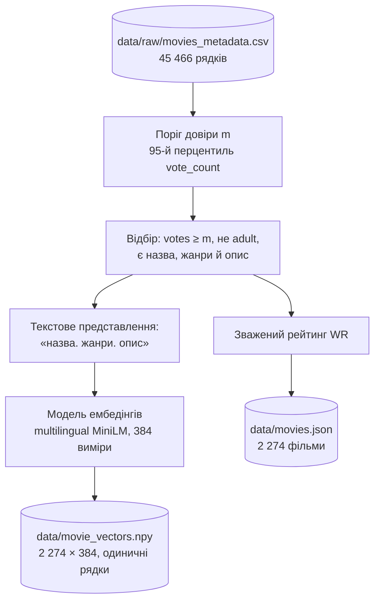
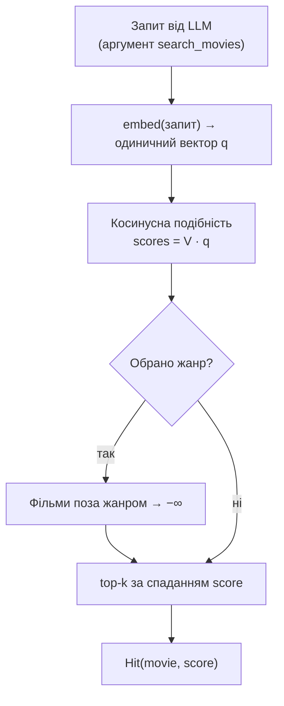

# 2. Дані та ембедінги

Цей документ описує етап відбору кандидатів (retrieval) RAG-пайплайна (Retrieval-Augmented Generation): з чого складається каталог фільмів, як він будується і як у ньому реалізовано семантичний пошук на основі векторних представлень (embedding-based retrieval). Каталог визначає множину всіх об'єктів рекомендації: велика мовна модель (Large Language Model, LLM) обирає фільми лише з нього (див. [3. LLM і виклик інструментів](03-llm-and-tool-calling.md)).

## 2.1. Джерело

| | |
|---|---|
| Набір даних | [The Movies Dataset](https://www.kaggle.com/datasets/rounakbanik/the-movies-dataset) (Kaggle), метадані з TMDB, зріз 2017 року |
| Ліцензія | CC0 1.0 (суспільне надбання) |
| Файл у репозиторії | `data/raw/movies_metadata.csv` — 45 466 рядків, 24 колонки |
| Використані колонки | `id` (TMDB id), `title`, `overview`, `genres`, `release_date`, `vote_average`, `vote_count`, `adult`, `poster_path` |

Ноутбук, з якого розпочато проєкт, збережено в `notebooks/` як довідковий матеріал. Каталог будується скриптом, а не ноутбуком.

## 2.2. Пайплайн побудови

Каталог не зберігається в git: репозиторій містить лише сирий набір даних. Команда `python -m scripts.prepare_data` будує каталог, якщо його ще немає: вона викликає `scripts.build_catalog`, а потім, за наявності `TMDB_API_KEY`, — `scripts.refresh_posters`. У Docker цей крок виконує контейнер бекенду під час старту, записуючи каталог у змонтовану папку проєкту `data/` ([розділ 1.8](01-overview.md#18-розгортання-docker-compose)).

Побудова детермінована: за того самого CSV і тієї самої моделі результатом є той самий каталог. Постери оновлюються через TMDB API, оскільки шляхи зі зрізу 2017 року більше не відкриваються ([розділ 5.3](05-e2e-workflow.md#53-підготовка-даних)).

### Правила відбору

Фільм потрапляє до каталогу, якщо одночасно:

1. `vote_count` ≥ *m*, де *m* — 95-й перцентиль кількості голосів по всьому набору (*m* = 434). Так у каталозі лишаються фільми, про які аудиторія має усталену думку, а рейтинг стає надійним.
2. `adult` = `False`.
3. Є непорожні назва, опис і хоча б один жанр.
4. TMDB id числовий. Дублікати id відкидаються (лишається перший рядок).

У результаті відбору каталог містить **2 274 фільми**, кожен із постером і датою виходу. Відбір за повнотою *всіх* колонок (`dropna`) не застосовано: він вимагає заповнених `homepage`, `tagline` і `belongs_to_collection` і тому залишив би 693 фільми, переважно частини франшиз.

### Зважений рейтинг

Середня оцінка фільму з малою кількістю голосів є ненадійною, тому каталог зберігає байєсове середнє (формула IMDb):

$$
WR = \frac{v \cdot R + m \cdot C}{v + m}
$$

де *R* — середня оцінка фільму (`vote_average`), *v* — кількість голосів, *m* — поріг довіри з правила 1, *C* = 5,0 — апріорна оцінка, до якої тяжіють фільми з малою кількістю голосів. Реалізація: `weighted_rating` у `scripts/build_catalog.py`.

## 2.3. Артефакти каталогу

| Файл | Вміст |
|---|---|
| `data/movies.json` | `embedding_model` (модель, якою обчислено векторні представлення), `source`, `min_votes`, `posters_refreshed` (дата оновлення постерів) і список `movies`: `id`, `title`, `year`, `genres`, `rating` (WR, 2 знаки), `votes`, `overview`, `poster_path` |
| `data/movie_vectors.npy` | матриця `float32` розміру 2 274 × 384. Рядок *i* — ембедінг фільму `movies[i]`, нормований до одиничної довжини |

`Catalog.load` перевіряє, що кількість рядків матриці дорівнює кількості фільмів. Обидва файли записуються атомарно (`replace_atomically`): спочатку тимчасовий файл поруч, потім перейменування. Завдяки цьому перерваний запис, наприклад зупинений `refresh_posters`, не залишає пошкодженого каталогу. Тест `test_built_catalogue_is_consistent` перевіряє цілісність побудованого каталогу: унікальність id, розмірність, одиничні норми, наявність постерів.

URL постера формується з `poster_path` без ключа API: `https://image.tmdb.org/t/p/w342{poster_path}`. Постер завантажує браузер користувача безпосередньо з CDN TMDB.

## 2.4. Модель ембедінгів

| | |
|---|---|
| Модель | `sentence-transformers/paraphrase-multilingual-MiniLM-L12-v2` |
| Розмірність | 384 |
| Мови | 50+, зокрема українська й англійська, у спільному векторному (латентному) просторі |
| Інференс | [fastembed](https://github.com/qdrant/fastembed): квантизована ONNX-версія на CPU, без PyTorch; ≈ 220 МБ, завантажується один раз у кеш проєкту `models/embeddings/` (або командою `python -m backend.adapters.embedder`) |

Багатомовну модель обрано тому, що описи фільмів написано англійською, а користувач формулює запит українською. Така модель відображає запит «страшний фільм про будинок з привидами» і англійський опис фільму жахів у близькі вектори, тому пошук працює без перекладу.

Обидва боки — фільми (офлайн, під час побудови каталогу) і запити (онлайн, під час роботи) — кодує **та сама** модель: її назва записана в `movies.json`, і бекенд завантажує саме її. Зміна моделі вимагає перебудови каталогу.

Реалізація: `backend/adapters/embedder.py` — функція `load_embedder(model_name)` повертає `embed(texts) → матриця одиничних векторів`.

## 2.5. Семантичний пошук

У системі застосовано щільний пошук (dense retrieval): релевантність фільму визначається косинусною подібністю (cosine similarity) між ембедінгом запиту та ембедінгом фільму. Оскільки всі вектори одиничні, косинусна подібність дорівнює скалярному добутку. Пошук по всьому каталогу зводиться до одного множення матриці 2 274 × 384 на вектор запиту: це точний пошук, а не наближений пошук найближчих сусідів (Approximate Nearest Neighbors, ANN), і на CPU він триває мілісекунди.

Жанровий фільтр — жорстке обмеження за метаданими, яке задає користувач в інтерфейсі. Він застосовується в коді, а не делегується моделі. Реалізація: `Catalog.search` у `backend/core/catalog.py`.

Запит до пошуку формулює LLM через виклик інструмента (tool calling) `search_movies`: це опис бажаного фільму мовою користувача, без перекладу (див. [розділ 3](03-llm-and-tool-calling.md)). Таку декомпозицію запиту можна розглядати як аналог SelfQueryRetriever: семантичну частину формулює LLM, а фільтр за метаданими (жанр) задає користувач. Модель знає з попереднього навчання фільми, які називає користувач («щось як «Blade Runner»»), і описує їхні риси. Ембедінг самої назви, особливо перекладеної, майже нічого не говорить про зміст фільму, що підтверджують вимірювання в [розділі 6](06-evaluation.md).

## 2.6. Чому без векторної бази даних

У проєкті свідомо не використано векторну базу даних (Vector DB) — FAISS, Qdrant, pgvector, LanceDB тощо. Проєкт є студентським proof of concept, предмет якого — алгоритм рекомендацій (відбір кандидатів, роль LLM, обґрунтування вибору), а не інфраструктура. За такого масштабу векторна БД не дає переваг, а лише ускладнює систему:

| Критерій | Цей проєкт | Коли векторна БД виправдана |
|---|---|---|
| Обсяг | 2 274 вектори × 384 = 3,5 МБ, повністю в пам'яті | від сотень тисяч — мільйонів векторів |
| Швидкість | точний пошук за 0,4 мс (0,7 мс із жанровим фільтром); разом із кодуванням запиту ≈ 22 мс | коли повний перебір помітно збільшує латентність (latency) відповіді |
| Точність | точний перебір: метрики відображають модель ембедінгів, а не похибку наближеного індексу (ANN) | наближений індекс прийнятний заради швидкості |
| Оновлення | каталог статичний, перебудовується скриптом | часті вставки й видалення в робочому режимі |
| Відтворюваність | сирий CSV у репозиторії, каталог відтворює скрипт; жодного сервера | — |

Перехід на векторну БД не змінює алгоритм: інструмент `search_movies` викликає `Catalog.search`, і достатньо замінити реалізацію цього методу.

## 2.7. Якість пошуку

Офлайн-метрики якості (Recall@k, MRR, точність тематичних запитів), бенчмарк і затримки винесено в [розділ 6](06-evaluation.md). Коротко: для запиту у формі, яку формулює агент (опис фільму мовою користувача, українською), потрібний фільм потрапляє до 12 кандидатів у 69 % випадків; з перекладом англійською цей показник становив би 83 %.

## 2.8. Код

| Файл | Роль |
|---|---|
| `scripts/prepare_data.py` | перший запуск: будує каталог, якщо його немає (у Docker — під час старту бекенду) |
| `scripts/build_catalog.py` | пайплайн побудови: відбір, зважений рейтинг, ембедінги, запис артефактів |
| `scripts/refresh_posters.py` | актуальні шляхи до постерів із TMDB API |
| `backend/core/catalog.py` | `Movie`, `Catalog`: завантаження, збереження, пошук |
| `backend/adapters/embedder.py` | модель ембедінгів (fastembed) |
| `tests/test_build_catalog.py`, `tests/test_catalog.py` | правила відбору, формула рейтингу, пошук, цілісність каталогу |
