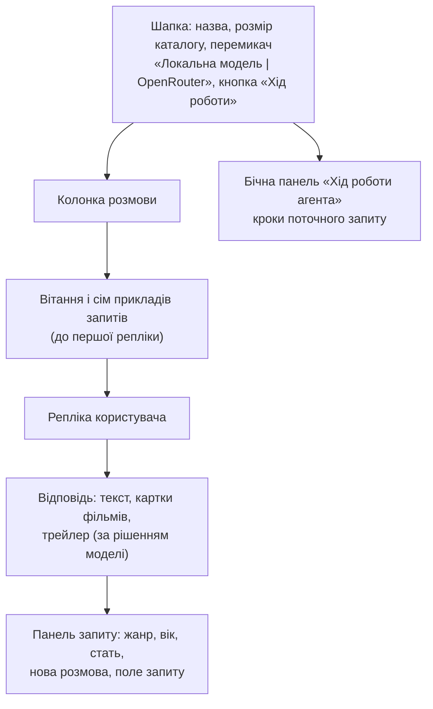
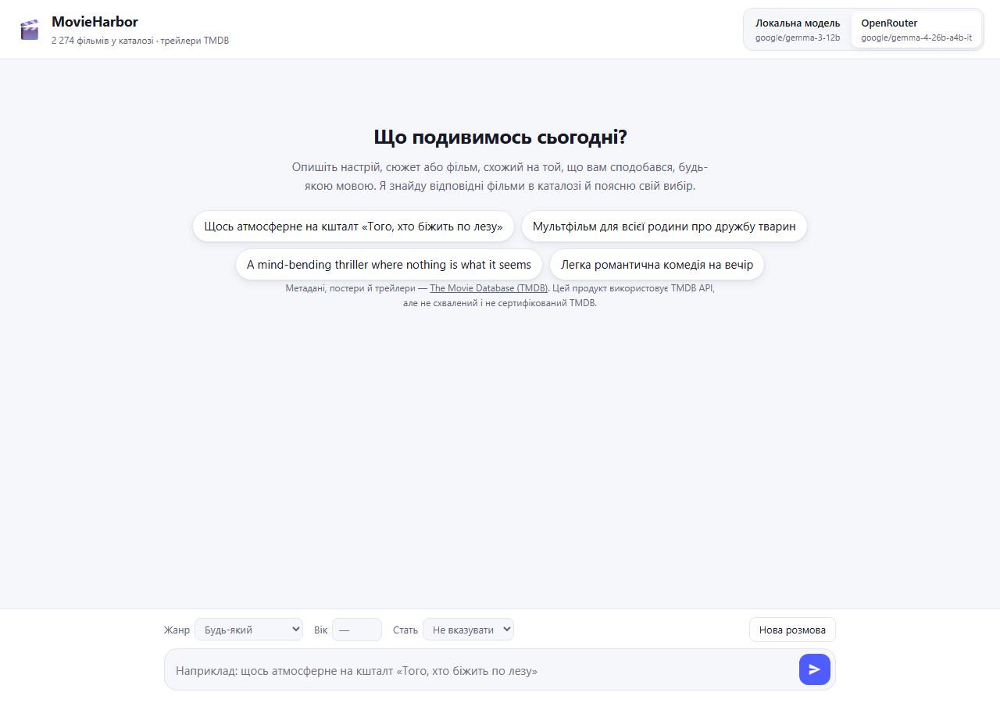
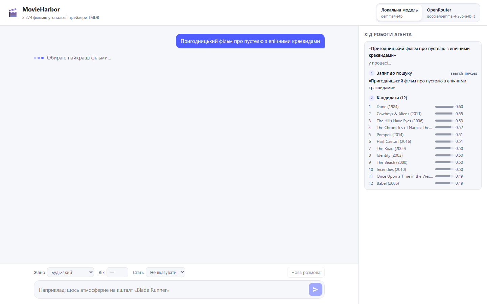
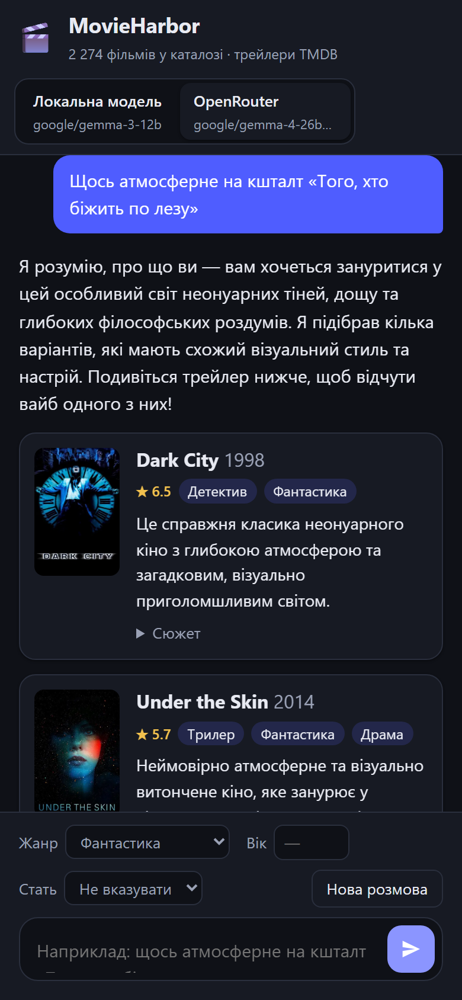
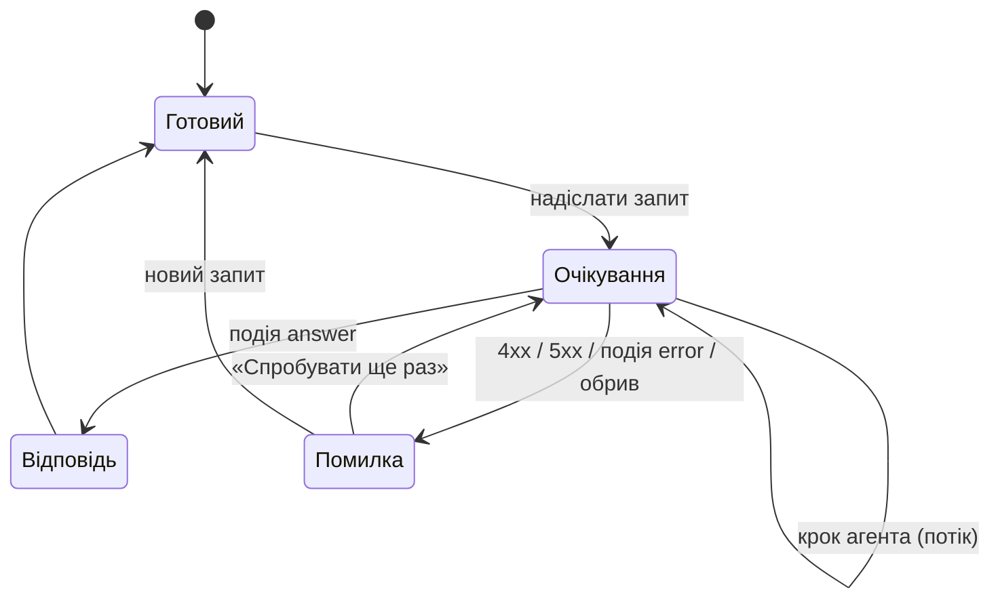

# 4. Інтерфейс

Розділ описує інтерфейс системи, що складається з двох частин: вебсторінки, з якою працює користувач, і HTTP API, через яке сторінка (або будь-який інший клієнт) звертається до рекомендатора. Окрім розмови з рекомендаціями, інтерфейс робить спостережуваним RAG-пайплайн: бічна панель показує кроки агента, тобто виклики інструментів (tool calling), які виконує велика мовна модель (Large Language Model, LLM), — від відбору кандидатів (retrieval) до остаточного вибору фільмів.

У Docker інтерфейс обслуговують два контейнери. Сторінку віддає `frontend` (nginx, http://127.0.0.1:8000), який також проксує `/api/` до `backend` ([розділ 1.8](01-overview.md#18-розгортання-docker-compose)). У локальній розробці `python -m backend` віддає і сторінку, і API з одного процесу.

## 4.1. Вебінтерфейс









| Елемент | Поведінка |
|---|---|
| Перемикач джерела моделі | «Локальна модель» (за замовчуванням) і «OpenRouter», з назвою моделі. Джерело неактивне, доки воно не готове: OpenRouter — без `LLM_API_KEY`, локальна модель — доки завантажуються її ваги; причину пояснює підказка. Щойно локальна модель стає доступною, сторінка вмикає її автоматично (протягом ≈ 10 хв; пізніше — після перезавантаження сторінки). Вибір зберігається |
| Приклади запитів | Сім нетривіальних запитів українською, перевірених у живих прогонах на локальній моделі (README, «Демо-запити»); натискання одразу надсилає запит |
| Жанр | Жорсткий фільтр пошуку за метаданими; назви жанрів відображаються українською |
| Вік, стать | Необов'язковий профіль користувача; модель враховує ці дані як м'яку підказку ([розділ 3.6](03-llm-and-tool-calling.md#36-промпт); вплив — [розділ 9](09-selection-parameters.md)) |
| Поле запиту | `Enter` — надіслати, `Shift+Enter` — новий рядок |
| Очікування | Індикатор із поточним кроком («Думаю над запитом…», «Обираю найкращі фільми…»); кроки надходять потоком під час роботи агента |
| Картка фільму | Постер (посилання на TMDB), назва, рік, зважений рейтинг ★, жанри українською, пояснення моделі «чому», згорнутий сюжет; за відсутності постера — значок 🎬 |
| Трейлер | Якщо модель вирішила його показати: заголовок «Оцініть атмосферу», пояснення моделі, мініатюра YouTube; відео (`youtube-nocookie.com`) завантажується лише після натискання |
| Нова розмова | Очищає історію й панель; налаштування зберігаються |
| Помилка | Червона картка з причиною і кнопкою «Спробувати ще раз». Розрізняються такі причини: немає зв'язку, помилка сервера (текст `detail`), обірваний потік, неочікуваний формат відповіді |
| Бекенд або модель ще запускаються | Якщо `/api/config` не відповідає (перший запуск будує каталог), сторінка показує «Сервер MovieHarbor ще запускається…». Якщо бекенд працює, але жодне джерело не готове (перший запуск завантажує локальну модель), — «Локальна модель ще завантажується…». Поле запиту вимкнене; сторінка повторює перевірку кожні 3 с і підключається автоматично. Після ≈ 10 хв очікування повідомлення радить переглянути журнал (`docker compose logs backend` або `ollama-init`) |

### Бічна панель «Хід роботи агента»

Панель має довідкове призначення: вона забезпечує спостережуваність роботи агента для дослідження і не заважає розмові. На широкому екрані панель розташована праворуч, на вузькому — висувається кнопкою «Хід роботи». Панель показує кроки **поточного** запиту й оновлюється з кожною реплікою; під час роботи агента вона заповнюється в реальному часі.

| Етап | Інструмент | Що відображається |
|---|---|---|
| 1. Запит до пошуку | `search_movies` | пошуковий запит, сформульований моделлю (усі пошуки, якщо їх було два) |
| 2. Кандидати (12) | — | пул кандидатів останнього пошуку: місце, назва, рік, смужка й числове значення косинусної подібності (cosine similarity); обрані моделлю фільми позначено ✓ і порядковим номером |
| 3. Трейлер | `show_trailer` | лише якщо модель вирішила показати: фільм, показано чи не знайдено, причина |
| 3 або 4. Вибір | `recommend` | «Обрано N з 12 · місця за схожістю: …»; id, відхилені перевіркою заземлення (grounding) у коді, якщо такі були |
| ! Корекції | — | кроки з помилками, які модель виправила |

У заголовку панелі наведено джерело, модель, кількість звернень до LLM і латентність (latency), тобто час відповіді. Зіставлення етапів 2 і 4 показує, що модель не обирає просто найближчих за подібністю кандидатів, а зважує весь запит, тобто виконує переранжування (reranking) пулу кандидатів.

### Стани репліки



Під час очікування поле запиту доступне лише для читання, а кнопки «Надіслати» і «Нова розмова» вимкнені, тому дві репліки не накладаються. Після помилки невдала репліка вилучається з історії, щоб репліки користувача й асистента чергувалися; повтор надсилає її знову. З історії до запиту включається не більше 20 останніх повідомлень.

### Принципи

- **Легкість.** Три статичні файли (`index.html`, `app.js`, `styles.css`), без збірки, фреймворків і зовнішніх шрифтів.
- **Безпека.** Усі рядки з API вставляються у сторінку як текст (`textContent` через допоміжну функцію `h`) і ніколи — як HTML.
- **Приватність.** До YouTube сторінка звертається лише після натискання на трейлер. `localStorage` зберігає тільки налаштування (джерело, жанр, вік, стать).
- **Доступність.** Семантичні елементи, підписи полів, `aria-live` для розмови й панелі, `role="radiogroup"` для перемикача, керування з клавіатури, `prefers-reduced-motion`.
- **Теми й адаптивність.** Світла й темна теми відповідно до налаштувань ОС; адаптивна верстка для ширини екрана від 360 px.
- **Атрибуція TMDB.** Сторінка містить обов'язкову примітку про використання TMDB API.

## 4.2. HTTP API

Інтерактивна документація OpenAPI доступна за адресою http://127.0.0.1:8001/docs (звернення до бекенду напряму) або за шляхом `/docs` у локальній розробці. Адресу сервера задають змінні `HOST` і `PORT`: за замовчуванням `127.0.0.1:8000`; у контейнері бекенду `HOST=0.0.0.0` (`backend/Dockerfile`), а Compose публікує порт як `127.0.0.1:8001`.

| Метод і шлях | Призначення |
|---|---|
| `GET /api/config` | джерела моделі, жанри, розмір каталогу, трейлери |
| `POST /api/recommend` | одна репліка → відповідь агента одним JSON |
| `POST /api/recommend/stream` | одна репліка → кроки агента потоком, потім відповідь (NDJSON); його використовує вебінтерфейс |
| `GET /` | вебінтерфейс (лише коли поруч є `frontend/`, тобто в локальній розробці) |

### `GET /api/config`

```json
{
  "providers": [
    {"id": "local", "label": "Локальна модель", "model": "gemma4:e4b", "configured": true, "ready": true},
    {"id": "openrouter", "label": "OpenRouter", "model": "google/gemma-4-26b-a4b-it", "configured": true, "ready": true}
  ],
  "genres": ["Action", "Adventure", "…"],
  "movies": 2274,
  "trailers": true
}
```

`configured` означає, що джерело вказане в налаштуваннях (для OpenRouter — задано `LLM_API_KEY`). `ready` означає, що джерело здатне відповісти зараз: локальний сервер уже перелічує модель у `GET /models` ([розділ 3.2](03-llm-and-tool-calling.md#32-джерела-моделі-локально-за-замовчуванням-або-через-api)). Ключі API ніколи не повертаються.

### `POST /api/recommend`

Запит (поле `viewer` — необов'язковий профіль користувача):

```json
{
  "provider": "local",
  "messages": [{"role": "user", "content": "Пригодницький фільм про пустелю з епічними краєвидами"}],
  "viewer": {"age": null, "gender": null, "genre": null}
}
```

| Поле | Правило |
|---|---|
| `provider` | `local` або `openrouter` |
| `messages` | 1–50 повідомлень `user`/`assistant`, кожне 1–4000 символів; останнє — від `user` |
| `viewer.age` | 1–120 або `null` |
| `viewer.gender` | `female`, `male`, `other` або `null` |
| `viewer.genre` | жанр із `/api/config` або `null` |

Відповідь (скорочено):

```json
{
  "reply": "Ось кілька фільмів, де пустеля — справжній герой історії…",
  "picks": [
    {"id": 841, "title": "Dune", "year": 1984, "genres": ["Action", "Science Fiction", "Adventure"],
     "rating": 5.86, "overview": "…", "poster_url": "https://image.tmdb.org/t/p/w342/…jpg",
     "why": "Епічні краєвиди пустельної планети…"}
  ],
  "trailer": {"movie_id": 841, "title": "Dune", "youtube_key": "…", "reason": "…"},
  "message": {"role": "assistant", "content": "Ось кілька фільмів…\n\n[recommended: Dune (1984, id 841); …]"},
  "trace": {
    "provider": "local", "model": "gemma4:e4b", "llm_calls": 3, "latency_ms": 35100,
    "steps": [
      {"tool": "search_movies", "arguments": {"query": "Пригодницький фільм про пустелю…"},
       "outcome": "знайдено 12 фільмів; найближчі: …",
       "data": {"candidates": [{"id": 841, "title": "Dune", "year": 1984, "score": 0.61}, "…"]}},
      {"tool": "show_trailer", "arguments": {"movie_id": 841, "reason": "…"},
       "outcome": "трейлер «Dune» показано", "data": {"id": 841, "title": "Dune", "status": "shown"}},
      {"tool": "recommend", "arguments": {"reply": "…", "picks": ["…"]},
       "outcome": "прийнято 3: Dune, …; відхилено 0", "data": {"accepted": [841, "…"], "rejected": []}}
    ]
  }
}
```

`message` — репліка асистента в тому вигляді, у якому клієнт додає її до `messages` наступного запиту: сервер не зберігає стану розмови. `trace.steps[].data` містить структуровані дані для панелі: кандидатів зі значеннями подібності, статус трейлера, прийняті й відхилені id.

### `POST /api/recommend/stream`

Запит той самий; відповідь має тип `application/x-ndjson` — по одному JSON-об'єкту в рядку:

```text
{"type": "step", "tool": "search_movies", "arguments": {…}, "outcome": "…", "data": {…}}
{"type": "step", "tool": "show_trailer", …}
{"type": "step", "tool": "recommend", …}
{"type": "answer", "reply": "…", "picks": […], "trailer": {…}, "message": {…}, "trace": {…}}
```

Кожен крок надходить, щойно інструмент виконано. Останній рядок — `answer` (поля як у `POST /api/recommend`) або `{"type": "error", "detail": "…"}`, якщо модель не впоралася із завданням. Перевірка запиту (400, 422) відбувається до початку потоку, тому ці помилки повертаються зі звичайними кодами HTTP.

### Коди відповіді

| Код | Коли | `detail` |
|---|---|---|
| 200 | відповідь агента (у потоці — також подія `error`) | — |
| 400 | обрано OpenRouter без `LLM_API_KEY` | українське пояснення |
| 422 | запит не відповідає схемі або невідомий жанр; до моделі запит не доходить | один рядок українською: назви полів («Некоректний запит: перевірте viewer.age.») або «Невідомий жанр: X» |
| 502 | модель недоступна, відповіла помилкою або не завершила відповідь (лише `POST /api/recommend`) | українське пояснення ([розділ 3.8](03-llm-and-tool-calling.md#38-обробка-помилок)) |

## 4.3. Код

| Файл | Роль |
|---|---|
| `frontend/index.html` | розмітка: шапка, колонка розмови, бічна панель |
| `frontend/app.js` | стан, запити до API, читання потоку, відповідь, панель кроків, очікування бекенду |
| `frontend/styles.css` | стилі, світла й темна теми, адаптивність, висувна панель |
| `frontend/nginx.conf`, `frontend/Dockerfile` | контейнер фронтенду: роздача файлів і проксі `/api/` без буферизації |
| `backend/api.py` | ендпоінти, моделі запиту й відповіді, `Recommender`, потік NDJSON |
| `tests/test_api.py` | контракт API, зокрема потік і помилки валідації |
| `tests/test_e2e.py` | наскрізні (E2E) сценарії в браузері ([розділ 10.6](10-testing.md#106-сценарії-e2e)) |
