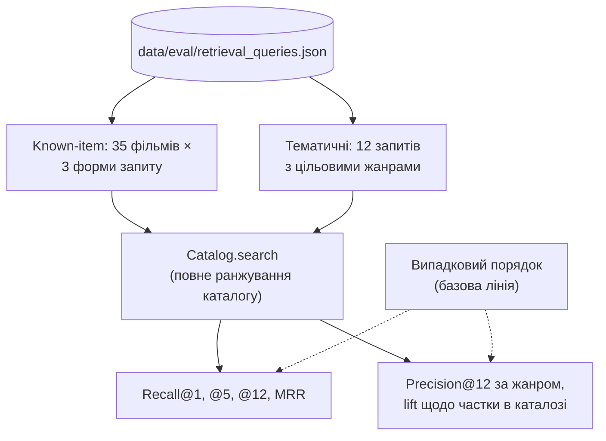

# 6. Оцінювання якості пошуку

Розділ описує офлайн-оцінювання (offline evaluation) етапу відбору кандидатів (retrieval) RAG-пайплайна, тобто семантичного пошуку за ембедінгами. Він є єдиним джерелом метрик якості пошуку, на які посилається текст магістерської роботи. Таблиці §6.4 і затримку «кодування запиту + пошук» відтворює команда з §6.7; решта затримок §6.5 та ілюстративні приклади — разові вимірювання. Після зміни каталогу, моделі ембедінгів або бенчмарку таблиці оновлюються в тій самій зміні.

## 6.1. Що вимірюється

Рекомендація формується у два етапи: семантичний пошук (dense retrieval) відбирає кандидатів, а велика мовна модель (Large Language Model, LLM) обирає з них фільми й пояснює вибір (див. [розділ 3](03-llm-and-tool-calling.md)). Завдяки заземленню (grounding) LLM не може порадити фільм, якого не було серед кандидатів, тому якість пошуку — верхня межа якості всієї системи. Відповідно, у цьому розділі вимірюється саме пошук: чи потрапляє потрібний фільм у 12 кандидатів, які отримує модель.



## 6.2. Бенчмарк

Файл `data/eval/retrieval_queries.json` містить дві частини.

**Known-item (пошук відомого фільму), 35 фільмів.** Для кожного фільму три форми запиту:

| Форма | Приклад для «Blade Runner» | Що моделює |
|---|---|---|
| `title_uk` | «Той, хто біжить по лезу» | користувач називає фільм українською назвою |
| `description_uk` | «детектив у дощовому місті майбутнього полює на штучних людей, які втекли» | опис українською: так користувач описує фільм і так модель формулює запит `search_movies` (мовою користувача) |
| `description_en` | «neo-noir science fiction: a detective hunts rogue replicants…» | опис англійською: такий запит писала б модель, якби перекладала прохання |

Ціллю запиту є сам фільм. Описи складено на основі загальних знань про фільм, а не скопійовано з опису в наборі даних, щоб не завищити збіг.

**Тематичні запити, 12 штук.** Запит українською про настрій або жанр («страшний фільм жахів, щоб не спати всю ніч») і цільові жанри (`Horror`). Релевантним вважається результат, що має хоча б один цільовий жанр.

## 6.3. Метрики

Застосовано офлайн-метрики ранжування (decision-support metrics), обчислені на зафіксованому бенчмарку: Recall@k і MRR — для known-item запитів, Precision@k — для тематичних. Метрики помилки (RMSE, MAE) тут не застосовні, бо система не прогнозує рейтинги.

Нехай *Q* — множина запитів, а rank(*q*) — позиція цільового фільму в повному ранжуванні каталогу за запитом *q*.

| Метрика | Формула | Зміст |
|---|---|---|
| Recall@k | $\frac{1}{\lvert Q \rvert}\sum_{q} [\mathrm{rank}(q) \le k]$ | частка запитів, для яких ціль потрапила в перші *k* |
| MRR | $\frac{1}{\lvert Q \rvert}\sum_{q} \frac{1}{\mathrm{rank}(q)}$ | середня обернена позиція цілі; 1 — ціль завжди перша |
| Precision@k (жанр) | частка перших *k* результатів із цільовим жанром | тематична точність |
| Lift | Precision@k / частка фільмів жанру в каталозі | у скільки разів краще за випадковий вибір |

Ключовою метрикою є **Recall@12**, оскільки саме 12 кандидатів LLM отримує з одного виклику пошуку.

Базова лінія — випадковий порядок каталогу з *N* = 2 274 фільмів: Recall@k = *k*/*N*, MRR = *H*<sub>N</sub>/*N* (*H*<sub>N</sub> — гармонічне число), Precision@k = частка жанру в каталозі.

## 6.4. Результати

Модель ембедінгів `paraphrase-multilingual-MiniLM-L12-v2`, каталог 2 274 фільми, точний пошук (без наближеного пошуку найближчих сусідів, ANN).

### Known-item

| Форма запиту | R@1 | R@5 | R@12 | MRR |
|---|---|---|---|---|
| назва українською | 0,143 | 0,314 | 0,343 | 0,218 |
| **опис українською (форма запиту агента)** | **0,371** | **0,543** | **0,686** | **0,473** |
| опис англійською (з перекладом) | 0,543 | 0,743 | 0,829 | 0,648 |
| випадковий порядок | 0,000 | 0,002 | 0,005 | 0,004 |

### Тематичні запити

| Запит | Жанри | P@12 | Частка в каталозі | Lift |
|---|---|---|---|---|
| мультфільм для всієї родини | Animation, Family | 0,750 | 0,147 | ×5,1 |
| страшний фільм жахів, щоб не спати всю ніч | Horror | 0,667 | 0,109 | ×6,1 |
| зворушлива романтична історія кохання | Romance | 0,917 | 0,147 | ×6,2 |
| смішна комедія на вечір з друзями | Comedy | 1,000 | 0,327 | ×3,1 |
| фільм про війну та солдатів на фронті | War, History | 0,750 | 0,055 | ×13,5 |
| наукова фантастика про космос та інші планети | Science Fiction | 1,000 | 0,162 | ×6,2 |
| заплутаний детектив про розслідування вбивства | Mystery, Crime | 0,917 | 0,233 | ×3,9 |
| документальне кіно про реальні події | Documentary | 0,083 | 0,003 | ×31,6 |
| фільм про музикантів, співаків і концерти | Music | 0,500 | 0,027 | ×18,6 |
| вестерн про ковбоїв на Дикому Заході | Western | 0,500 | 0,013 | ×39,2 |
| казкова пригода з магією, чарівниками та драконами | Fantasy | 0,917 | 0,145 | ×6,3 |
| напружений бойовик з погонями і вибухами | Action | 0,750 | 0,318 | ×2,4 |
| **середнє** | | **0,729** | | |

### Ілюстративні приклади

Перші п'ять результатів (косинусна подібність першого й п'ятого в дужках):

| Запит | Топ-5 |
|---|---|
| страшний фільм про будинок з привидами | A Haunted House (0,80) · Sinister 2 · Thir13en Ghosts · House at the End of the Street · Night of the Living Dead (0,66) |
| мультфільм про тварин для всієї родини | Madagascar (0,57) · 101 Dalmatians · The Lorax · The Fox and the Hound · Lady and the Tramp (0,54) |
| космічна подорож і чорні діри | Event Horizon (0,56) · Pitch Black · The Dark Tower · 2001: A Space Odyssey · Men in Black (0,52) |
| щось атмосферне на кшталт «Того, хто біжить по лезу» | The Ides of March (0,50) · The Running Man · Hail, Caesar! · Smokin' Aces · Hummingbird (0,47) |
| neo-noir dystopian science fiction, artificial humans, rain-soaked futuristic city | Metropolis (0,66) · The Mist · The 6th Day · The Happening · Dark City (0,58) |
| Blade Runner: a cop hunts rogue replicants, artificial humans, in a dystopian Los Angeles of 2019; neo-noir science fiction | Blade Runner (0,61) · The Terminator · Let's Be Cops · Pulp Fiction · R.I.P.D. (0,60) |

### Висновки

1. **Запит має формулювати LLM як опис.** Опис фільму знаходить ціль серед 12 кандидатів у 69 % випадків українською і в 83 % англійською — проти 34 % для назви українською. Назва, особливо перекладена, майже не несе змісту для моделі ембедінгів. Тому агент спершу формулює пошуковий запит-опис для виклику інструмента (tool calling) `search_movies` ([розділ 3](03-llm-and-tool-calling.md)), а не передає в пошук сирий текст користувача.
2. **Багатомовність працює без перекладу.** Агент пише запит мовою користувача; український опис знаходить ціль у 69 % випадків — у 130 разів більше за випадковий рівень. Переклад англійською підняв би Recall@12 до 0,83. Це свідома ціна: переклад став би неявним шаром, який робить зайвою багатомовну модель ембедінгів ([розділ 3.7](03-llm-and-tool-calling.md#37-обґрунтування-рішень)).
3. **Тематичний пошук точний для поширених жанрів** (P@12 ≥ 0,67 для 9 із 12 запитів). Нижчі значення відповідають рідкісним жанрам: документальних фільмів у каталозі 6 (0,3 %), тож навіть ідеальний пошук дав би не більше 6/12 = 0,50. Lift для рідкісних жанрів найбільший.

## 6.5. Затримки

Вимірювання на CPU ноутбука розробника (Windows, без GPU):

| Операція | Час |
|---|---|
| Завантаження моделі ембедінгів (один раз під час старту бекенду) | 1,6 с |
| Лише пошук по каталогу (`Catalog.search`, k = 12) | 0,4 мс (0,7 мс із жанровим фільтром) |
| Кодування запиту + пошук по каталогу, медіана | 22 мс |
| Те саме, 95-й перцентиль | 32 мс |
| Побудова каталогу (2 274 описи) | ≈ 3 хв |

Пошук займає частки відсотка часу відповіді: латентність (latency) системи визначають переважно виклики LLM.

## 6.6. Обмеження та загрози валідності

- **Малий бенчмарк.** 35 + 12 запитів дають оцінку порядку величини, а не точні значення: одна позиція змінює Recall на 0,029.
- **Розмітка автора.** Запити й цільові жанри склав автор. Описи імітують запити, які формулює модель, але написані людиною. Фактичні запити моделі видно в трасуванні агента.
- **Жанр як наближення релевантності.** Precision за жанром не враховує настрій чи сюжет. Фільм потрібного жанру може не відповідати запиту, і навпаки.
- **Оцінено лише пошук.** Якість остаточних рекомендацій і пояснень LLM тут не вимірюється: вона залежить від моделі й потребує експертної або користувацької оцінки.
- **Лише частина офлайн-метрик.** Метрики ранжування nDCG і MAP, розглянуті в теоретичній частині роботи, не обчислюються. Онлайн-метрики (CTR, коефіцієнт конверсії, A/B-тестування) потребують реальних користувачів і в межах PoC не вимірюються.

## 6.7. Відтворення

```bash
python -m scripts.build_catalog         # якщо змінилися дані або модель
python -m scripts.evaluate_retrieval    # таблиці known-item і тематичних запитів §6.4, затримку запиту §6.5
```

Пошук точний і детермінований, тому повторний запуск дає ті самі метрики. Затримки залежать від обладнання.
