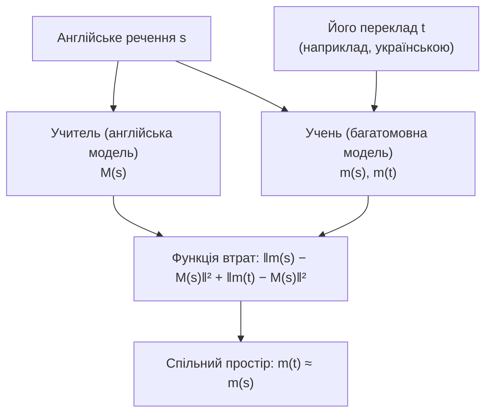

# 7. Вибір моделі ембедінгів

Цей документ обґрунтовує вибір моделі ембедінгів `sentence-transformers/paraphrase-multilingual-MiniLM-L12-v2` для етапу відбору кандидатів (retrieval), тобто для щільного пошуку (dense retrieval) за векторними представленнями (ембедінгами). Модель порівнюється з альтернативами за опублікованими метриками відкритих бенчмарків; також показано, як її обмеження компенсовано в архітектурі. Власні вимірювання на каталозі проєкту наведено в [розділі 6](06-evaluation.md).

## 7.1. Вимоги

| Вимога | Обґрунтування |
|---|---|
| Багатомовність, зокрема українська↔англійська | користувач пише українською (або англійською), описи фільмів — англійською |
| Робота на CPU поруч із локальною LLM | застосунок розраховано на локальний запуск: за замовчуванням велика мовна модель (Large Language Model, LLM) — Gemma 4, ≈ 5,5 ГБ — займає відеокарту ноутбука майже повністю ([розділ 1.8](01-overview.md#18-розгортання-docker-compose)). Модель ембедінгів має працювати на CPU, займати мало оперативної пам'яті й кодувати запит за десятки мілісекунд |
| Малий розмір і швидкий старт | модель завантажується під час першого запуску; бекенд стартує за секунди |
| Відкрита ліцензія, без платного API | відтворюваність результатів для будь-кого, хто клонує репозиторій |
| Короткі тексти | текстове представлення фільму — «назва. жанри. опис»: медіана 83 токени (див. §7.5) |

## 7.2. Чому багатомовна модель

Одномовна (англійська) модель ембедінгів відображає український текст у випадкову ділянку векторного (латентного) простору: запит «страшний фільм про привидів» не опиниться поруч з англійським описом фільму жахів. Цю проблему можна розв'язати трьома способами:

1. **Переклад запиту** перед пошуком: окрема модель або API, додаткова затримка й ще одне джерело помилок.
2. **Переклад каталогу**: 2 274 описи українською, але для користувача, який пише англійською, виникає обернена проблема.
3. **Багатомовна модель зі спільним векторним простором для всіх мов** — обраний варіант.

Модель `paraphrase-multilingual-MiniLM-L12-v2` навчено методом *багатомовної дистиляції знань* (multilingual knowledge distillation; Reimers & Gurevych, 2020 [1]):

- **Учитель** (teacher) — англомовна модель парафраз.
- **Учень** (student, багатомовний трансформер) навчається відображати і англійське речення, і його переклад у вектор учителя для англійського речення.
- Навчання виконується на паралельних корпусах для 50+ мов, серед яких українська.
- **Наслідок:** переклади одного змісту різними мовами потрапляють у близькі точки спільного простору, тому український запит і англійський опис можна безпосередньо порівнювати за косинусною подібністю (cosine similarity).

На цій властивості ґрунтується весь пошук у проєкті: агент (LLM, що викликає інструмент пошуку) формулює запит мовою користувача, без перекладу. Український опис знаходить потрібний фільм серед 12 кандидатів у 69 % випадків, англійський опис того самого фільму — у 83 % ([розділ 6.4](06-evaluation.md#64-результати)).

## 7.3. Моделі-кандидати

Кількість параметрів і розміри ваг наведено за картками моделей на Hugging Face [13], якщо не вказано інше.

| Модель | Параметри | Розмірність | Макс. токенів | Українська | Ліцензія | Розмір ваг |
|---|---|---|---|---|---|---|
| **paraphrase-multilingual-MiniLM-L12-v2** | 117,7 млн | 384 | 128 [13, 16] | так [1, 12] | Apache-2.0 | 449 МБ fp32; **≈ 220 МБ** квантизована ONNX у fastembed [16] |
| paraphrase-multilingual-mpnet-base-v2 | 278,0 млн | 768 | 128 | так | Apache-2.0 | 1 061 МБ; ≈ 1,0 ГБ у fastembed |
| LaBSE | 470,9 млн | 768 | 256 | так (109 мов) | Apache-2.0 | 1 797 МБ |
| multilingual-e5-small | 117,7 млн | 384 | 512 | так | MIT | 449 МБ |
| multilingual-e5-base | 278,0 млн | 768 | 512 | так | MIT | 1 061 МБ |
| multilingual-e5-large | 559,9 млн | 1024 | 512 | так | MIT | 2 136 МБ; ≈ 2,24 ГБ у fastembed |
| bge-m3 | 568 млн [5, 6] | 1024 | 8192 | 100+ мов (українську окремо не названо) | MIT | 2 166 МБ |
| gte-multilingual-base | 305 млн | 768 | 8192 | так (70+ мов) | Apache-2.0 | 583 МБ (fp16) |
| jina-embeddings-v3 | 572 млн [7] | 1024 | 8192 | так (30 мов) | CC-BY-NC-4.0 | 1 092 МБ (bf16) |
| OpenAI text-embedding-ada-002 | не опубліковано | 1536 [15] | 8192 [14] | не вказано | платний API | — |
| OpenAI text-embedding-3-small | не опубліковано | 1536 [14] | 8192 [14] | не вказано | платний API | — |

Модель `text-embedding-ada-002` використано у вихідному ноутбуку проєкту (`notebooks/`).

## 7.4. Опубліковані метрики

Значення взято з першоджерел; посилання на джерело наведено у квадратних дужках, «н/д» означає, що значення не опубліковано або не знайдено.

| Модель | MTEB-en v1: середнє / пошук | MMTEB: середнє / пошук / bitext [3, табл. 2] | Tatoeba ukr–eng, F1 | Багатомовний пошук |
|---|---|---|---|---|
| **MiniLM-L12-v2** | **52,44 / 32,45** [2, табл. 1] | **48,8 / 36,6 / 44,6** | **92,82** [2, табл. 12] | н/д |
| mpnet-base-v2 | 54,71 / 35,34 [2] | 52,0 / 39,8 / 52,1 | 92,67 [2] | н/д |
| LaBSE | 45,21 / 18,99 [2] | 52,1 / 33,2 / 76,4 | 93,97 [2] | н/д |
| mE5-small | 57,9 [4, табл. 3] / н/д | 55,5 / 49,3 / 67,5 | 81,62 [13] | MIRACL nDCG@10 60,8 [4] |
| mE5-base | 59,5 [4] / 48,9ᵇ [6] | 57,0 / 52,7 / 69,4 | 88,29 [13] | MIRACL 62,3 [4] |
| mE5-large | 61,5 [4] / 51,4ᵇ [6] | 58,6 / 54,1 / 71,7 | 93,32 [13] | MIRACL 66,5 [4] |
| bge-m3 (dense) | 59,84 / 48,7ᵇ [6] | н/д | н/д | MIRACL 69,2 [5]; MKQA R@100 75,1 [5] |
| ada-002 | 61,0 / 49,3 [8, табл. 6] | н/д | н/д | MIRACL 31,4 [15]ˢ |
| 3-small | 62,3 [14] / н/д | н/д | н/д | MIRACL 44,0 [15]ˢ |

ᵇ середнє nDCG@10 на BEIR — набори, що становлять категорію пошуку MTEB. ˢ вторинне джерело.

Додаткові порівняння MiniLM-L12-v2 із mpnet-base-v2 і LaBSE:

| Показник | MiniLM-L12-v2 | mpnet-base-v2 | LaBSE | Джерело |
|---|---|---|---|---|
| SBERT: якість ембедінгів речень (14 наборів) | 64,25 | 65,83 | н/д | [12] |
| SBERT: семантичний пошук (6 наборів) | 39,19 | 41,68 | н/д | [12] |
| Швидкість, речень/с (GPU V100) | 7 500 | 2 500 | н/д | [12] |
| Багатомовний STS (STS17 + STS22), середнє | 64,23 | 67,71 | 65,67 | [2, табл. 14] |
| Bitext mining, середнє | 57,98 | 63,38 | 81,75 | [2, табл. 12] |

Для моделі-учня з роботи [1] (XLM-R, 2020): міжмовний STS17 (7 пар EN–xx) — 83,7 проти 73,5 у LaBSE; Tatoeba для української — точність 94,3 проти 95,2 у LaBSE.

**Порівнянність.**

- MTEB-en v1 (56 наборів, [2]) і MMTEB (132 задачі, [3]) — різні бенчмарки; їхні значення не можна безпосередньо зіставляти.
- MIRACL у [4] охоплює 16 мов, а в [5] і [6] — 18.
- Tatoeba подано як F1 у [2, 13] і як точність у [1].
- Значення для моделей OpenAI взято з документації OpenAI та вторинного джерела; протокол оцінювання MIRACL для них невідомий.

## 7.5. Обґрунтування вибору

1. **Зіставлення українська↔англійська на рівні значно більших моделей.** F1 на Tatoeba ukr–eng становить 92,82, що близько до значень LaBSE (93,97) і mE5-large (93,32), які більші в 4–5 разів, і вище, ніж у mE5-base (88,29) та mE5-small (81,62) [2, 13]. Для системи, у якій запит і документ написано різними мовами, це ключова властивість.
2. **Найменша й найшвидша з придатних.** ≈ 220 МБ квантизованої ONNX-моделі в fastembed проти ≈ 1 ГБ у mpnet і ≈ 2,2 ГБ у mE5-large чи bge-m3. Модель утричі швидша за mpnet (7 500 проти 2 500 речень/с на V100 [12]). На CPU ноутбука вона завантажується за 1,6 с, а кодування запиту разом із пошуком триває 22 мс ([розділ 6.5](06-evaluation.md#65-затримки)).
3. **Відкрита ліцензія Apache-2.0 і готова ONNX-версія у fastembed** — без PyTorch і без платного API.
4. **Сумісність із локальним запуском.** Коли весь стек працює на одному ноутбуці, його ресурси розподіляються між двома моделями. Gemma 4 (`gemma4:e4b`) займає ≈ 5,5 ГБ із 8 ГБ відеопам'яті. MiniLM працює на CPU і додає ≈ 220 МБ до образу та пам'яті процесу, не конкуруючи з LLM за GPU. Більші моделі-кандидати (mE5-large, bge-m3: ≈ 2,2 ГБ) або забрали б відеопам'ять у LLM, або на CPU кодували б запит у рази повільніше. Тому для локального сценарію за замовчуванням мала багатомовна модель — свідомий вибір у компромісі між латентністю та складністю (latency vs. complexity), а не лише економія.

### Чим поступається модель і як це компенсовано

| Обмеження | Факт | Компенсація в архітектурі |
|---|---|---|
| Нижча якість ранжування в пошукових бенчмарках | пошук 32,45 у MTEB-en [2] проти 49,3 в ada-002 [8]; 36,6 в MMTEB проти 49,3 у mE5-small [3] | запит формулює LLM як опис рис фільму мовою користувача (Recall@12 = 0,69 для українських описів проти 0,34 для назв, [розділ 6](06-evaluation.md)); пошук повертає 12 кандидатів, а LLM переранжовує їх (reranking) і робить остаточний вибір |
| Вхід до 128 токенів [13, 16] | у каталозі медіана 83 токени, 90-й перцентиль — 132; 254 з 2 274 текстів (11,2 %) довші, і в них обрізається кінець опису | назва й жанри розміщено на початку тексту, тому обрізається лише кінець опису |
| Низька розмірність векторів (384 виміри) | окремі слова можуть переважати (приклад «cop» у [розділі 6.4](06-evaluation.md#ілюстративні-приклади)) | та сама: LLM переранжовує кандидатів і пояснює вибір |

## 7.6. Альтернативи й шлях покращення

- **multilingual-e5-small** — найближча заміна: той самий розмір (117,7 млн, ініціалізована з Multilingual-MiniLM-L12-H384), 512 токенів, суттєво кращий пошук у MMTEB (49,3 проти 36,6). Водночас вона гірше зіставляє ukr–eng (81,62 проти 92,82) і потребує префіксів `query:` / `passage:` [13]. Порівняння на бенчмарку проєкту — найпростіший наступний експеримент.
- **multilingual-e5-base / large, bge-m3** — найкращий багатомовний пошук (bge-m3: MIRACL 69,2, MKQA R@100 75,1 [5]) ціною 1–2,2 ГБ ваг і повільнішого кодування на CPU.
- **API-моделі OpenAI** — сильні англійською (MTEB 61,0–62,3 [8, 14]), але платні, із закритими вагами й слабшими багатомовними результатами (MIRACL 31,4–44,0 [15]).

Заміна моделі не змінює логіки системи: достатньо змінити константу `DEFAULT_MODEL` у `backend/adapters/embedder.py` (для e5 — також додати префікси) і перебудувати каталог (`python -m scripts.build_catalog`). Назва моделі записується в `data/movies.json`, тому бекенд автоматично кодує запити тією самою моделлю. Після заміни слід повторити `python -m scripts.evaluate_retrieval` і оновити [розділ 6](06-evaluation.md).

## 7.7. Джерела

1. N. Reimers, I. Gurevych. *Making Monolingual Sentence Embeddings Multilingual using Knowledge Distillation.* EMNLP 2020. [arXiv:2004.09813](https://arxiv.org/abs/2004.09813).
2. N. Muennighoff, N. Tazi, L. Magne, N. Reimers. *MTEB: Massive Text Embedding Benchmark.* EACL 2023, pp. 2014–2037. [arXiv:2210.07316](https://arxiv.org/abs/2210.07316).
3. K. Enevoldsen, I. Chung, I. Kerboua, M. Kardos et al. *MMTEB: Massive Multilingual Text Embedding Benchmark.* ICLR 2025. [arXiv:2502.13595](https://arxiv.org/abs/2502.13595).
4. L. Wang, N. Yang, X. Huang, L. Yang, R. Majumder, F. Wei. *Multilingual E5 Text Embeddings: A Technical Report.* 2024. [arXiv:2402.05672](https://arxiv.org/abs/2402.05672).
5. J. Chen, S. Xiao, P. Zhang, K. Luo, D. Lian, Z. Liu. *M3-Embedding: Multi-Linguality, Multi-Functionality, Multi-Granularity Text Embeddings Through Self-Knowledge Distillation.* Findings of ACL 2024, pp. 2318–2335. [arXiv:2402.03216](https://arxiv.org/abs/2402.03216).
6. X. Zhang, Y. Zhang, D. Long et al. *mGTE: Generalized Long-Context Text Representation and Reranking Models for Multilingual Text Retrieval.* EMNLP 2024 Industry Track. [arXiv:2407.19669](https://arxiv.org/abs/2407.19669).
7. S. Sturua, I. Mohr, M. K. Akram, M. Günther et al. *jina-embeddings-v3: Multilingual Embeddings With Task LoRA.* 2024. [arXiv:2409.10173](https://arxiv.org/abs/2409.10173).
8. Z. Li, X. Zhang, Y. Zhang, D. Long, P. Xie, M. Zhang. *Towards General Text Embeddings with Multi-stage Contrastive Learning.* 2023. [arXiv:2308.03281](https://arxiv.org/abs/2308.03281).
9. L. Wang, N. Yang, X. Huang, L. Yang, R. Majumder, F. Wei. *Improving Text Embeddings with Large Language Models.* ACL 2024. [arXiv:2401.00368](https://arxiv.org/abs/2401.00368).
10. Y. Zhang, M. Li, D. Long, X. Zhang et al. *Qwen3 Embedding: Advancing Text Embedding and Reranking Through Foundation Models.* 2025. [arXiv:2506.05176](https://arxiv.org/abs/2506.05176).
11. H. Schechter Vera, S. Dua et al. *EmbeddingGemma: Powerful and Lightweight Text Representations.* 2025. [arXiv:2509.20354](https://arxiv.org/abs/2509.20354).
12. SBERT documentation. *Pretrained Models.* https://www.sbert.net/docs/sentence_transformer/pretrained_models.html (переглянуто 31.10.2026).
13. Картки моделей Hugging Face (`sentence-transformers/*`, `intfloat/multilingual-e5-*`, `BAAI/bge-m3`, `Alibaba-NLP/gte-multilingual-base`, `jinaai/jina-embeddings-v3`); значення Tatoeba ukr–eng — з розділу `model-index` (MTEB Tatoeba) кожної картки (переглянуто 31.10.2026).
14. OpenAI API documentation. *Embeddings guide.* https://developers.openai.com/api/docs/guides/embeddings (переглянуто 31.10.2026).
15. J. Briggs. *OpenAI's Text Embeddings v3.* Pinecone, 25.01.2024. https://www.pinecone.io/learn/openai-embeddings-v3/ (вторинне джерело).
16. Qdrant fastembed. *Supported Models*: https://qdrant.github.io/fastembed/examples/Supported_Models/; модель `Qdrant/paraphrase-multilingual-MiniLM-L12-v2-onnx-Q` на Hugging Face.

Джерела [9]–[11] містять зведені таблиці лідерборду MTEB, які використано для перевірки узгодженості чисел. Для моделей, перелічених тут, лідерборд MTEB(Multilingual, v2) значень MiniLM, mpnet і LaBSE не містить.
