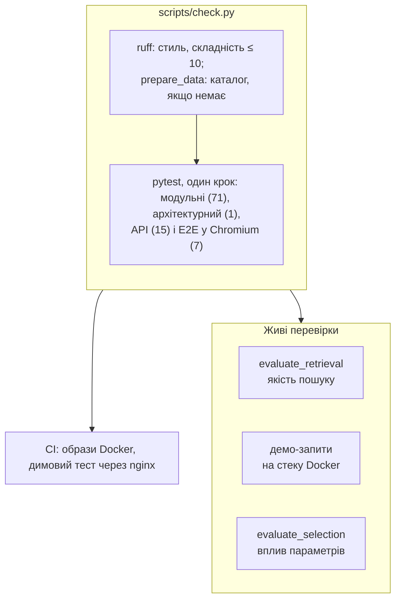
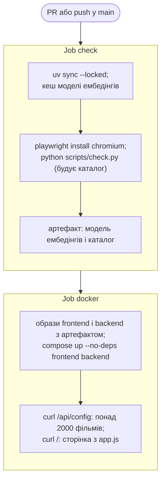

# 10. Стратегія тестування

Розділ описує стратегію тестування системи: що перевіряється автоматично, а що — у живих прогонах, чим замінено зовнішні сервіси і які вимоги фіксує кожен тест. Основний поділ такий: **детерміновані тести перевіряють код**, а **поведінку справжньої великої мовної моделі (Large Language Model, LLM) вимірюють живі перевірки**, до яких належить і офлайн-оцінювання якості ([розділи 6](06-evaluation.md) і [9](09-selection-parameters.md)). Тести не звертаються до мережі й не завантажують жодної моделі.

## 10.1. Принципи

Принципи тестування зафіксовано в [AGENTS.md](../../AGENTS.md#testing):

- **Поведінка через публічну точку входу.** Тест звертається до функції, HTTP-ендпоінта або сторінки, а не до внутрішніх деталей реалізації.
- **Тест перевіряє конкретний результат.** Тест, який пройшов би навіть тоді, коли код нічого не повертає, тестом не вважається.
- **Виправлення помилки починається з тесту**, що падає з очікуваної причини.
- **Детермінованість.** Тести не використовують ні мережі, ні справжніх моделей: модель ембедінгів замінено хешуванням слів, LLM — сценарієм або локальною заглушкою.
- **Пропуск — не проходження.** За відсутності Chromium наскрізні (E2E) тести позначаються як пропущені із зазначенням причини, і про пропуск обов'язково повідомляють.
- **Контроль якості не послаблюють.** Не допускаються `# noqa`, нові винятки ruff, пропущені чи послаблені тести: усувається причина збою.

## 10.2. Рівні перевірки



Контроль якості (`scripts/check.py`) послідовно виконує чотири кроки й зупиняється на першому збої: `ruff check`, `ruff format --check`, `python -m scripts.prepare_data` (будує каталог, лише якщо його немає; за наявності `TMDB_API_KEY` у `.env` він також одноразово оновлює постери через TMDB API (≈ 2 300 запитів)) і `pytest`. CI виконує той самий скрипт.

Живі перевірки дорожчі й недетерміновані, тому їх запускають за потреби: після зміни промпту, інструментів, каталогу чи моделі (§10.7).

## 10.3. Набір тестів

Набір містить 94 тести в 15 файлах (з урахуванням параметризованих випадків).

| Шар | Файли (тестів) | Підміни | Що перевіряє |
|---|---|---|---|
| Ядро | `test_tools.py` (14), `test_agent.py` (9), `test_catalog.py` (6), `test_prompts.py` (5) | `fake_embed`, `ScriptedChat`, `FakeTrailers` | схеми інструментів, заземлення (grounding), цикл агента й бюджет звернень, пошук і жанровий фільтр, атомарний запис каталогу, запобіжники промпту, мова відповіді |
| Адаптери й налаштування | `test_llm_client.py` (16), `test_tmdb.py` (3), `test_settings.py` (3) | `httpx.MockTransport` | запит Chat Completions з інструментами, розбір відповіді, готовність моделі на сервері, помилки сервера й мережі як українські повідомлення без ключів, вибір трейлера, профілі джерел, актуальність `.env.sample` |
| Дані й метрики | `test_build_catalog.py` (3), `test_prepare_data.py` (1), `test_refresh_posters.py` (1), `test_evaluate_retrieval.py` (4), `test_evaluate_selection.py` (6) | функції-підміни побудови й TMDB | поріг голосів і зважений рейтинг, відбір фільмів, побудова лише відсутнього каталогу, оновлення постерів, формули метрик і бутстреп-інтервалів, узгодженість бенчмарків із каталогом |
| Архітектура | `test_architecture.py` (1) | — | `backend/core` не імпортує `fastapi`, `httpx`, `uvicorn`, `fastembed`, адаптери й `backend.api` |
| API | `test_api.py` (15) | заглушковий сервер LLM і TMDB | ендпоінти, коди 400, 422 і 502, жоден невалідний запит не доходить до моделі, ключі не потрапляють у відповіді, потік NDJSON |
| E2E | `test_e2e.py` (7) | заглушковий сервер; браузер бачить лише `127.0.0.1` | сценарії з §10.6 |

## 10.4. Підміни зовнішніх залежностей

| Залежність | Підміна | Де | Навіщо |
|---|---|---|---|
| Модель ембедінгів (MiniLM, ONNX) | `fake_embed`: хешування слів у 384-вимірний вектор; тексти зі спільними словами ближчі | `tests/doubles.py` | детерміновано й без завантаження моделі; розмірність 384 дає змогу шукати і в справжньому каталозі `data/` |
| LLM у модульних тестах | `ScriptedChat`: відтворює заготовлені відповіді й записує кожен запит і `tool_choice` | `tests/doubles.py` | сценарій задає саме ту поведінку моделі, яку перевіряє тест, зокрема збої: текст замість виклику інструмента (tool calling), id не з пошуку, вичерпаний бюджет звернень |
| TMDB у модульних тестах | `FakeTrailers`: ключ трейлера для заданих id | `tests/doubles.py` | трейлер є лише в обраних фільмів |
| Сервери моделі й TMDB для адаптерів | `httpx.MockTransport` | `test_llm_client.py`, `test_tmdb.py` | будь-яка відповідь сервера без мережі: 401, 402, 404, 429, 502, HTML замість JSON, відхилене з'єднання, тайм-аут |
| LLM і TMDB для API- та E2E-тестів | `stub_app`: справжній HTTP-сервер на `127.0.0.1`. OpenAI-сумісна модель шукає за словами користувача, показує трейлер, коли про нього просять, і радить перші три результати. `fail_next` дає одну помилку 500 | `tests/servers.py` | HTTP-стек працює повністю, як із живою моделлю; сервер записує кожен запит разом із заголовком авторизації |
| Налаштування | `stub_settings` з `_env_file=None` | `tests/conftest.py` | тести ніколи не читають `.env` розробника з ключами |
| Мережа браузера | `page.route`: запити не до `127.0.0.1` обриваються | `tests/test_e2e.py` | постери й мініатюри не завантажуються; так перевіряється і запасний значок 🎬 |

## 10.5. Вимоги й тести, що їх фіксують

| Вимога | Тести |
|---|---|
| Рекомендувати лише фільми з останнього пошуку (заземлення) | `test_recommend_keeps_only_searched_movies_once_each`, `test_a_new_search_replaces_the_grounding_set`, `test_recommend_with_only_unsearched_ids_is_an_error_and_keeps_the_turn_open` |
| Репліка завершується лише прийнятим `recommend` | `test_a_turn_never_ends_in_prose`, `test_prose_makes_the_next_call_require_a_tool_without_a_fake_user_turn`, `test_agent_gives_up_after_the_call_budget` |
| Помилка в аргументах не обриває репліку | `test_bad_calls_return_an_error_the_model_can_read` (4 випадки), `test_rejected_picks_give_the_model_another_chance` |
| Трейлер — лише за наявності TMDB і лише для знайденого фільму | `test_show_trailer_needs_a_searched_movie_with_a_trailer`, `test_a_tool_that_is_not_offered_cannot_be_called`, `test_the_trailer_step_matches_whether_trailers_are_available` |
| Запобіжники промпту не зникають | `test_every_guardrail_is_in_the_prompt_with_and_without_trailers` |
| Мова відповіді — мова користувача | `test_the_reply_language_is_named_from_the_script_of_the_viewers_message`, `test_the_ukrainian_style_rules_appear_only_for_a_ukrainian_answer` |
| Попередня розмова — контекст, а не повідомлення | `test_earlier_turns_reach_the_model_as_context_not_as_messages`, `test_history_entry_remembers_the_picks_for_the_next_turn` |
| Найбільша допустима відповідь вміщається в ліміт токенів | `test_the_largest_valid_recommend_fits_the_default_token_budget` |
| Ключі API не витікають | `test_config_lists_both_sources_and_never_exposes_keys`, `test_server_errors_become_ukrainian_messages_without_the_key` (9 випадків), `test_tmdb_failure_means_no_trailer_and_the_key_stays_out_of_the_log` |
| Помилки — зрозумілою українською мовою | `test_network_failures_become_ukrainian_messages` (3 випадки), `test_an_unreachable_model_server_is_a_502_with_a_ukrainian_message`, `test_validation_errors_carry_one_ukrainian_message_naming_the_field` |
| Невалідний запит не доходить до моделі | `test_invalid_requests_are_rejected_before_any_model_call` (5 випадків), `test_the_stream_validates_before_streaming_and_reports_model_failures_as_an_event` |
| Кроки агента йдуть потоком | `test_each_tool_call_is_reported_as_it_runs`, `test_the_stream_reports_each_step_then_the_answer`, `test_steps_carry_the_ranked_candidates_and_the_choice_for_the_trace` |
| Ядро не залежить від HTTP | `test_core_imports_no_web_framework_http_client_or_adapter` |
| Локальна модель пропонується, лише коли сервер її вже має | `test_a_model_is_ready_only_once_the_server_lists_it`, `test_the_local_model_is_ready_only_once_its_server_lists_it`, `test_a_local_model_still_downloading_disables_asking_until_it_is_ready` |
| Каталог не псується під час запису | `test_an_interrupted_write_leaves_the_previous_file_intact` |
| Каталог і бенчмарки узгоджені | `test_built_catalogue_is_consistent`, `test_benchmark_refers_to_movies_and_genres_of_the_shipped_catalogue`, `test_the_benchmark_uses_genres_of_the_catalogue` |
| `.env.sample` містить лише справжні налаштування | `test_env_sample_lists_only_real_settings` |

Відповідність між ризиками галюцинацій (hallucinations) і тестами наведено в [розділі 8.6](08-hallucinations.md#86-код-і-тести).

## 10.6. Сценарії E2E

Тест запускає справжній застосунок (`create_app` з підміною ембедінгів `fake_embed`) на вільному порту `127.0.0.1`, а поруч — заглушковий сервер LLM і TMDB. Сервер і браузер Chromium (Playwright, без вікна) спільні для всього модуля; кожен тест відкриває нову сторінку.

| Сценарій | Що перевіряє |
|---|---|
| Повна розмова | локальна модель за замовчуванням, жанровий фільтр, три картки з поясненнями; панель: запит, 12 кандидатів, позначки вибору, «Обрано 3 з 12»; наступна репліка передає попередню відповідь у контексті; трейлер і програвач; панель оновлюється, а не накопичується |
| OpenRouter | ключ іде лише на сервер моделі; джерело й жанр зберігаються після перезавантаження |
| Помилка й повтор | помилка моделі українською; «Спробувати ще раз» без дубля репліки |
| Приклади й нова розмова | приклад запускає розмову; «Нова розмова» очищає розмову й панель |
| Бекенд ще запускається | поле запиту вимкнене з поясненням; сторінка підключається сама |
| Локальна модель ще завантажується | жодне джерело не готове → поле запиту вимкнене з поясненням; щойно модель готова, сторінка вмикає запит і обирає локальну модель |
| Неочікувана відповідь | тіло відповіді іншого формату → «неочікуваному форматі», а не «немає зв'язку» |

## 10.7. Живі перевірки

Заглушка поводиться як «ідеальна» модель, тому тести не відображають ні якості рекомендацій, ні збоїв справжньої моделі. Їх вимірюють окремо — офлайн-оцінюванням і живими прогонами:

| Перевірка | Як | Що вимірює | Результати |
|---|---|---|---|
| Якість пошуку | `python -m scripts.evaluate_retrieval`: справжня модель ембедінгів, детерміновано | Recall@k, MRR, Precision@12, латентність (latency) | [розділ 6](06-evaluation.md) |
| Демо-запити | 7 запитів зі стартового екрана (з уточненням до третього) й 2 англійські контрольні, по 2 прогони через `POST /api/recommend` на стеку Docker: 20 реплік | картки, послідовність інструментів, мова, латентність | README, [розділ 3.10](03-llm-and-tool-calling.md#310-мала-локальна-модель) |
| Вплив параметрів | `python -m scripts.evaluate_selection --provider local` або `openrouter` на стеку Docker | релевантність і рейтинг вибору порівняно з пошуком без LLM, частки жанрів, стабільність | [розділ 9](09-selection-parameters.md) |
| Ризики галюцинацій | цільові живі запити | конкретні збої та їхні виправлення | [розділ 8.4](08-hallucinations.md#84-що-показали-живі-прогони) |

Після зміни промпту або інструментів демо-запити потрібно перевірити повторно ([AGENTS.md](../../AGENTS.md#docs)).

## 10.8. Неперервна інтеграція



Job `docker` отримує модель ембедінгів і каталог з артефакту job `check`, тому нічого не перебудовує й не завантажує повторно. Локальну модель (≈ 5,5 ГБ) CI не завантажує.

## 10.9. Обмеження

- **Справжня LLM у контролі якості не бере участі.** Збої моделі тести відтворюють сценаріями `ScriptedChat`: текст замість виклику, id не з пошуку, вичерпаний бюджет. Так перевіряється реакція коду на збої, але не їхня частота, яку показують лише живі перевірки.
- **`fake_embed` перевіряє механіку пошуку, а не якість.** Якість пошуку вимірює офлайн-оцінювання ([розділ 6](06-evaluation.md)).
- **Тести працюють зі справжнім каталогом.** `create_app` завантажує каталог із `data/` (запит кодує `fake_embed` тієї самої розмірності). Каталог не зберігається в git, тому за його відсутності контроль якості спершу будує його: на свіжому клоні перший запуск триває ≈ 3 хв довше й потребує доступу до мережі для одноразового завантаження моделі ембедінгів. За наявності `TMDB_API_KEY` у `.env` той самий крок оновлює й постери через TMDB API — це єдине звернення контролю якості до зовнішнього сервісу, і лише під час побудови каталогу.
- **Вигляд сторінки не тестується.** E2E-тести перевіряють вміст і поведінку, а не верстку. Знімки екрана в `docs/images/` зроблено на живому стеку.
- **Docker у CI — лише димовий тест.** Контейнери `ollama` й `ollama-init` перевірено лише вручну.
- **Живі перевірки мають малий обсяг.** На кожен запит виконано по 2 прогони. Скрипт прогону демо-запитів не входить у репозиторій.
- **Покриття коду не вимірюється.** Критерієм повноти є вимоги з §10.5, а не відсоток покритих рядків.

## 10.10. Запуск

```bash
uv sync
uv run playwright install chromium       # один раз, для E2E
uv run python scripts/check.py           # ruff, каталог (якщо немає, ≈ 3 хв), усі тести з E2E
uv run pytest tests/test_agent.py -k prose   # окремі тести під час роботи
```

Порядок роботи такий: спершу запускають цільовий тест, потім увесь контроль якості. Налаштування pytest задано в `pyproject.toml`: тимчасові файли створюються в `.pytest_tmp` у репозиторії, оскільки на Windows системна тимчасова папка може бути недоступна.
