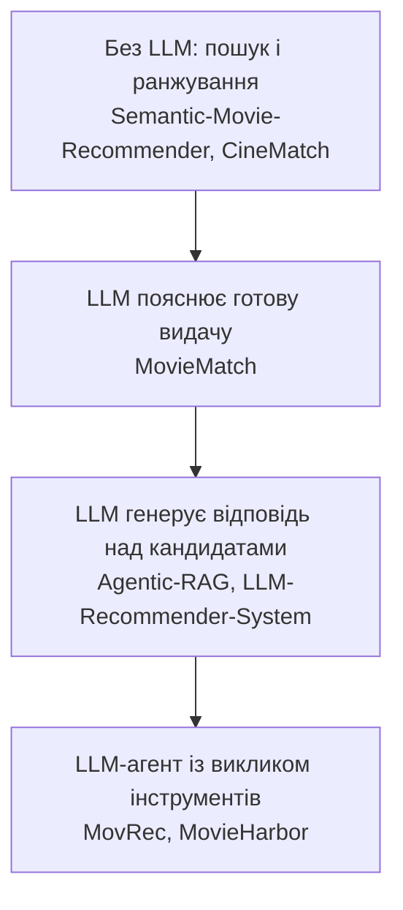

# 11. Аналогічні системи та порівняння

Розділ визначає місце MovieHarbor серед аналогічних рекомендаційних систем фільмів, що використовують семантичний пошук і великі мовні моделі (Large Language Model, LLM). Розглянуто сім систем: шість відкритих репозиторіїв і один комерційний продукт.

Критерії відбору:
- вбудована семантика (векторні представлення описів);
- використання LLM для роботи з медіаконтентом або порівнянна архітектура без неї;
- доступний технічний опис.

Описи ґрунтуються на першоджерелах (код, README, сторінки продукту), перевірених 31.10.2026. Вимоги, яким відповідає сама MovieHarbor, наведено в [розділі 12](12-requirements.md).

## 11.1. Критерії порівняння

| Вимір | Що порівнюється |
|---|---|
| Відбір кандидатів (retrieval) | векторне сховище, тип пошуку (щільний, гібридний), фільтри метаданих |
| Модель ембедінгів | яка модель і чи вона багатомовна |
| Роль LLM | немає; пояснення; генерація відповіді над знайденим контекстом (RAG); агент із викликом інструментів (tool calling) |
| Заземлення (grounding) | чи обмежено вибір знайденими кандидатами, і хто це гарантує: код чи лише промпт |
| Розгортання | Local-First (усе на пристрої користувача), гібридне, хмарне |
| Інтерфейс | вільний запит чи вибір фільму-зразка, діалог, картки, трейлери |
| Оцінювання | чи є офлайн-метрики і чи опубліковано результати |

Діаграма впорядковує системи за роллю LLM, від найменшої до найбільшої. Tasteray не розкриває архітектури, тому на діаграмі її немає.

## 11.2. Огляд систем

### Agentic-RAG Movie Recommender

Відкритий проєкт [1] на Next.js і FastAPI з LangChain:
- **Відбір кандидатів:** локальна ChromaDB з ембедінгами `all-MiniLM-L6-v2`, після чого — фільтри за роком і жанром у коді.
- **Генерація:** локальна LLM `llama3.2` в Ollama пише відповідь вільним текстом, враховуючи до 5 попередніх реплік.
- **Перевірка через TMDB:** якщо користувач задав фільтр за стрімінговою платформою (одна з шести, зокрема Netflix) або мінімальним рейтингом, система паралельно запитує TMDB API про рейтинг і доступність кандидатів.

Назви фільмів система виділяє з тексту відповіді регулярними виразами й показує як картки з постером, рейтингом, платформами та акторами. Заземлення забезпечує лише промпт: назва, якої не було серед знайдених кандидатів, теж стає карткою. Мовна модель і векторне сховище працюють локально, але без TMDB фільтри за платформою й рейтингом і заповнення карток не працюють. Інтерфейс підтримує голосове введення; трейлерів, Docker і оцінювання немає.

### MovieMatch

Відкритий проєкт [2] з архітектурою Backend-For-Frontend: Next.js проксує запити до FastAPI.
- **Сценарій:** рекомендація від фільму до фільму — користувач обирає фільм-зразок, вільного запиту й діалогу немає.
- **Відбір кандидатів:** FAISS (`all-MiniLM-L6-v2`) повертає 50 найближчих фільмів із каталогу з 19 934 фільмів.
- **Ранжування:** гібридна оцінка `0,70 · подібність + 0,20 · зважений рейтинг + 0,10 · log(популярність)`. Зважений рейтинг обчислено з голосів TMDB за формулою IMDb, як і в MovieHarbor.

Локальна LLM в Ollama (`llama3.2:1b`, 4-бітне квантування) на запит користувача пояснює одну картку («AI Insights»): чому фільм рекомендовано і чим він відрізняється від зразка. У ранжуванні LLM участі не бере. Скрипт оцінювання рахує влучання очікуваних фільмів у топ-10 для 5 зразків, результатів не опубліковано.

### Semantic-Movie-Recommender

Дослідницький ноутбук [3] (Colab, Gradio) без LLM. Вільний запит кодується моделлю `all-mpnet-base-v2`, ChromaDB (через LangChain) повертає 20 найближчих фільмів із 992 фільмів IMDb Top 1000. Далі застосовуються фільтри за жанром, режисером, актором, роком, тривалістю й мінімальним рейтингом.

Проєкт порівнює три моделі ембедінгів за Recall, Precision і MRR на 3 запитах:
- `all-mpnet-base-v2` найкраща лише за k = 20: Recall 0,367, Precision 0,183, MRR 0,50;
- за k = 10 її випереджає `all-MiniLM-L6-v2`.

Списки впорядковано за спаданням відстані, тобто у зворотному порядку, тому значення MRR ненадійні.

### CineMatch (Semantic Movie Search)

Відкритий проєкт [4] на Next.js і FastAPI; репозиторій перейменовано на `semantic-movie-search`. Він використовує той самий набір даних, що й MovieHarbor (`movies_metadata.csv` з Kaggle), доповнений аніме. LLM у системі немає: «пояснення» формуються шаблоном.

Вільний запит обробляє гібридний пошук у пам'яті процесу:
- косинусна подібність за ембедінгами `all-MiniLM-L6-v2`;
- лексичний пошук BM25 за назвами;
- злиття двох списків методом Reciprocal Rank Fusion;
- підсилення за точним збігом назви й рейтингом.

Векторне сховище Pinecone використовується лише офлайн: вектори завантажуються в нього, а звідти — у локальний знімок. До рефакторингу у вересні 2026 року система зверталася до Pinecone під час пошуку.

Жорсткий фільтр лише один — за типом (фільм чи аніме); жанр входить у текст запиту. Трейлери з YouTube система показує через TMDB API; діалогу й оцінювання немає.

### LLM-Recommender-System

Дослідницький пайплайн [5] на датасеті MovieLens 100K без інтерфейсу:
- **Кандидати:** колаборативна фільтрація — по 20 найкращих фільмів 10 найподібніших користувачів.
- **Вибір:** хмарна модель OpenAI `gpt-3.5-turbo` обирає з кандидатів 10 фільмів.
- **Порівняння:** чотири промпти й базова лінія популярності.

HR@10, середнє трьох прогонів:

| Промпт | HR@10 |
|---|---|
| Genre | **76,52 %** |
| Wiki | 71,94 % |
| Two-step | 68,98 % |
| Базова лінія (10 найпопулярніших) | 67,74 % |
| Collab | 4,04 % |

Перевага LLM над базовою лінією популярності невелика. Описи з Вікіпедії в промпті Wiki стосуються переглянутих фільмів користувача, а не кандидатів.

### MovRec

Розмовна рекомендаційна система [6], найближча до MovieHarbor архітектурно. Вона працює в Docker Compose (PostgreSQL 16 з pgvector, застосунок FastAPI і службу щоденного перерахунку рейтингів) над каталогом з 250 фільмів MovieLens з описами з TMDB.

Хмарна LLM Gemini (`gemini-flash-lite-latest`) сама вирішує, чи викликати інструмент пошуку (tool calling) з фільтрами за жанром і роками. Інструмент:
- оцінює фільми як `0,8 · косинусна подібність + 0,2 · байєсів рейтинг`;
- переранжовує результат методом Maximal Marginal Relevance, щоб добірка була різноманітнішою.

Ембедінги теж хмарні (`gemini-embedding-001`, 1 536 вимірів). Вигадувати фільми забороняє лише промпт. Історія розмови зберігається в PostgreSQL. Скрипт оцінює пошук (Precision, Recall, nDCG@5 на 13 запитах), результатів не опубліковано.

### Tasteray

Закритий комерційний продукт [7] компанії TasteRay, Inc. для iOS, Android, вебу й WhatsApp, що позиціонується як «культурний асистент» на основі LLM. За описом на сайті, моделі враховують історію переглядів, настрій, доступний час і соціальний контекст, а навчено їх на 500 000 рецензій. Архітектуру не розкрито.

Опубліковані показники є самозвітом без незалежної перевірки. Наприклад, 92 % з понад 4 200 учасників знайшли новий улюблений фільм протягом першого місяця. Статті про продукт написано редакцією самого сервісу.

## 11.3. Порівняльна матриця

**Архітектура:**

| Система | Відбір кандидатів | Модель ембедінгів | LLM і її роль | Заземлення | Розгортання |
|---|---|---|---|---|---|
| Agentic-RAG [1] | ChromaDB + фільтри (рік, жанр; платформа й рейтинг через TMDB) | `all-MiniLM-L6-v2` (англ.) | `llama3.2`, локально; відповідь вільним текстом | лише промпт | локально + TMDB API |
| MovieMatch [2] | FAISS, від фільму до фільму; гібридна оцінка | `all-MiniLM-L6-v2` (англ.) | `llama3.2:1b`, локально; пояснення на запит | — (LLM не обирає) | локально |
| Semantic-Movie [3] | ChromaDB + фільтри | `all-mpnet-base-v2` (англ.) | немає | — | Colab |
| CineMatch [4] | гібридний: косинус + BM25, RRF | `all-MiniLM-L6-v2` (англ.) | немає | — | сервер; Pinecone офлайн |
| LLM-Recommender [5] | колаборативна фільтрація | — | `gpt-3.5-turbo`, хмара; вибір 10 із кандидатів | промпт | хмарна LLM |
| MovRec [6] | pgvector + фільтри (жанр, роки), MMR | `gemini-embedding-001`, хмара | Gemini, хмара; агент із викликом інструментів | лише промпт | Docker Compose + хмарні API |
| Tasteray [7] | не розкрито | не розкрито | LLM, не розкрито | не розкрито | хмарний сервіс |
| **MovieHarbor** | точний пошук у пам'яті (NumPy) + жанровий фільтр | `paraphrase-multilingual-MiniLM-L12-v2` (багатомовна) | Gemma 4 E4B, локально (або Gemma 4 26B через OpenRouter); агент: запит, трейлер, переранжування й пояснення | **код** відхиляє фільми не з пошуку | Local-First, Docker Compose |

**Інтерфейс та оцінювання:**

| Система | Запит | Діалог | Пояснення вибору | Трейлери | Хід роботи видно | Оцінювання |
|---|---|---|---|---|---|---|
| Agentic-RAG | вільний текст, голос | так | у тексті відповіді | ні | ні | немає |
| MovieMatch | фільм-зразок | ні | на запит, для однієї картки | ні | ні | скрипт, результатів немає |
| Semantic-Movie | вільний текст | ні | ні | ні | ні | Recall, Precision, MRR (3 запити) |
| CineMatch | вільний текст, настрій, тест | ні | шаблон | так | ні | немає |
| LLM-Recommender | історія користувача | ні | ні | ні | ні | HR@10 (MovieLens 100K) |
| MovRec | вільний текст | так | у тексті відповіді | ні | ні | скрипт, результатів немає |
| Tasteray | вільний текст | так | так | н/д | ні | самозвіт |
| **MovieHarbor** | вільний текст українською чи англійською + профіль | так | для кожного фільму | за рішенням моделі | **бічна панель: запит, 12 кандидатів, вибір** | Recall@12, MRR, Precision@12 ([розділ 6](06-evaluation.md)); експеримент на двох моделях ([розділ 9](09-selection-parameters.md)) |

## 11.4. Позиціонування MovieHarbor: переваги й недоліки

**Переваги.**

1. **Local-First за замовчуванням.** Мовна модель, модель ембедінгів і пошук працюють на комп'ютері користувача. Текст розмови нікуди не передається, а TMDB отримує лише ідентифікатор фільму. Локально працюють і пошук та LLM у MovieMatch, але там немає діалогу. MovRec і LLM-Recommender залежать від хмарних моделей, Agentic-RAG — від TMDB API.
2. **Заземлення гарантує код.** Фільм, якого не було серед кандидатів останнього пошуку, відхиляється ще до показу. В Agentic-RAG і MovRec це правило задано лише промптом.
3. **Агент із викликом інструментів.** Як і в MovRec, LLM сама вирішує, коли шукати. Крім того, вона формулює опис для пошуку мовою користувача, вирішує, чи доречний трейлер, і переранжовує кандидатів.
4. **Багатомовність.** Це єдина з розглянутих систем із багатомовною моделлю ембедінгів та українським інтерфейсом: запит українською знаходить англійські описи без перекладу. Інші відкриті системи з ембедінгами використовують англомовні моделі (`all-MiniLM-L6-v2`, `all-mpnet-base-v2`) або хмарні ембедінги (MovRec).
5. **Спостережуваність.** Бічна панель показує пошуковий запит, 12 кандидатів із подібністю і місця обраних фільмів. Видно, чому модель обрала не найближчих. Жодна з розглянутих систем такого не показує.
6. **Відтворюване оцінювання з опублікованими результатами:**
   - офлайн-метрики пошуку на бенчмарку з 47 запитів ([розділ 6](06-evaluation.md));
   - експеримент із вибором на двох моделях з інтервалами довіри ([розділ 9](09-selection-parameters.md)).

**Недоліки.**

1. **Малий і застарілий каталог:** 2 274 фільми зі зрізу 2017 року. Для порівняння, MovieMatch має 19 934 фільми.
2. **Лише щільний пошук.** Немає лексичного компонента (BM25 з Reciprocal Rank Fusion, як у CineMatch), тож точні й перекладені назви знаходяться гірше ([розділ 8](08-hallucinations.md), ризики R5 і R16).
3. **Лише жанровий фільтр.** Фільтрів за роками, платформою чи рейтингом, як в Agentic-RAG і MovRec, немає.
4. **Латентність локальної моделі:** медіана 35 с на GPU ноутбука проти секунд у хмарних моделях (компроміс latency vs. complexity).
5. **Немає персоналізації за історією.** Система не має колаборативної фільтрації та облікових записів і працює в умовах холодного старту (cold-start).
6. **Немає явного механізму різноманітності** на кшталт MMR у MovRec. Зсув вибору до популярних фільмів виміряно в [розділі 9](09-selection-parameters.md).

## 11.5. Висновок

Серед розглянутих систем MovieHarbor поєднує три властивості, які в аналогах трапляються лише окремо:
- агент із викликом інструментів над семантичним пошуком (як у MovRec);
- локальне виконання всіх моделей (як у MovieMatch чи Agentic-RAG);
- заземлення, яке гарантує код, а не промпт.

Багатомовність, панель ходу роботи й відтворюване оцінювання відрізняють її від усіх аналогів. Платою за це є малий каталог, висока латентність локальної моделі й відсутність лексичного пошуку та персоналізації за історією.

## 11.6. Уточнення за першоджерелами

Під час перевірки уточнено кілька поширених тверджень про ці системи:

| Твердження | За першоджерелом |
|---|---|
| Agentic-RAG перевіряє рейтинг і доступність на Netflix для кожного запиту | лише коли задано фільтр за платформою чи рейтингом; Netflix — одна з шести платформ |
| MovieMatch зважує рейтинг критиків | зважений рейтинг із голосів глядачів TMDB |
| Semantic-Movie довела перевагу `all-mpnet-base-v2` за Precision, Recall і MRR | лише за k = 20, на 3 запитах |
| CineMatch залежить від хмарного Pinecone і використовує LLM OpenAI | LLM немає; Pinecone з вересня 2026 року використовується лише офлайн |
| CineMatch жорстко звужує кандидатів за жанром | жорсткий фільтр лише за типом (фільм чи аніме) |
| LLM-Recommender досягає найкращого HR@10 (71,94 %) з описами з Вікіпедії | найкращий промпт — Genre (76,52 %); описи стосуються переглянутих фільмів користувача |
| MovRec використовує відкриту модель ембедінгів | хмарна `gemini-embedding-001` |
| Tasteray поєднує колаборативну фільтрацію з GPT-4 | у джерелах не підтверджено |

## Джерела

Репозиторії перевірено 31.10.2026; у дужках — дата останнього коміту.

1. gajulanikhil. *Agentic-RAG Movie Recommender.* https://github.com/gajulanikhil/agentic-rag-movie-recommender (24.03.2026).
2. VivekaAryan. *MovieMatch.* https://github.com/VivekaAryan/Movie_recommendation_system (27.06.2026).
3. melofy-vibes. *Semantic-Movie-Recommender.* https://github.com/melofy-vibes/Semantic-Movie-Recommender (11.06.2026).
4. muaazl. *CineMatch / Semantic Movie Search.* https://github.com/muaazl/semantic-movie-search, раніше https://github.com/muaazl/cine-match (28.09.2026).
5. N. Carroll. *LLM-Recommender-System.* https://github.com/nick-carroll1/LLM-Recommender-System (12.12.2023).
6. fedjabogataj. *MovRec: Conversational movie recommender.* https://github.com/fedjabogataj/MovRec (28.09.2026).
7. TasteRay, Inc. *Best movie recommendation engine vs your taste.* https://www.tasteray.com/articles/best-movie-recommendation-engine; *Personalized movie recommendations software.* https://www.tasteray.com/articles/personalized-movie-recommendations-software
